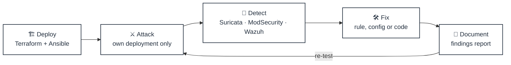
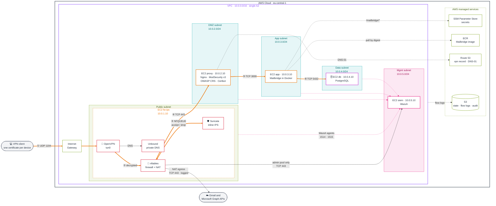
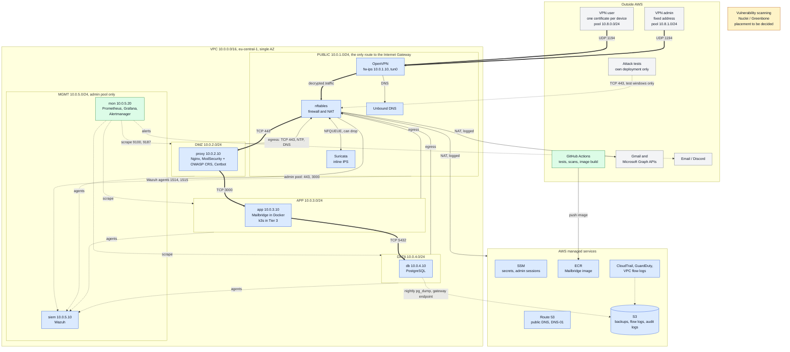

# Secure Mailbridge Lab

> A segmented AWS lab that runs **Mailbridge**, a unified Gmail and Outlook inbox, behind **OpenVPN**, with **Suricata** inline IPS, a **ModSecurity** WAF and **Wazuh** SIEM. I attack my own deployment, measure what gets detected, fix it and document the findings.

[](https://github.com/rossiko22/secure-mailbridge-lab/actions/workflows/ci.yml)


---

## Table of contents

- [Overview](#overview)
- [Architecture](#architecture)
- [Tech stack](#tech-stack)
- [Project status](#project-status)
- [Repository layout](#repository-layout)
- [Getting started](#getting-started)
- [Security and cost guardrails](#security-and-cost-guardrails)
- [CI quality gates](#ci-quality-gates)
- [Documentation](#documentation)
- [Scope and ethics](#scope-and-ethics)
- [Author](#author)
- [License](#license)

---

## Overview

The lab answers one question: **if someone attacks a real web app placed behind layered defences, what actually stops them, and what actually sees them?**



- **Infrastructure as code:** the whole lab is rebuilt from Terraform and Ansible, then torn down after each session so it costs almost nothing.
- **Defence in depth:** the network is split into subnets with three filtering layers (security groups, NACLs, nftables), an inline IPS on the decrypted VPN traffic, a WAF in front of the app, and a SIEM collecting everything.
- **Evidence-driven:** every attack scenario ends as a row in [`docs/findings-report.md`](docs/findings-report.md): attack, then detection (or miss), then fix, then re-test.

---

## Architecture

### Tier 1: request path

This is the Tier 1 target design (part of it is still being built, see [Project status](#project-status)). [`docs/ARCHITECTURE.md`](docs/ARCHITECTURE.md) is the source of truth.



**How to read it**

| Element | Meaning |
|---|---|
| 🟧 thick orange arrows ①–⑥ | the user request path, one hop at a time |
| thin arrows | admin access, client DNS and outbound NAT |
| 🩷 dotted pink arrows | security telemetry to Wazuh |
| dotted grey arrows | calls to AWS services (logical: they leave through fw-ips NAT, because there are no interface endpoints) |
| 🟩 green box | public subnet, the only one routed to the Internet Gateway |
| 🟦 teal boxes | private subnets, default route `0.0.0.0/0 → fw-ips` |

**Request path, step by step**

1. The client connects to `vpn.<domain>` on **UDP 1194**, the only port open to the internet.
2. OpenVPN decrypts the traffic onto `tun0`, and nftables applies the per-pool policy: the user pool may reach only `10.0.2.10:443`.
3. Allowed traffic is sent through **NFQUEUE** to Suricata, which can drop it inline. If Suricata stops, traffic stops too (fail closed).
4. The proxy terminates TLS for `mail.<domain>` (resolvable only inside the VPN) and filters requests with ModSecurity and the OWASP CRS.
5. The proxy forwards to Mailbridge on TCP 3000.
6. Mailbridge reads and writes PostgreSQL on TCP 5432. Mailbox OAuth tokens are encrypted before they are stored.

**Design principles**

- **One way in.** Clients reach the app only through OpenVPN. TCP 443 on fw-ips opens only during planned outside-attack test windows.
- **One hop at a time.** Proxy → app → db, enforced by security groups, NACLs and nftables. No subnet can skip a layer.
- **Inspected and attributable.** Suricata sees the decrypted VPN traffic. VPN pools are routed, not NATed, so every log shows the real client address and therefore the device certificate.
- **Private by default.** `mail.<domain>` never appears in public DNS, port 22 is never open, and every private subnet leaves through fw-ips.

### End state: Tiers 1 to 3

<details>
<summary>Show the full planned lab (monitoring, CI, backups, k3s, scanning)</summary>

<br/>

This is the planned finished lab. It is not what runs today: see [`docs/TASKS.md`](docs/TASKS.md).



**Colours:** blue is Tier 1, green is Tier 2, amber is Tier 3, grey is outside the lab.
**Lines:** thick is the user request path, thin is admin and outbound traffic, dotted is telemetry, backups and test-only paths.

</details>

---

## Tech stack

| Layer | Tool | Role in the lab |
|---|---|---|
| Infrastructure | **Terraform** (AWS provider 6.x) | VPC, subnets, routes, security groups, NACLs, EC2, SSM parameters |
| Configuration | **Ansible** (one role per host, dynamic `aws_ec2` inventory) | idempotent host setup over SSH tunnelled through SSM |
| Remote access | **OpenVPN** + easy-rsa | the only entry point; offline CA, one certificate per device, CRL revocation |
| Firewall | **nftables** | per-pool forwarding policy, NAT for private subnets, logged drops |
| IPS | **Suricata** (NFQUEUE on `tun0`) | inline inspection of decrypted VPN traffic, ET Open + custom rules |
| DNS | **Unbound** | private `mail.<domain>` record for VPN clients |
| Reverse proxy / WAF | **Nginx** + **ModSecurity v3** (OWASP CRS) + **Certbot** | TLS (Let's Encrypt via DNS-01), rate limiting, web attack filtering |
| Application | **Mailbridge** in **Docker** | unified Gmail / Outlook inbox, image pulled from ECR by digest |
| Database | **PostgreSQL** | app data; reachable only from the app host |
| SIEM | **Wazuh** | collects Suricata, nftables, Nginx, ModSecurity, auth and OpenVPN logs |
| Secrets | **SSM Parameter Store** | SecureString parameters; one IAM role per instance, least privilege |
| Monitoring *(Tier 2)* | **Prometheus**, **Grafana**, **Alertmanager** | host and service health, alerting |

---

## Project status

**Current phase:** Tier 1 on AWS. The live tracker is [`docs/TASKS.md`](docs/TASKS.md), and session notes are in [`docs/progress.md`](docs/progress.md).

| Component | Status |
|---|---|
| Network: VPC, 5 subnets, routes, security groups, NACLs, flow logs | ✅ in code, imported from the hand build (clean rebuild planned in task 1.20) |
| fw-ips: OpenVPN, nftables, Suricata, Unbound | ✅ in code, rebuilt from scratch and verified |
| Dynamic Ansible inventory | ✅ verified |
| `persistent` stack | 🟡 started (DB password in SSM); state bucket, Route 53 zone and others still to import |
| db: PostgreSQL | ⏭️ next |
| app, proxy, siem | ⬜ planned |
| `make up` / `make down` | ⬜ planned (task 1.20) |
| Attack scenarios and findings report | ⬜ after Tier 1 |
| Tier 2 (monitoring, app CI, backups) and Tier 3 (k3s, scanning, ISO 27001 map) | 🔒 gated: each starts only after the previous tier's write-up |

---

## Repository layout

```text
secure-mailbridge-lab/
├── terraform/
│   ├── modules/          # shared modules: network/, security/, compute/
│   ├── persistent/       # created once, never destroyed: secrets, state and log buckets, DNS zone, Budget
│   └── lab/              # the lab itself: network (kept between sessions) + EC2 hosts (removed after each session)
├── ansible/
│   ├── site.yml          # one play per host group
│   ├── inventories/aws/  # aws_ec2 dynamic inventory (by Project and Role tags)
│   └── roles/            # fw_ips/ proxy/ app/ db/ siem/ mon/
├── suricata-rules/
│   ├── rules/            # custom Suricata rules (local.rules)
│   └── pcaps/            # test captures + generate.py
├── docs/                 # architecture, decisions, findings (see Documentation)
├── .github/workflows/    # CI quality gates
├── .pre-commit-config.yaml
└── START.md              # start-of-session checklist
```

---

## Getting started

> [!WARNING]
> This deploys real, billable AWS resources in **your** account. Read [`docs/ARCHITECTURE.md`](docs/ARCHITECTURE.md) §12 (cost control) first, and always tear down at the end of a session.

### Prerequisites

- An AWS account with root MFA and an MFA-protected admin IAM user (no access keys; Terraform uses `aws login`)
- AWS CLI v2 and the **Session Manager plugin**
- **Terraform ≥ 1.11** (the `persistent` stack uses write-only arguments)
- **Ansible** installed with pipx, plus `boto3` and `botocore[crt]` injected into its venv, and the `amazon.aws` collection
- An **offline easy-rsa CA** on your laptop, with the fw-ips files published to SSM under `/vpn/fw-ips/*` (see ARCHITECTURE §5)
- A subdomain delegated to the Route 53 zone, and an OpenVPN client profile
- Untracked local files, created from the examples: `terraform/lab/backend.hcl`, `terraform/lab/terraform.tfvars`

### Session routine (until `make up` exists)

```bash
# 1. Log in and load the Ansible key
aws login
aws sts get-caller-identity --query Arn --output text
ssh-add ~/.ssh/mailbridge-lab-ansible

# 2. Bring the hosts up (review the plan before applying)
terraform -chdir=terraform/lab plan -out=on.tfplan
terraform -chdir=terraform/lab apply on.tfplan

# 3. Configure the hosts; the second run should report changed=0
cd ansible
ansible-inventory --graph
ansible fw_ips -m command -a 'cloud-init status --wait'
ansible-playbook site.yml

# 4. Connect and check
sudo openvpn --config <device>.ovpn
ping -c 3 10.0.1.10
dig +short @10.0.1.10 mail.<domain>   # expect 10.0.2.10
```

### Teardown

```bash
# Removes the EC2 hosts, the Elastic IP and the vpn record; the free network layer stays
terraform -chdir=terraform/lab plan -var fw_enabled=false -out=off.tfplan
terraform -chdir=terraform/lab apply off.tfplan
```

The full routine, with the expected output of every check, is in [`docs/TASKS.md`](docs/TASKS.md) ("Before db").

---

## Security and cost guardrails

| Guardrail | How it's enforced |
|---|---|
| No SSH exposure | sshd listens on loopback only; Ansible tunnels SSH through SSM, so port 22 is never open |
| No secrets in the repo | secrets live in SSM Parameter Store; `gitleaks` runs in pre-commit and CI; `.ovpn`, keys and `*.tfstate` are gitignored |
| DB password never in state | created with an ephemeral `random_password` into a write-only `value_wo` argument |
| Least-privilege IAM | one role per instance, each granted only its own parameter paths |
| Instance hardening | IMDSv2 required, encrypted gp3 disks, unattended security updates, apt over HTTPS |
| Offline PKI | the CA key never touches AWS hosts; only an encrypted backup sits in SSM, which no instance can read |
| TLS | Let's Encrypt **staging** while building; production only after the setup is stable |
| Cost | no NAT Gateway, no ALB, no interface endpoints; t3 instances use `standard` credits; $20 AWS Budget alert; hosts destroyed after every session |

---

## CI quality gates

Every pull request must pass all six checks before merging to `main`:

| Check | What it catches |
|---|---|
| `terraform fmt -check` | formatting drift |
| `terraform validate` | invalid configuration in `lab` and `persistent` |
| `tflint` | provider-specific mistakes and deprecated syntax |
| `checkov` | IaC security misconfigurations |
| `ansible-lint` | non-idempotent or unsafe Ansible patterns |
| `gitleaks` | committed secrets |

Branches follow Conventional Commits (`feat:`, `fix:`, `docs:`, `chore:`), one change per branch.

---

## Documentation

| Document | Purpose |
|---|---|
| [`ARCHITECTURE.md`](docs/ARCHITECTURE.md) | **source of truth**: subnets, instances, security groups, NACLs, nftables, VPN, DNS, IAM, detection |
| [`TASKS.md`](docs/TASKS.md) | task tracker with verify steps for every item |
| [`progress.md`](docs/progress.md) | per-session log: done, verified, next |
| [`decisions.md`](docs/decisions.md) | one line per design decision (date · decision · why) |
| [`rationale.md`](docs/rationale.md) | the reasoning behind each decision: options, choice, trade-off, verification |
| [`lessons.md`](docs/lessons.md) | per-session write-ups of what was built and learned |
| [`threat-model.md`](docs/threat-model.md) | threat model *(draft pending)* |
| [`findings-report.md`](docs/findings-report.md) | attack scenarios: attack → detection → fix → re-test |
| [`iso27001-map.md`](docs/iso27001-map.md) | ISO 27001 / NIS2 controls map *(Tier 3)* |

---

## Scope and ethics

All attack tooling in this repository targets **only infrastructure I own and deploy myself**. The Google and Microsoft OAuth apps stay in testing mode with test accounts only, and no testing is aimed at Google, Microsoft or any third-party service.

---

## Author

**Marko Spasovski**: built as a hands-on security engineering project covering network segmentation, inline IPS, SIEM, and attack and detection testing.

[GitHub](https://github.com/rossiko22) · [LinkedIn](https://www.linkedin.com/in/marko-spasovski2/)

---

## License

No license has been chosen yet. Until one is added, all rights are reserved.
