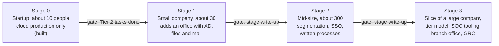

# One company that grows: plan, flows and learning path

> **Status: PROPOSED.** Everything in this folder is a proposal. Nothing here is decided or built
> unless it is labelled **Stage 0 (built)**. `docs/ARCHITECTURE.md` stays the source of truth for
> what exists. Where a proposal differs from it, the text says **"Differs from ARCHITECTURE"** and
> explains why. No decision numbers are invented here; numbers in brackets such as "(decision 68)"
> refer to existing entries in `docs/decisions.md`.

This documentation set turns the Secure Mailbridge Lab into **one fictional company, Quillmere,
that grows through four stages**. At every stage you play three roles:

- **BLUE:** build, operate and secure the infrastructure the way a company of that size would.
- **RED:** attack it, with a scope and method that fit that size of company.
- **PURPLE:** attack → detect (or miss) → fix → re-test, mapped to MITRE ATT&CK.

The set is written to be long-term context for you and for AI coding assistants. Every file can be
read on its own, and all files use the same names, addresses and groups
(`shared/00-naming-and-addressing.md`).

---

## 1. How to read the set

| If you want to… | Read in this order |
|---|---|
| Understand the whole plan | this file → `shared/00` → `shared/01` → `comparison.md` |
| Decide what to build next | `comparison.md` → `aws/04-roadmap-and-cost.md` or `proxmox/04-roadmap-and-cost.md` |
| Build a stage | `shared/00` → the platform's `01-architecture-per-stage.md` → `shared/02` → `shared/03` |
| Run an attack | `shared/05` → the platform's `03-attack-ranges.md` → `shared/04` (to record the detection) |
| Prepare for an interview | `shared/08` → the rationale you wrote for that stage |
| Plan your studies | `shared/06` → `shared/07` |
| Give an AI assistant context | this file + `shared/00` + the one file for the task. Don't paste the whole set. |

**Conventions used in every file**

| Mark | Meaning |
|---|---|
| **PROPOSED** | A design element that is not decided. Becomes real only through your normal process: options A/B/C, a line in `decisions.md`, a section in `rationale.md`. |
| **Stage 0 (built)** | Exists today and is verified, as described in `ARCHITECTURE.md`. |
| **(verify)** | A version, price, licence term or certification detail written from memory. Check it before relying on it. |
| **Assumptions** box | Something the author assumed because the repository doesn't say. Change the assumption and the design may change. |
| **Differs from ARCHITECTURE** | The proposal changes something `ARCHITECTURE.md` states today. |
| **Lab vs real** | Where the lab simulates something a real company does differently, and why that matters. |
| `W1-03`, `W2-01`… | A deliberate weakness built into a stage so the red role has something realistic to find (`shared/01`, section 5). |
| `S1-A04`, `S2-P11`… | A roadmap step: stage, platform (A = AWS, P = Proxmox), number. |

---

## 2. Stage map



| Step | Who | Tool | Evidence it produces | What can go wrong |
|---|---|---|---|---|
| Stage 0 → 1 gate | you | `docs/TASKS.md` | every Tier 2 task ticked, `findings-report.md` filled | starting AD before the first pentest is written up; you lose the Stage 0 portfolio piece |
| Stage 1 → 2 gate | you | a stage write-up in the style of `tier1-writeup.md` | write-up, ATT&CK coverage table, restore-test record | growing the host count before the Stage 1 processes have run at least twice |
| Stage 2 → 3 gate | you | the same | write-up, internal pentest report, access-review record | adding Stage 3 tools (SOAR, PAM) without the alerts and admin paths they are meant to manage |

The rule from `ARCHITECTURE.md` §13 carries over unchanged: **do not start a stage until the
previous stage's write-up is done.**

| Stage | Company | New in this stage | BLUE (operate) | RED (attack) | PURPLE (measure) | Existing `TASKS.md` items it contains |
|---|---|---|---|---|---|---|
| **0** | Startup, ~10 people, no office IT | `fw-ips`, `proxy`, `app`, `db`, `siem`, `mon`, `vuln` (built) | finish: backups with a restore test, app CI, GuardDuty, WAF engine upgrade | web application and cloud pentest from the attacker VPN certificate | findings report: attack → detection or miss → fix → re-test | 2.17, 2.14, 2.15, 2.2–2.5, 2.6, T2.2, T2.3, T2.4 |
| **1** | Small company, ~30 people, one IT generalist | office network: `hq-fw`, `dc01`, `fs01`, `mail01`, `ws01`–`ws03` | joiner/mover/leaver, password resets, monthly patching, backups, MFA on remote access, LAPS, CIS baselines, tool roles from AD groups | external pentest, then assumed-breach phishing (GoPhish, lab users only) | first ATT&CK coverage table | T3.3 starts as a living document |
| **2** | Mid-size, ~300 people, IT team and a first security hire | segmentation, `dc02`, `ca01`, `wsus01`, `kc01`, `glpi01`, `intra01`, `mx01`, `gvm01`, `bkp01`, `ops01` | change management, vulnerability management with deadlines, L1 SOC runbooks, access reviews, SSO | internal network pentest: AD attack paths to Domain Admin | coverage measured with Atomic Red Team | T3.2 |
| **3** | A slice of a large company | tier model, `paw-t0`, `paw-t1`, `pam01`, `vault01`, `radius01`, `thehive01`, `shuffle01`, `misp01`, `velo01`, k3s, branch (`br-fw`, `dc03`, `ws-br01`) | GRC, incident response plan, tabletop exercises, detection as code | goal-driven red team with a C2 inside the lab only | MTTD and MTTR per objective | T3.1, T3.3 |

---

## 3. Files in this set

```
docs/fable-5.2-review/
├── PROMPT_FABLE.md                   the task description (not modified)
├── README.md                         this file
├── comparison.md                     AWS vs Proxmox vs hybrid, with a recommendation
├── shared/                           platform-independent
│   ├── 00-naming-and-addressing.md   ADDED: company, sites, address plan, hosts, AD names, groups
│   ├── 01-company-profiles.md        how companies organise IT and security per size
│   ├── 02-identity-and-access.md     AD per stage, RBAC, tier model, SSO flows
│   ├── 03-operations-flows.md        eight operations flows with runbooks; the UI principle
│   ├── 04-security-operations.md     alerts, incidents, detections, vulnerabilities, hunting
│   ├── 05-offensive-engagements.md   engagement plans, rules of engagement, findings, purple loop
│   ├── 06-learning-path.md           idea catalogue, semester plan, certifications, portfolio
│   ├── 07-extra-ideas.md             everything valuable that fits nowhere else
│   └── 08-interview-prep.md          ten questions per stage with model answers
├── aws/
│   ├── 01-architecture-per-stage.md  networks, address plan, allowed flows per stage
│   ├── 02-platform-specifics.md      identity on AWS, cloud security topics, AWS limits
│   ├── 03-attack-ranges.md           what can and can't be attacked on AWS
│   └── 04-roadmap-and-cost.md        phased roadmap, entry and exit criteria, costs
└── proxmox/
    ├── 01-architecture-per-stage.md  networks, VLANs, allowed flows per stage
    ├── 02-platform-specifics.md      hardware, networking, IaC, backups, isolation
    ├── 03-attack-ranges.md           the layer-2 range and everything AWS can't do
    └── 04-roadmap-and-cost.md        phased roadmap, entry and exit criteria, costs
```

One file was added to the structure the prompt asked for: `shared/00-naming-and-addressing.md`.
It exists so that names and addresses are defined once and every other file can be checked
against it.

---

## 4. The principles that hold at every stage

These come from `CLAUDE.md` and the prompt, and every file follows them.

1. **Only your own lab is attacked.** No third-party service, no Google or Microsoft API, no scan
   of anything outside the lab. Every red activity starts from a written scope and rules of
   engagement (`shared/05`, section 4).
2. **Malware and C2 run only in isolated segments** with no route to the internet or to your home
   network.
3. **Everything is infrastructure as code** (Terraform, Ansible, Packer). Ansible roles are
   idempotent: the second run reports `changed=0`.
4. **Secrets live in a secret store**, never in the repository: SSM Parameter Store on AWS, Vault
   or OpenBao on Proxmox.
5. **Let's Encrypt staging** until you decide to switch to production.
6. **Small steps.** One role, module or rule set per step, each with a verify command.
7. **Build by hand, compare with code, rebuild from code** (decision 11). It still applies to
   every new kind of component, such as the first domain controller.
8. **Configuration through reviewed code; UIs for looking.** Explained in the next section.

### The UI principle in short

A web UI is a second way to change a system. Once a change is made there, the code in the
repository no longer describes what is running. This is called **configuration drift**, and it
breaks three things at once: the rebuild from code, the review (nobody approved the click), and
the audit trail (the Git history no longer explains the system).

So the lab uses UIs **read-only**: EveBox for Suricata events, Grafana for dashboards, the Wazuh
dashboard for the SIEM. Changes go through a pull request.

A real company accepts a UI anyway in four cases, and so does the lab:

| Case | Example | How to keep it honest |
|---|---|---|
| Break-glass | the firewall is down and the pipeline can't reach it | a named emergency account, the session logged, the change back-ported to code the same day |
| Investigation | an analyst builds an ad-hoc query or a temporary dashboard | read-only role; anything worth keeping is exported and committed |
| The product has no usable API | parts of OPNsense, some Windows server roles | export the configuration to Git after each change, and diff it in review |
| Data, not configuration | resetting a user's password, closing a ticket, acknowledging an alert | the UI's own audit log is the record |

The full explanation, with the drift-detection method, is in `shared/03-operations-flows.md`,
section 2.

---

> **Assumptions (apply to the whole set)**
>
> 1. The company name **Quillmere** is invented and assumed not to belong to a real company (verify).
> 2. Stage 0 is complete only when the existing Tier 2 tasks are done; Stage 1 is gated on them.
> 3. The office network is 10.20.0.0/16 with its own firewall `hq-fw`, joined to the existing
>    10.0.0.0/16 by a site-to-site tunnel, on every platform.
> 4. On Proxmox, the copy of the Mailbridge stack reuses 10.0.0.0/16.
> 5. `siem` (10.0.5.10) and `mon` (10.0.5.20) stay the single SIEM and monitoring hosts for all sites.
> 6. Your current semester, home network, hardware budget and AWS credit balance are unknown.
> 7. Prices, versions, licence terms and certification details are from memory and marked (verify).

---

## 5. Glossary

Every acronym used in this set.

| Term | Meaning |
|---|---|
| ACL | Access control list: the permission entries on a file, share or directory object |
| ACME | Automatic Certificate Management Environment: the protocol Let's Encrypt and `step-ca` use to issue certificates |
| AD | Active Directory: Microsoft's directory service |
| AD CS | Active Directory Certificate Services: Microsoft's PKI role |
| AD DS | Active Directory Domain Services: the domain controller role |
| AGDLP | Accounts → Global groups → Domain Local groups → Permissions: the Microsoft group-nesting model |
| ALB | Application Load Balancer (AWS); excluded by the cost guardrails |
| AMI | Amazon Machine Image |
| API | Application programming interface |
| AppSec | Application security |
| ARP | Address Resolution Protocol: maps an IP address to a MAC address on one layer-2 network |
| AS-REP | Authentication Service reply in Kerberos; "AS-REP roasting" attacks accounts without pre-authentication |
| ATT&CK | MITRE's catalogue of adversary tactics and techniques |
| AZ | Availability Zone (AWS) |
| BCP | Business continuity plan |
| BIA | Business impact analysis |
| BOLA | Broken object level authorization (the API name for IDOR) |
| BYOL | Bring your own licence |
| C2 | Command and control: the channel an attacker uses to steer compromised hosts |
| CA | Certificate authority |
| CAB | Change advisory board |
| CI/CD | Continuous integration / continuous delivery |
| CIS | Center for Internet Security: publishes hardening benchmarks and the CIS Controls |
| CISO | Chief information security officer |
| CMDB | Configuration management database: the inventory of systems |
| CRL | Certificate revocation list |
| CRS | OWASP Core Rule Set for ModSecurity |
| CSF | NIST Cybersecurity Framework |
| CSPM | Cloud security posture management |
| CTF | Capture the flag: a security competition |
| CTI | Cyber threat intelligence |
| CVE | Common Vulnerabilities and Exposures: the identifier of a known vulnerability |
| CVSS | Common Vulnerability Scoring System |
| DA | Domain Admin |
| DAST | Dynamic application security testing |
| DC | Domain controller |
| DCSync | An attack that asks a DC to replicate password hashes |
| DFIR | Digital forensics and incident response |
| DHCP | Dynamic Host Configuration Protocol |
| DKIM | DomainKeys Identified Mail: a signature on e-mail |
| DMARC | Domain-based Message Authentication, Reporting and Conformance |
| DMZ | Demilitarised zone: a network for hosts that accept less trusted traffic |
| DNS | Domain Name System |
| DNS-01 | The ACME challenge that proves domain control through a DNS TXT record |
| DoS | Denial of service |
| DR | Disaster recovery |
| DTP | Dynamic Trunking Protocol (Cisco) |
| EAP | Extensible Authentication Protocol, used inside 802.1X |
| EBS | Elastic Block Store (AWS disks) |
| EC2 | Elastic Compute Cloud (AWS virtual machines) |
| ECR | Elastic Container Registry (AWS) |
| EDR | Endpoint detection and response |
| EIP | Elastic IP: a static public IPv4 address in AWS |
| ENI | Elastic network interface (AWS) |
| EPSS | Exploit Prediction Scoring System: the probability a CVE is exploited |
| ESC1…ESC8 | Names of AD CS misconfiguration classes |
| FIDO2 | Phishing-resistant authentication standard (security keys, passkeys) |
| FIM | File integrity monitoring |
| FTP | File Transfer Protocol (plain text) |
| GDPR | EU General Data Protection Regulation |
| gMSA | Group managed service account: an AD account whose password AD rotates |
| GPO | Group Policy Object |
| GRC | Governance, risk and compliance |
| HA | High availability |
| HQ | Headquarters: the office site, 10.20.0.0/16 |
| IaC | Infrastructure as code |
| IAM | Identity and access management (also the AWS service) |
| ICS | Industrial control systems |
| IdP | Identity provider |
| IDOR | Insecure direct object reference |
| IDS / IPS | Intrusion detection / prevention system |
| IGW | Internet Gateway (AWS) |
| IKEv2 | Internet Key Exchange version 2, the key exchange of IPsec |
| IMDS | Instance Metadata Service (AWS) |
| IOC | Indicator of compromise |
| IPsec | The IP security protocol suite for VPNs |
| IR | Incident response |
| ISMS | Information security management system (ISO 27001) |
| ITIL | A framework of IT service management practices |
| JML | Joiner, mover, leaver: the identity lifecycle |
| KDC | Key Distribution Center: the Kerberos service on a DC |
| KEV | CISA's Known Exploited Vulnerabilities catalogue |
| KMS | Key Management Service (AWS) |
| KSM | Kernel same-page merging: memory deduplication on a hypervisor |
| L1 / L2 / L3 (SOC) | Analyst tiers: triage, investigation, expert or engineering |
| Layer 2 / layer 3 | The data-link and network layers of the OSI model |
| LAPS | Local Administrator Password Solution |
| LDAP / LDAPS | Lightweight Directory Access Protocol, and LDAP over TLS |
| LLMNR | Link-Local Multicast Name Resolution |
| MFA | Multi-factor authentication |
| MISP | An open-source threat intelligence platform |
| MITM | Man in the middle |
| MTTD / MTTR | Mean time to detect / mean time to respond |
| MX | Mail exchanger: the DNS record and the host that receive mail |
| NAC | Network access control |
| NACL | Network ACL (AWS, stateless, per subnet) |
| NAT | Network address translation |
| NBT-NS | NetBIOS Name Service |
| NDR | Network detection and response |
| NFQUEUE | The Linux kernel queue that hands packets to Suricata inline |
| NIS2 | The EU directive on network and information security |
| NIST | US National Institute of Standards and Technology |
| NTDS | The AD database (`ntds.dit`) |
| NTLM | Microsoft's older challenge-response authentication |
| NTP | Network Time Protocol |
| OIDC | OpenID Connect |
| OPSEC | Operational security: how an attacker avoids detection |
| OSINT | Open-source intelligence |
| OT | Operational technology |
| OU | Organisational unit in AD |
| OWASP | Open Worldwide Application Security Project |
| PAM | Privileged access management (also Linux's Pluggable Authentication Modules; the text says which) |
| PAW | Privileged access workstation |
| PBS | Proxmox Backup Server |
| PKI | Public key infrastructure |
| PL | Paranoia level (CRS) |
| PoC | Proof of concept |
| PR | Pull request |
| PVE | Proxmox Virtual Environment |
| RADIUS | Remote Authentication Dial-In User Service |
| RBAC | Role-based access control |
| RCE | Remote code execution |
| RDP | Remote Desktop Protocol |
| RODC | Read-only domain controller |
| RoE | Rules of engagement |
| RPO / RTO | Recovery point objective / recovery time objective |
| S3 | Simple Storage Service (AWS) |
| SAML | Security Assertion Markup Language |
| SAST | Static application security testing |
| SBOM | Software bill of materials |
| SCA | Software composition analysis |
| SCIM | System for Cross-domain Identity Management (user provisioning) |
| SCP | Service control policy (AWS Organizations) |
| SG | Security group (AWS, stateful, per interface) |
| SIEM | Security information and event management |
| SLA / SLO | Service level agreement / objective |
| SMB | Server Message Block: Windows file sharing |
| SNI | Server Name Indication (TLS) |
| SOAR | Security orchestration, automation and response |
| SOC | Security operations centre |
| SoA | Statement of Applicability (ISO 27001) |
| SPF | Sender Policy Framework |
| SPN | Service principal name (Kerberos) |
| SQLi | SQL injection |
| SSM | AWS Systems Manager |
| SSO | Single sign-on |
| SSRF | Server-side request forgery |
| STIX / TAXII | Formats and transport for sharing threat intelligence |
| STRIDE | A threat-modelling mnemonic |
| TGS / TGT | Ticket-granting service / ticket-granting ticket (Kerberos) |
| TLP | Traffic Light Protocol: sharing labels for information |
| TLS | Transport Layer Security |
| TOTP | Time-based one-time password |
| TTP | Tactics, techniques and procedures |
| UPN | User principal name (the `user@domain` sign-in name in AD) |
| VLAN | Virtual LAN (IEEE 802.1Q) |
| VPC | Virtual Private Cloud (AWS) |
| VPN | Virtual private network |
| WAF | Web application firewall |
| WinRM | Windows Remote Management |
| WSUS | Windows Server Update Services |
| XDR | Extended detection and response |
| XSS | Cross-site scripting |
| YACE | Yet Another CloudWatch Exporter (built, decision 121) |
| ZTA | Zero trust architecture |
| 802.1X | The IEEE standard for port-based network access control |
