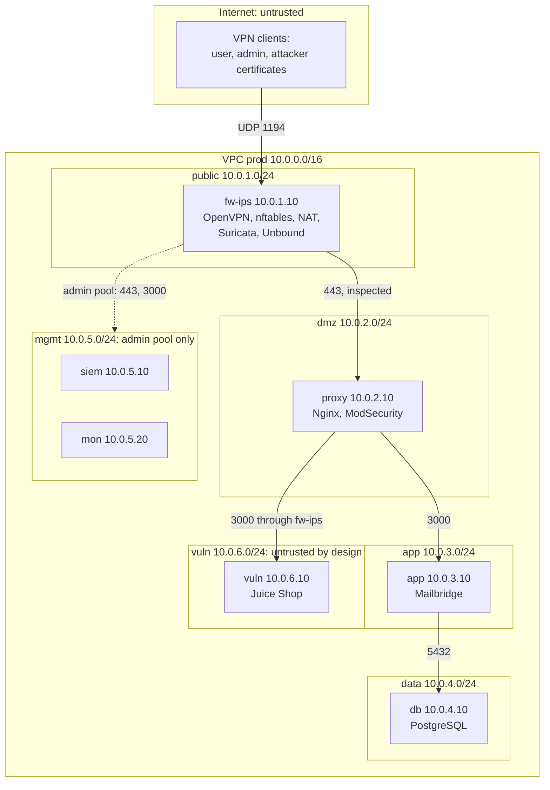
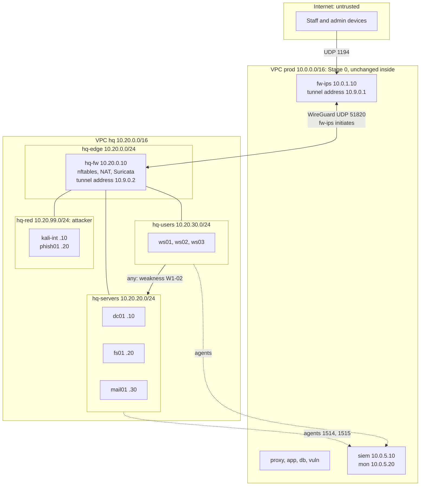
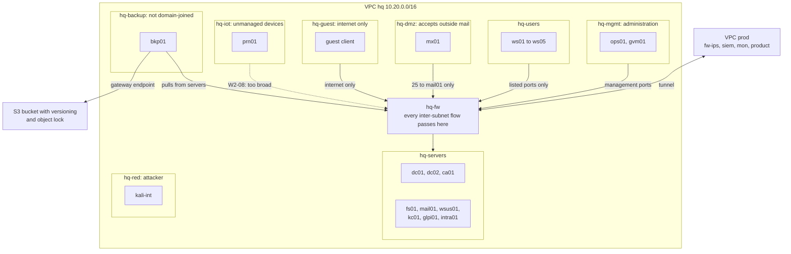
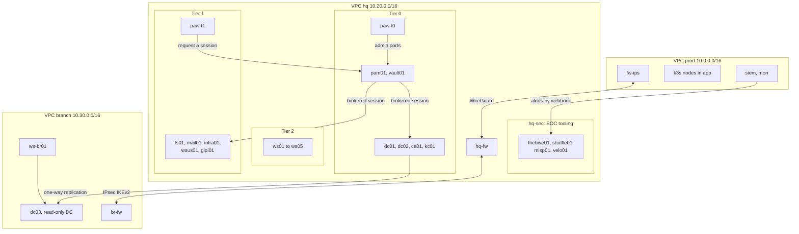

# AWS 01 · Architecture per stage

> **Status: PROPOSED**, except Stage 0, which repeats `docs/ARCHITECTURE.md` as **built**. This
> is the AWS-only version: the whole company lives in AWS. Names, addresses and host lists come
> from `shared/00-naming-and-addressing.md`.

> **Assumptions**
>
> 1. Everything stays in eu-central-1, one availability zone, as today.
> 2. The office is a **second VPC**, `hq`, 10.20.0.0/16, with its own firewall `hq-fw`. The
>    alternatives are compared in section 2.1.
> 3. More-specific routes to a firewall interface (the pattern proven for the `vuln` subnet,
>    decisions 68 and 131) are used for every path between office subnets.
> 4. AWS quotas and feature details (NACL rule limits, route specificity rules) are from memory
>    (verify).

---

## 1. Where this differs from ARCHITECTURE.md

Stated once here, and repeated where each occurs.

| # | Differs from ARCHITECTURE | Why |
|---|---|---|
| D1 | A second VPC and a second firewall host, `hq-fw`, with one new internet-facing port: UDP 51820, accepted **from the Elastic IP of `fw-ips` only** | an office is a separate trust zone with its own perimeter. `fw-ips` gains no new inbound port: it initiates the tunnel |
| D2 | A third VPN pool, **staff 10.8.2.0/24**, on `fw-ips` | staff need remote access to office resources; the user pool keeps meaning "Mailbridge users" and the admin pool "administrators" |
| D3 | `siem` and `mon` accept agents and scrape targets from 10.20.0.0/16 (later 10.30.0.0/16) | one SIEM for all sites |
| D4 | NACLs in the office VPC are **coarse** (subnet to subnet); the fine rules are in security groups and on `hq-fw` | AD needs many ports, and a NACL holds only about 20 rules per direction by default (verify) |
| D5 | From Stage 2, Windows hosts are **stopped, not destroyed**, between sessions | a domain with members, patch history and real state can't be re-created in a few minutes; see `04-roadmap-and-cost.md` |
| D6 | Interactive administration of Windows uses RDP, first over the admin VPN, later only through SSM port forwarding or `pam01` | Stage 0 has no Windows; port 22 stays closed everywhere as today |

The cost guardrails are **kept**: no NAT Gateway, no ALB, no interface endpoints, no Transit
Gateway, t3 with `standard` credits. `04-roadmap-and-cost.md` section 5 discusses the one place
a stage could justify bending one.

---

## 2. Design choices that shape every stage

### 2.1 Where the office lives

| Option | How | For | Against |
|---|---|---|---|
| **A. Second VPC with its own firewall, joined by a self-managed tunnel (recommended)** | VPC `hq` 10.20.0.0/16; `hq-fw` with an Elastic IP; WireGuard between `hq-fw` and `fw-ips` | a real trust boundary; identical addresses and tunnel design to the Proxmox and hybrid versions; teaches site-to-site VPNs; later maps cleanly to a separate AWS account | one more small instance and one more public address per session |
| B. Secondary CIDR in the existing VPC | add 10.20.0.0/16 to the VPC; `fw-ips` filters everything | cheapest; no tunnel | one firewall is both the cloud edge and the office edge; no site boundary to attack or defend; a migration later |
| C. VPC peering | two VPCs, peered | free; simple | peered traffic bypasses the firewalls unless routing is forced through them, and return paths become asymmetric |
| D. Transit Gateway or AWS Site-to-Site VPN | managed routing or managed IPsec | what large companies use | hourly charges; breaks the spirit of the guardrails. Learn it on paper, or for one session |

**The concept.** A site boundary is a place where two parties with different trust meet and
where one firewall per side enforces its own policy. Option A gives you two firewalls with a
tunnel between them, which is how offices and clouds are joined in practice.

### 2.2 The tunnel

| Option | For | Against |
|---|---|---|
| **A. WireGuard, `hq-fw` ↔ `fw-ips` (recommended for HQ)** | small configuration, fast, easy to reason about; the keys live in SSM like the VPN's | less common in enterprise firewalls |
| B. IPsec with IKEv2 (strongSwan) | what enterprise firewalls and cloud VPN services speak; a frequent interview topic | more moving parts: proposals, lifetimes, NAT traversal |

**Recommendation:** WireGuard for HQ ↔ prod at Stage 1; **IPsec for branch ↔ HQ at Stage 3**, so
you've built and debugged one of each.

The tunnel is initiated by `fw-ips` with a keepalive. Security groups are stateful, so `fw-ips`
needs no new inbound rule; `hq-fw` accepts UDP 51820 from one address.

### 2.3 Inspection between office subnets

AWS routes between subnets of a VPC directly; a firewall instance sees nothing unless routing
sends traffic to it. The lab already solved this for `vuln` (decision 68): a route **more
specific than the VPC's local route**, pointing at the firewall's interface. Every office subnet's
route table lists every *other* office subnet with `hq-fw`'s interface as the target.

Three rules that came out of decisions 68 and 131 and apply again:

1. **Paths must be symmetric.** If A → B crosses `hq-fw`, B → A must too, or the firewall sees
   half a connection and drops it.
2. **Security groups on those paths name addresses, not groups.** A group reference doesn't
   match traffic that arrived through a middlebox.
3. **Traffic inside one subnet never crosses the firewall.** `dc01` ↔ `fs01` is controlled by
   security groups only, and Suricata doesn't see it. This is a real AWS limit; see
   `03-attack-ranges.md`.

---

## 3. Stage 0: cloud production (built)

| Boundary or hop | Who controls it | Enforced by | Evidence | What can go wrong |
|---|---|---|---|---|
| Internet → `fw-ips` | you | sg-fw, public NACL, OpenVPN with `tls-crypt` | OpenVPN log, flow logs | a stolen device certificate; mitigated by revocation and per-pool rules |
| VPN → `proxy` | you | nftables per pool; Suricata inline | `FW-DROP`, `eve.json` | a `drop` rule that matches real traffic (decision 82) |
| `proxy` → `app` → `db` | you | security groups by reference, NACLs | flow logs; application logs | this path uses the local route, so Suricata doesn't see it, by design |
| `proxy` → `vuln` | you | more-specific routes through `fw-ips`; groups by address | `eve.json` flows; `VULN-EGRESS-DROP` | an asymmetric route silently breaks the path |
| admin pool → `mgmt` | you | nftables, sg-siem, sg-mon, mgmt NACL | dashboard access logs | the admin laptop is the single most valuable target |

Allowed flows for Stage 0 are the tables in `ARCHITECTURE.md` §4 and aren't repeated here.

**Stage 0 isn't finished** until the Tier 2 tasks are done; they add no network change except
the S3 gateway endpoint for backups (T2.3).

---

## 4. Stage 1: the office appears

### 4.1 Address plan

| Subnet | CIDR | Route table | Hosts |
|---|---|---|---|
| `hq-edge` | 10.20.0.0/24 | 0.0.0.0/0 → internet gateway | `hq-fw` 10.20.0.10 (Elastic IP) |
| `hq-mgmt` | 10.20.10.0/24 | default and every other office subnet → `hq-fw` | empty at Stage 1 |
| `hq-servers` | 10.20.20.0/24 | the same | `dc01` .10, `fs01` .20, `mail01` .30 |
| `hq-users` | 10.20.30.0/24 | the same | `ws01` .101, `ws02` .102, `ws03` .103 |
| `hq-red` | 10.20.99.0/24 | the same | `kali-int` .10, `phish01` .20 |
| prod VPC, private table | — | **add** 10.20.0.0/16 → `fw-ips` interface | — |
| VPN staff pool | 10.8.2.0/24 | already covered by the existing 10.8.0.0/16 → `fw-ips` route | staff devices |

The office VPC uses a **DHCP options set**: DNS servers 10.20.20.10, domain name `corp.<domain>`.
`dc01` forwards other names to the VPC resolver, and `mail.<domain>` and `vuln.<domain>` to
Unbound on `fw-ips`.

### 4.2 Diagram

| Boundary or hop | Who controls it | Enforced by | Evidence | What can go wrong |
|---|---|---|---|---|
| Internet → `hq-fw` | network admin | sg-hq-fw: UDP 51820 from the address of `fw-ips` only; edge NACL | flow logs: every other probe is `REJECT` | the Elastic IP of `fw-ips` changes each session; the rule must be built from Terraform's output, never typed |
| Tunnel | network admin | WireGuard keys from SSM, one path per host role | `wg show`: recent handshake; a probe from `mon` | keys generated on a host and never stored; allowed-address lists too wide, so one side can spoof the other's networks |
| `hq-users` → `hq-servers` | network admin | `hq-fw`: **allow all** (`W1-02`); security groups by address | `hq-fw` flow log | it is the deliberate weakness. The danger is forgetting to fix it at Stage 2 |
| inside `hq-servers` | network admin | security groups only | flow logs | `hq-fw` and Suricata don't see it |
| office → `siem` | SOC engineer | `hq-fw`, the tunnel, `fw-ips`, sg-siem, mgmt NACL | agents `Active` | five places must agree; a missing rule in one shows as "agent disconnected" |
| staff pool → office | network admin | nftables on `fw-ips`, then `hq-fw` | OpenVPN log with the user name; `hq-fw` log | staff VPN gives broad access to the server network: realistic, and a finding for the Stage 1 test |
| `hq-red` → office | the RoE | `hq-fw`: same rules as `hq-users`, only during an engagement | `hq-fw` log | leaving the attacker rules on after the engagement |

### 4.3 Allowed flows, Stage 1

| # | Source | Destination | Port | Reason |
|---|---|---|---|---|
| 1 | `fw-ips` Elastic IP | `hq-fw` Elastic IP | UDP 51820 | site-to-site tunnel |
| 2 | office private subnets | internet, through `hq-fw` | TCP 443, UDP 123 | updates, SSM, time; logged, as for prod |
| 3 | `hq-users`, `hq-mgmt` | `dc01` | TCP/UDP 53, 88, 389, 464; TCP 135, 445, 636, 3268, 3269, 49152–65535; UDP 123 | domain membership: DNS, Kerberos, LDAP, SMB, RPC, time |
| 4 | `hq-users` | `fs01` | TCP 445 | file shares |
| 5 | `hq-users` | `fs01` | TCP 21 and the passive range | **`W1-01`**: legacy FTP |
| 6 | `hq-users` | `mail01` | TCP 443, 587, 993 | webmail, submission, IMAP |
| 7 | `hq-users` | `hq-servers` | **any** | **`W1-02`**: flat trust. Rows 3–6 are what *should* remain |
| 8 | `fs01`, `mail01` | `dc01` | as row 3 (same subnet: security groups only) | member servers; LDAPS for mail authentication |
| 9 | all office hosts | `siem` 10.0.5.10 | TCP 1514, 1515 | Wazuh agents |
| 10 | `mon` 10.0.5.20 | all office hosts | TCP 9100 (Linux), 9182 (Windows exporter) | metrics |
| 11 | `mon` 10.0.5.20 | `mail01`, `dc01` | TCP 443; TCP/UDP 53 | blackbox probes |
| 12 | `dc01` | Unbound 10.0.1.10 | TCP/UDP 53 | conditional forwarder for `mail.<domain>`, `vuln.<domain>` |
| 13 | Unbound 10.0.1.10 | `dc01` | TCP/UDP 53 | conditional forwarder for `corp.<domain>` |
| 14 | `mon`, `siem` | `dc01` | TCP 636 | LDAPS sign-in for Grafana and the Wazuh dashboard |
| 15 | staff pool 10.8.2.0/24 | `mail01` | TCP 443 | webmail from outside the office |
| 16 | staff pool 10.8.2.0/24 | `fs01`, `dc01` | TCP 445; row 3 ports | shares over the VPN |
| 17 | `fw-ips` | `dc01` | TCP 636 | OpenVPN checks staff credentials against AD |
| 18 | admin pool 10.8.1.0/24 | `hq-servers`, `hq-users` | TCP 3389 | administration, and the operator's console to the workstations (D6) |
| 19 | `phish01` | `mail01` | TCP 25 | phishing campaign delivery, during the engagement only |
| 20 | `hq-users` | `phish01` | TCP 443 | the landing page, during the engagement only |
| 21 | `kali-int` | as `hq-users` | as `hq-users` | assumed-breach position, during the engagement only |
| 22 | admin pool | `phish01` | TCP 3333 | GoPhish admin UI |
| — | everything else | — | — | dropped and logged on `hq-fw` or `fw-ips` |

**Lab vs real.** Row 18's "operator's console" exists because nobody sits at these
workstations. In a real office the user is at the keyboard and no such flow exists. Keep that
rule in a clearly named set, and exclude the admin pool's RDP from detection statistics.

---

## 5. Stage 2: segmentation

### 5.1 Address plan (additions)

| Subnet | CIDR | Hosts |
|---|---|---|
| `hq-mgmt` | 10.20.10.0/24 | `ops01` .10, `gvm01` .30 |
| `hq-servers` | 10.20.20.0/24 | adds `dc02` .11, `ca01` .15, `wsus01` .40, `kc01` .50, `glpi01` .60, `intra01` .70 |
| `hq-users` | 10.20.30.0/24 | adds `ws04` .104, `ws05` .105 |
| `hq-dmz` | 10.20.40.0/24 | `mx01` .10 |
| `hq-guest` | 10.20.50.0/24 | one throwaway client |
| `hq-iot` | 10.20.60.0/24 | `prn01` .10 |
| `hq-backup` | 10.20.70.0/24 | `bkp01` .10, with an S3 gateway endpoint on this subnet's route table |

The DHCP options set now lists both DCs.

### 5.2 Diagram

| Boundary or hop | Who controls it | Enforced by | Evidence | What can go wrong |
|---|---|---|---|---|
| `hq-users` → `hq-servers` | network admin | `hq-fw` allow-list (the Stage 1 rows 3–6, nothing else) | drops logged per source | an application breaks and someone adds "any" back |
| `hq-mgmt` → everything | network and system admins | `hq-fw`: management ports from `ops01` only | `hq-fw` log; Ansible logs on `ops01` | `ops01` becomes the keys to the kingdom. Treat it as Tier 0 from the day it exists |
| `gvm01` → everything | vulnerability analyst | `hq-fw`: all ports, all subnets, logged; the host is off outside scan windows | scan reports; `hq-fw` log | a scanner with stored administrator credentials is a prime target |
| `hq-dmz` | network admin | `hq-fw`: only `mx01` → `mail01`:25 inward | mail logs | a DMZ host allowed to reach the DCs "for authentication" |
| `hq-guest` | network admin | `hq-fw`: internet only; every private range dropped | drops | a guest rule that forgets one private range |
| `hq-iot` | network admin | `hq-fw`: should accept print jobs only; **`W2-08`** lets `prn01` reach `hq-servers` | new flows from `hq-iot` | unmanaged devices can't run an agent, so the network is the only sensor |
| `hq-backup` | sysadmin | `hq-fw`: `bkp01` initiates everything; nothing initiates to it except `ops01` | failed delete attempts; S3 access logs | a backup server joined to the domain shares the domain's fate |
| `bkp01` → S3 | sysadmin | a gateway endpoint (free) and a role limited to that bucket; versioning and object lock | S3 server access log; CloudTrail data events if enabled (cost: verify) | a role that can delete versions |

### 5.3 Allowed flows, Stage 2 (changes from Stage 1)

| # | Source | Destination | Port | Reason |
|---|---|---|---|---|
| 7 | — | — | — | **removed**: `W1-02` is fixed. Only rows 3–6 remain between users and servers |
| 5 | — | — | — | **removed**: FTP is gone |
| 18 | — | — | — | **changed**: admin RDP from the VPN is removed; interactive access goes through SSM port forwarding, automation through `ops01` |
| 23 | `ops01` | all office hosts | TCP 22 (Linux), TCP 5986 (Windows, WinRM over TLS) | configuration management after a merged change |
| 24 | `gvm01` | all lab subnets | all | authenticated vulnerability scans, in scan windows |
| 25 | `hq-users` | `kc01` | TCP 443 | single sign-on |
| 26 | `kc01` | `dc01`, `dc02` | TCP 636, 88 | user federation |
| 27 | `siem`, `mon`, `glpi01` | `kc01` | TCP 443 | token exchange (back channel) |
| 28 | admin and staff pools | `kc01` | TCP 443 | sign-in from outside the office |
| 29 | `hq-users` | `glpi01`, `intra01` | TCP 443 | tickets, the intranet application |
| 30 | all Windows hosts | `wsus01` | TCP 8531 | update approvals over TLS |
| 31 | `wsus01` | internet | TCP 443 | update metadata from the vendor |
| 32 | all domain members | `ca01` | TCP 135 and the RPC range | certificate enrolment |
| 33 | `hq-red` (as an outside sender) | `mx01` | TCP 25 | inbound mail, simulated |
| 34 | `mx01` | `mail01` | TCP 25 | relay inward |
| 35 | `mail01` | `mx01` | TCP 25 | relay outward (goes nowhere beyond the lab) |
| 36 | `hq-guest` | internet | TCP 80, 443; UDP 53 to `hq-fw` | guests |
| 37 | `hq-users`, `fs01` | `prn01` | TCP 9100, 631 | printing |
| 38 | `prn01` | `hq-servers` | any | **`W2-08`** |
| 39 | `bkp01` | `hq-servers` | TCP 22, 445 | backups pulled |
| 40 | `bkp01` | S3 | TCP 443 through the gateway endpoint | second copy |
| 41 | `dc01` ↔ `dc02` | each other | AD replication ports (same subnet: security groups) | replication |
| 42 | `hq-users` | any DNS server other than the DCs | UDP/TCP 53 | **`W2-07`**: allowed at first; the fix blocks it |
| 43 | DCs | VPC resolver | TCP/UDP 53 | the only DNS path out |

**A hardening step worth doing here.** Row 3's RPC range is over 16,000 ports. Windows lets you
restrict the dynamic RPC range on servers to a hundred ports or so; the firewall rule shrinks
with it. Measure the allowed port count before and after: it's a concrete least-privilege
number for the write-up.

---

## 6. Stage 3: tiers, a SOC, a branch

### 6.1 Address plan (additions)

| Subnet | CIDR | Hosts |
|---|---|---|
| `hq-mgmt` | 10.20.10.0/24 | adds `pam01` .40, `vault01` .50 |
| `hq-sec` | 10.20.80.0/24 | `thehive01` .10, `shuffle01` .20, `misp01` .30, `velo01` .40 |
| `hq-paw` | 10.20.90.0/24 | `paw-t0` .10, `paw-t1` .11 |
| `hq-red` | 10.20.99.0/24 | adds `c2-01` .30 (**see the warning in section 6.4**) |
| prod `app` | 10.0.3.0/24 | `k3s01`–`k3s03` .21–.23 (task T3.1) |
| VPC `branch`: `br-edge` | 10.30.0.0/24 | `br-fw` 10.30.0.10 (Elastic IP) |
| VPC `branch`: `br-servers` | 10.30.20.0/24 | `dc03` .10 |
| VPC `branch`: `br-users` | 10.30.30.0/24 | `ws-br01` .101 |

### 6.2 Diagram

| Boundary or hop | Who controls it | Enforced by | Evidence | What can go wrong |
|---|---|---|---|---|
| Tier 0 | identity team | `hq-fw`: administrative ports to Tier 0 hosts from `paw-t0` and `pam01` only; AD authentication policies | 4624 of a `t0-` account anywhere else is an alert | Tier 0 members live in the `hq-servers` subnet with Tier 1 hosts, so inside that subnet only security groups separate them. Write those groups per host |
| PAW → `pam01` → target | security engineering | `hq-fw`: RDP, WinRM and SSH to servers accepted **from `pam01` only** | session recordings | one leftover direct rule makes the broker optional |
| `hq-sec` | SOC | `hq-fw`: SOC tools receive from `siem`; `velo01` accepts its clients on one port | case and playbook logs | SOAR holds API keys for many systems; it is a Tier 0 secret store in disguise |
| HQ ↔ branch | network admin | IPsec between `hq-fw` and `br-fw`; UDP 500 and 4500 between the two Elastic IPs only | tunnel state; `mon` probe | mismatched proposals; lifetimes that cause a drop every hour |
| branch → HQ | network admin | `br-fw` and `hq-fw`: `dc03` to the DCs for replication; branch users to listed services only | replication health | the branch treated as trusted because "it is ours" |
| k3s | platform team | security groups for the nodes; network policies inside the cluster | Kubernetes audit log to `siem` | the cluster's pod network bypasses the subnet model unless policies exist |

### 6.3 Allowed flows, Stage 3 (changes from Stage 2)

| # | Source | Destination | Port | Reason |
|---|---|---|---|---|
| 23 | — | — | — | **narrowed**: `ops01` keeps configuration management to Tier 1 and Tier 2; Tier 0 changes run from `paw-t0` |
| 44 | `paw-t0` | Tier 0 hosts | TCP 3389, 5986, 9389 | Tier 0 administration |
| 45 | `paw-t1`, `paw-t0` | `pam01` | TCP 443 | request privileged sessions |
| 46 | `pam01` | Tier 1 and Tier 2 hosts | TCP 22, 3389, 5986 | brokered sessions; the only source for these ports |
| 47 | `pam01`, applications | `kc01` | TCP 443 | sign-in |
| 48 | application hosts, `ops01`, k3s | `vault01` | TCP 8200 | secrets |
| 49 | `vault01` | `db` 10.0.4.10 | TCP 5432 | dynamic database credentials |
| 50 | `siem` | `shuffle01`, `thehive01` | TCP 443 | alert forwarding |
| 51 | `shuffle01` | `thehive01`, `misp01`, `hq-fw`, `kc01` | TCP 443 | playbook actions |
| 52 | all agents | `velo01` | TCP 8000 | Velociraptor clients |
| 53 | `hq-fw` Elastic IP ↔ `br-fw` Elastic IP | each other | UDP 500, 4500 | IPsec |
| 54 | `dc03` | `dc01`, `dc02` | AD replication ports | read-only replica |
| 55 | `br-users` | `dc03` | row 3 ports | branch logon |
| 56 | `br-users` | `fs01`, `mail01`, `kc01` | TCP 445, 443 | branch use of HQ services |
| 57 | branch hosts | `siem` | TCP 1514, 1515 | agents |
| 58 | admin pool | `paw-t0`, `paw-t1` | TCP 3389, through SSM port forwarding only | the operator's console to the PAWs |
| 59 | `proxy` | k3s ingress 10.0.3.21–23 | TCP 443 or the ingress port | the product, now on k3s |
| 60 | k3s nodes | each other | TCP 6443, 10250; UDP 8472 | cluster traffic |

### 6.4 The C2 host on AWS

`c2-01` is in the address plan so the names match Proxmox. **On AWS it should not run until
you've read the current AWS testing policy and, if required, received approval** (decision 75
records that C2 needs approval). There is also a technical reason: without interface endpoints,
any instance reaches SSM through the internet on TCP 443, so `hq-red` can't be made truly
egress-free on AWS without giving up your own management path. On Proxmox the segment simply
has no route. The recommendation in `comparison.md` follows from this.

---

## 7. Terraform and Ansible layout: PROPOSED

| Stack or role | Contains | Lifetime |
|---|---|---|
| `terraform/persistent` (built) | adds: WireGuard and IPsec keys as write-only parameters, the backup bucket (T2.3), AD-related secrets, golden AMIs' snapshots | never destroyed |
| `terraform/lab` (built) | `prod`, plus the route to 10.20.0.0/16 | hosts per session |
| `terraform/hq` | the office VPC, subnets, route tables, security groups, NACLs (free, kept); hosts behind `hq_enabled` and per-stage switches | network kept; hosts per session, Windows stopped from Stage 2 |
| `terraform/branch` | the same for the branch | as `hq` |
| `terraform/sandbox` | the separate attack-range account (`03-attack-ranges.md`) | created for an exercise, destroyed after |
| Ansible roles | `hq_fw`, `dc`, `fs`, `mail_internal`, `workstation_windows`, `workstation_linux`, `windows_baseline`, `sysmon`, then per Stage 2 and 3 host | idempotent; second run `changed=0` |

The existing modules (`network`, `security`, `compute`) are reused. The inventory stays the
dynamic `aws_ec2` plugin grouped by the `Role` tag (decision 45), with a new `Site` tag.

---

## 8. How to verify the network of each stage

| Stage | Check | Expected |
|---|---|---|
| 1 | `wg show` on both firewalls | a handshake under two minutes old |
| 1 | from `ws01`: `Test-NetConnection dc01 -Port 88` | succeeds |
| 1 | from outside, scan the Elastic IP of `hq-fw` | nothing answers; flow logs show `REJECT` for every probe |
| 1 | `ping` from `ws01` to `fs01` while running `tcpdump` on `hq-fw` | packets visible in both directions (the detour works and is symmetric) |
| 1 | Wazuh | every office agent `Active`; a failed logon on `ws01` appears |
| 2 | from `ws01`: a port scan of `hq-servers` | only the listed ports answer; drops are logged with the source |
| 2 | from the guest client: any private address | times out; logged |
| 2 | from `ws01`: `nslookup example.com 1.1.1.1` after the `W2-07` fix | times out; logged |
| 2 | from `fs01`: delete a backup on `bkp01` or a version in S3 | refused |
| 3 | RDP from `paw-t1` straight to `intra01` | refused; through `pam01` it works and is recorded |
| 3 | sign in as a `t0-` account on `ws01` | refused by policy; an alert fires |
| 3 | `repadmin /showrepl dc03` | successful one-way replication |
| every stage | `terraform plan` on each stack; second Ansible run | no changes; `changed=0` |
