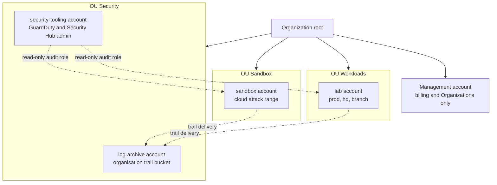

# AWS 02 · Platform specifics

> **Status: PROPOSED.** How to run the company's identity and Windows estate on AWS, what AWS
> can't do for a security lab, and the cloud security topics only AWS can teach.

> **Assumptions**
>
> 1. **Every price in this file is an approximation from memory for eu-central-1 and is marked
>    (verify).** Check the AWS pricing pages and the Pricing Calculator before relying on any of
>    them. The only measured numbers are Stage 0's: about $0.25 per hour for seven hosts.
> 2. Feature availability (Windows editions on EC2, WorkSpaces bundles, instance features such
>    as virtual TPM) changes; each claim of that kind is marked (verify).
> 3. You keep one AWS account for the lab until Stage 2, then add accounts through AWS
>    Organizations (section 5.2).

---

## 1. Identity on AWS: the options

| Option | What it is | Cost (verify) | Teaches | Doesn't teach | Verdict |
|---|---|---|---|---|---|
| **A. Self-managed domain controllers on EC2 (recommended)** | Windows Server instances you promote yourself | licence included in the hourly price; a t3.medium Windows instance is roughly $0.065–0.07 per hour; only while running | everything: promotion, DNS, GPO, replication, AD CS, backup, the attack paths, the fixes | nothing is hidden from you | the main domain of the lab |
| B. AWS Managed Microsoft AD | AWS runs two domain controllers for you | roughly $0.12–0.15 per hour for the smallest edition, **all day, every day**: around $90–110 a month; can't be stopped | how enterprises consume a managed directory; trusts to it; integration with other AWS services | you get a delegated admin, **not Domain Admin**; you can't sign in to the DCs, so most DC-level attacks and defences can't be practised | read about it; try it for one day inside its free trial if one is offered (verify) |
| C. Simple AD | a Samba-based directory run by AWS | cheaper than B, still billed continuously | very little that carries over | most AD features | skip |
| D. AD Connector | a proxy that lets AWS services use your own AD | billed continuously | how AWS services attach to an existing directory | — | only if you want WorkSpaces or Identity Center on your own AD |
| E. IAM Identity Center | single sign-on to AWS accounts with permission sets | free | workforce access to AWS done properly: no IAM users, short-lived roles | it isn't a directory for computers | **add at Stage 2**; it complements A |
| F. WorkSpaces | managed virtual desktops | a monthly fee plus an hourly rate in the hourly mode, per desktop; needs B, C or D | virtual desktop concepts | the desktops in licence-included bundles are, as far as the author knows, built on Windows Server (verify), so they add little over an EC2 instance | skip unless a job posting you're aiming at asks for it |

**The concept behind the choice.** A managed service removes work, and the removed work is the
learning. Option B is the right answer for many real companies and the wrong one for a lab whose
purpose is to understand and attack a domain. Know how to say both halves of that sentence.

**Cost versus teaching, in one line each**

| Option | Cost for a 5-hour session, two DCs | Monthly when idle | Teaching value for an AD career |
|---|---|---|---|
| A, destroyed after the session | about $0.70 | $0 | very high |
| A, stopped between sessions | about $0.70 | about $6–8 for two 30–40 GB disks | very high, plus patching and state |
| B | — | about $90–110 | low to medium |

---

## 2. Windows on EC2

### 2.1 Licensing and editions

| Fact | Consequence |
|---|---|
| Windows Server AMIs are **licence-included**: the hourly price contains the licence | no keys, no activation work, no evaluation timers |
| The Windows premium is roughly 40–60 % on top of the Linux price for small t3 sizes (verify) | a Windows host costs about as much as the next Linux size up |
| **Windows client editions aren't offered licence-included** on normal shared instances (verify) | workstations are **Windows Server standing in for a client** |
| The Windows root volume is 30 GB or more | disks cost more than the Linux hosts' 10–20 GB |
| SQL Server Express is free; other editions add a large hourly premium | `intra01` uses Express |

**Lab vs real: Windows Server as a workstation.** It behaves the same for the things this lab
cares about: domain join, Group Policy, Kerberos, credential caching, Sysmon, lateral movement.
It differs in defaults (hardened browser configuration, no consumer applications, some client
security features configured differently) and has no Office. For the phishing exercise that
means credential-harvesting pages work as in reality, and Office-macro payloads can't be
practised here. Say this in the report's scope section.

### 2.2 Sizes

| Host | Suggested type | Why | Approx. per hour (verify) |
|---|---|---|---|
| `dc01`, `dc02`, `dc03` | t3.medium | 4 GB is comfortable for a small directory with DNS | $0.066 |
| `ca01` | t3.small or t3.medium | idle most of the time | $0.04–0.066 |
| `fs01` | t3.medium | file services plus the agent and Sysmon | $0.066 |
| `intra01` | t3.medium | IIS and SQL Server Express | $0.066 |
| `wsus01` | t3.large | WSUS and its database are memory-hungry | $0.12 |
| `ws01`–`ws05`, `ws-br01`, PAWs | t3.medium | a desktop session with a browser | $0.066 each |
| `hq-fw`, `br-fw` | t3.small | as `fw-ips` | $0.024 |
| `mail01` | t3.small, or t3.medium if Rspamd and the webmail feel slow | — | $0.024–0.048 |

**The CPU-credit problem.** A t3 with `standard` credits starts with no credit balance and is
held to its baseline (20 % of a vCPU for most small sizes). Windows first boot, updates and
domain controller promotion are CPU-heavy, so they crawl. The lab already measured this on
`siem` (decision 99). Three ways to live with it without breaking the guardrail:

1. **Golden AMIs** (section 2.3): updates and role installation happen once, at build time.
2. **Stopped, not destroyed** (from Stage 2): credits aren't the issue once nothing is being
   installed at every start.
3. **Long timeouts** in Ansible for the first run, as already done for `siem`.

### 2.3 Images

| Step | Tool | Result |
|---|---|---|
| Build | Packer with the `amazon-ebs` builder, from the current Windows Server base AMI | an AMI with updates, the Wazuh agent installer, Sysmon, OpenSSH Server, and the roles a host class needs already installed |
| Generalise | the Windows launch agent's Sysprep step | each instance gets its own machine identity |
| Store | the AMI's snapshot in the account | billed per GB-month of snapshot storage (small; verify) |
| Rebuild | monthly, as part of the patch cycle | the "patching" of ephemeral hosts |

**Why this matters beyond speed.** An image pipeline is how real companies patch fleets of
short-lived servers: they don't patch the running machine, they replace it with one built from
a newer image. Stage 2 lets you compare both models side by side: image replacement for
stateless hosts, in-place patching with rings for the domain controllers.

### 2.4 Persistence: destroy, stop or snapshot

| Option | Between sessions | For | Against |
|---|---|---|---|
| **A. Rebuild from code every session (recommended for Stage 1)** | nothing exists | keeps the existing teardown model and its proof that the code works; costs nothing idle | the domain is new every time: about 30–45 minutes of build; no patch history; no long-lived Kerberos or certificate state |
| **B. Stop the Windows fleet (recommended from Stage 2)** | disks remain, billed per GB-month | a domain with history: real patching, password ages, certificate lifetimes, stale objects | roughly $0.10 per GB-month (verify): ten Windows hosts at 40 GB is about $40 a month; drift can now exist, so the drift check matters |
| C. Launch from a snapshot of a built domain | snapshots remain | faster than A | domain controllers restored from old images can corrupt replication when there is more than one. Avoid for DCs |

**Differs from ARCHITECTURE (D5).** `ARCHITECTURE.md` §12 removes every host after each session.
Option B keeps Windows disks. The reason isn't convenience: patch management, access reviews
and backup-and-restore of a directory can't be practised on a domain that is an hour old.
Linux hosts keep being rebuilt.

A middle path worth knowing: keep **only the domain controllers** stopped (two or three disks)
and rebuild members each session, re-joining them from code. That is cheap, and re-joining
machines is itself realistic.

---

## 3. Automating Windows

| Option | How Ansible reaches the host | For | Against |
|---|---|---|---|
| **A. SSH tunnelled through SSM (recommended)** | Windows' built-in OpenSSH Server on loopback; the same `AWS-StartSSHSession` tunnel as the Linux hosts (decision 36) | one connection method for every host; no management port open on any network | Ansible's Windows-over-SSH support is newer than WinRM (verify with your Ansible version) |
| B. WinRM over TLS, through an SSM port-forwarding session | PSRP to 5986 on localhost | the long-established Windows path | a tunnel per host to manage; slower |
| C. WinRM over TLS across the network from `ops01` | 5986 open from one host | how most companies really do it; teaches WinRM, which attackers also use | a management port on the network. It's the Stage 2 design (flow 23 in `01-architecture-per-stage.md`), with `ops01` as the only source |
| D. SSM Run Command and State Manager | AWS runs documents on the instance | no Ansible needed; cloud-native | a second configuration system beside Ansible |

**Recommendation.** A for Stage 1 (it preserves "port 22 is never open to any network" and adds
no new pattern). C from Stage 2, deliberately, because WinRM from a management host is what
you'll meet at work and what the red role should find and abuse.

**Collections you'll need:** `ansible.windows`, `microsoft.ad`, `community.windows` (verify
current names and versions).

**Secrets for the domain.** The directory recovery password, the first administrator's password
and every service account's password are generated by `persistent` as write-only parameters
(decision 46's pattern). Each host pulls only what it needs with its own role. The domain-join
credential is a dedicated account that can only join machines to one OU.

**Interactive access.** RDP through an SSM port-forwarding session to localhost:3389 needs no
open port and leaves a CloudTrail record of who opened the session. That is the default from
Stage 2 (D6).

**A bootstrap trap.** The office VPC's DHCP options point every host's DNS at `dc01`. While
`dc01` is still being built, it has no working resolver and can't reach SSM. Its own first-boot
configuration must set the VPC resolver statically, then switch to itself after promotion.

---

## 4. What AWS can't do for a security lab

| AWS limit | What you can't practise | What to do instead |
|---|---|---|
| **No shared layer 2.** A VPC delivers no broadcast and no multicast between instances, and AWS answers ARP itself | ARP spoofing, rogue DHCP, LLMNR, NBT-NS and mDNS poisoning, IPv6 router-advertisement attacks, passive sniffing of neighbours | Proxmox (`proxmox/03-attack-ranges.md`). On AWS, learn the cloud replacement: Traffic Mirroring |
| **AWS owns DHCP** | running, attacking or defending a DHCP server | the DHCP options set on AWS; real DHCP on Proxmox |
| **No VLANs, trunks or switch ports** | VLAN hopping, 802.1X, network access control, port security | Proxmox with a managed switch |
| **A firewall instance sees only routed traffic** | inspecting traffic between two hosts in the same subnet | smaller subnets (even one host each); host-based sensors (Sysmon, Zeek on the host); Traffic Mirroring to a sensor interface (billed per mirrored interface per hour, verify) |
| **Outbound TCP 25 to the internet is blocked by default** | sending real mail | nothing: the lab's mail is internal by rule anyway. Traffic to private addresses is, as far as the author knows, unaffected (verify) |
| **The AWS testing policy** | denial of service, flooding; C2 without approval (decision 75) | rate caps; Proxmox for C2 |
| **No licence-included Windows client** | Office macros, client-only security features | Windows Server as a stand-in; Proxmox with evaluation media |
| **No hypervisor access** | memory snapshots from outside the guest; nested virtualisation on these instance types (verify); a virtual-machine-based malware sandbox | in-guest memory capture; Proxmox for the sandbox |
| **No truly offline segment** without interface endpoints | isolated malware or C2 networks that you can still manage | Proxmox |
| **Ephemeral hosts** | patching, long-lived state | stopped Windows hosts from Stage 2 |
| **`standard` CPU credits** | fast Windows builds | golden AMIs |
| **No console** beyond a serial console and screenshots | watching a boot, pre-boot disk encryption | Proxmox |
| **Quotas** on rules per NACL, rules per security group and routes per table (verify the numbers) | mirroring every AD port in a NACL | coarse NACLs (D4) |

**The honest summary.** AWS is excellent for everything above layer 3, for identity, and for
cloud-native security. It can't teach the local-network attacks that make internal pentests
what they are. That gap is the reason the Proxmox version exists.

---

## 5. Cloud security topics only AWS can teach

For each: what it is, why companies need it, how to practise it here, the cost, and the stage.

### 5.1 IAM in depth

| Topic | What and why | Practise | Stage |
|---|---|---|---|
| Policy evaluation | how identity policies, resource policies, permission boundaries, session policies and SCPs combine; an explicit deny always wins | the IAM policy simulator (already used for every role in Stage 0) | 0 |
| Least privilege with conditions | restricting an action to one resource, one record name, one tag | built: `proxy` may only write two TXT records (decision 60) | 0 |
| Roles instead of keys | temporary credentials for people, instances and pipelines | built for instances and the laptop; add OIDC for CI (T2.2) | 0 |
| Permission boundaries | a ceiling on what a role can ever be granted; what lets you delegate role creation safely | give a "developer" role the right to create roles, bounded | 2 |
| Access analysis | finding resources shared outside the account and unused permissions | IAM Access Analyzer (the external-access analyser is free; other analysers are paid, verify) | 2 |
| Privilege escalation paths | combinations of harmless-looking permissions that yield admin | the sandbox account, `03-attack-ranges.md` | 3 |

**Interview core:** "An IAM role answers two questions with two different policies: the trust
policy says who may become the role, the permission policy says what the role may do. Most
cross-account mistakes are in the first."

### 5.2 Organizations, SCPs and a landing zone

| Element | Who | Tool | Evidence | What can go wrong |
|---|---|---|---|---|
| Management account | you, rarely | AWS Organizations | CloudTrail of organisation changes | running workloads in it: SCPs don't restrict the management account, so it is the cloud's Tier 0 |
| Log archive | security | an organisation trail into a bucket nobody in a workload account can change | log file validation (already used) | the account being logged can delete its own logs if they stay in the same account |
| Security tooling | security | delegated administrator for GuardDuty and Security Hub | findings from all accounts in one place | the audit role being read-write "to fix things" |
| Lab account | you | the existing stacks | — | moving an existing account into an organisation applies SCPs to it: test the SCPs first |
| Sandbox | red role | a short-lived attack range | its own trail | a sandbox that can assume roles in the lab account |
| SCPs | security | deny rules on OUs | an attempt is denied and logged | an SCP that blocks your own break-glass path |

**SCPs worth writing** (each one is a guardrail from `CLAUDE.md` turned into a control):

| SCP | Effect |
|---|---|
| deny every region except eu-central-1 (with the global-service exceptions) | resources can't appear where you aren't looking |
| deny creating NAT Gateways, load balancers and interface endpoints | the cost guardrails enforced, not just promised |
| deny stopping or deleting the trail, GuardDuty and the log bucket | an attacker with admin in a workload account can't blind you |
| deny instances without IMDSv2 | the baseline can't be skipped |
| deny root user actions in member accounts | — |

**Cost:** Organizations and SCPs are free. A managed landing zone (Control Tower) is free in
itself but turns on services that bill (Config above all; verify). **Options:** A: hand-built
organisation with five accounts in Terraform (recommended: you understand every piece). B:
Control Tower (what companies use; more cost, less understanding). C: stay in one account
(Stage 0–1).

**Stage:** 2 for the organisation and SCPs; the sandbox account can come earlier if you want
the cloud attack range before Stage 2.

### 5.3 Detection and posture services

| Service | What it does | Cost note (verify) | How to use it in the lab | Stage |
|---|---|---|---|---|
| CloudTrail (built) | records control-plane calls | the first copy of management events is free; data events and the query service are paid | feed the bucket to Wazuh; write rules: console sign-in without MFA, root use, IAM changes, trail changes, `PassRole`, a new access key | 0 → 2 |
| GuardDuty | managed threat detection from CloudTrail, flow logs and DNS logs | 30-day trial, then by volume; small for a lab that runs a few hours a week, but not zero | start with task 2.14 (decision 140); trigger findings on purpose; send them to Wazuh | 0 |
| VPC flow logs (built) | traffic metadata | storage only | already the evidence that corrected a misleading scan | 0 |
| Config | records resource configuration and evaluates rules | **billed per recorded change**; a lab that creates and destroys hundreds of resources per session can run this up. Limit the recorded types or use periodic recording | turn on for one month in Stage 2; write one custom rule | 2 |
| Security Hub | aggregates findings; runs benchmark checks (CIS, AWS best practices) | trial, then per check and per finding; needs Config | one month: compare its score with Prowler's free output | 2 |
| Prowler, ScoutSuite | open-source posture audits | free | run against your own account at every stage; track the findings count | 0 |
| Inspector | vulnerability scanning of instances and images | per instance and per image scanned | compare with `gvm01` and Trivy for one session | 2 |
| Macie, Detective | data discovery; investigation graphs | paid by volume | read about them | — |

**The pattern to learn:** every managed detection has an open-source or manual counterpart you
can run free. Use the managed one inside its trial to learn it, record what it found that the
free one didn't, then decide. That comparison is a portfolio piece.

### 5.4 KMS and encryption

| Topic | What and why | Practise | Cost |
|---|---|---|---|
| AWS-managed vs customer-managed keys | with a customer-managed key **you** write the key policy, so you decide who can decrypt | one customer-managed key for the backup bucket; a key policy that lets `bkp01` encrypt but not decrypt | about $1 per key per month plus requests (verify) |
| Envelope encryption | data is encrypted with a data key, the data key with the KMS key | read how S3 and EBS do it; decrypt an object by hand with the CLI | — |
| Key policies and grants | the resource policy of a key; the one policy type where the account root must be named | lock yourself out of a scratch key on purpose, then recover | — |
| What KMS doesn't solve | anyone allowed to call the service decrypts transparently (the reason behind decision 22) | already demonstrated in Stage 0 | — |

### 5.5 Cross-account access

| Topic | Practise |
|---|---|
| A role in account A trusted by account B | the audit role from security-tooling into the lab account |
| The confused-deputy problem and external IDs | a deliberately weak trust policy in the sandbox |
| Role chaining and session duration | follow one chain in CloudTrail from sign-in to action |
| Workforce access with IAM Identity Center | permission sets `ReadOnly`, `SecurityAudit`, `LabAdmin` mapped from the `APP-AWS-*` groups through `kc01` |

---

## 6. The cloud's own tier model

The AD tier model from `shared/02-identity-and-access.md` has an exact cloud counterpart. Being
able to draw this table is a strong interview answer.

| AD | AWS | Why it's the same idea |
|---|---|---|
| Tier 0: domain controllers | the management account, the identity source, the log archive | whoever controls them controls everything else |
| `t0-` accounts and PAWs | break-glass roles with hardware MFA, used from a clean device | a top-tier credential must not touch lower-tier systems |
| Tier 1: servers | workload accounts | compromise is contained to the account |
| Tier 2: workstations | developer sandboxes | assumed hostile |
| GPO baseline | SCPs | rules the lower level can't override |
| AD audit events | the organisation trail | evidence held out of the reach of those it records |
| Kerberoastable service account | a long-lived access key | a credential that can be stolen and used elsewhere, quietly |

---

## 7. Logging on AWS from Stage 2

| Source | Where it lands | How it reaches Wazuh |
|---|---|---|
| Organisation trail | log-archive bucket | Wazuh's AWS module reads the bucket with a read-only role |
| GuardDuty findings | security-tooling account | exported to a bucket or through an event rule; the same module |
| VPC flow logs | bucket in `persistent` (built) | queried on demand; not ingested (volume) |
| Config and Security Hub | security-tooling account | optional |
| Instance logs | Wazuh agents (built) | direct |

Keep the principle from decision 107: Wazuh stores what rules matched; raw evidence stays in S3
with a lifecycle, and is exported before it's needed.

---

## 8. How to verify the platform pieces

| Claim | Check | Expected |
|---|---|---|
| A Windows host is managed without an open port | security group of the host | no inbound 22, 3389 or 5986 from any network at Stage 1 |
| The golden AMI is current | the AMI's build date | within the current patch cycle |
| The domain rebuilds from code | destroy and rebuild `dc01`, run the role twice | second run `changed=0`; `dcdiag` passes |
| An SCP holds | try to create a NAT Gateway in a member account | denied; the denial is in CloudTrail |
| The trail can't be stopped from a workload account | `stop-logging` as the lab account's admin | denied |
| CloudTrail reaches the SIEM | create and delete a scratch IAM user | a Wazuh alert within minutes |
| No long-lived keys exist | the credential report | no active access keys |
| The audit role is read-only | try a write call with it | denied |
