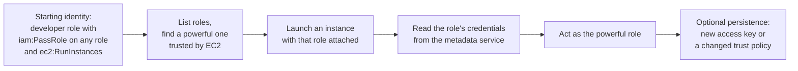
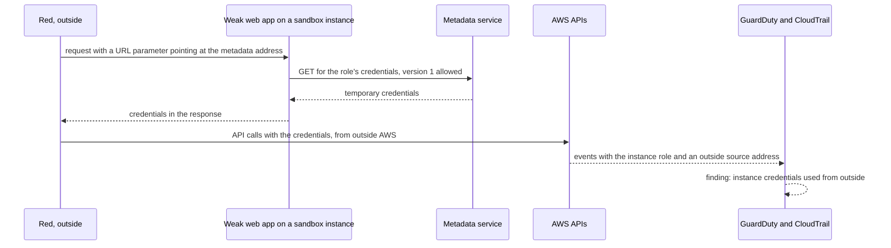

# AWS 03 · Attack ranges

> **Status: PROPOSED.** What the red role can and can't do on AWS, how each stage's engagement
> from `shared/05-offensive-engagements.md` is adjusted for AWS, and the design of a
> cloud-native attack range in a separate sandbox account.

> **Assumptions**
>
> 1. **The AWS penetration-testing policy must be read before every engagement (verify).** This
>    file summarises it from memory and from decision 75. If the policy and this file disagree,
>    the policy wins.
> 2. The sandbox account is a new, empty member account with nothing of value in it and no trust
>    relationship to the lab account.
> 3. Tool names and GuardDuty finding names are from memory (verify).

---

## 1. Rules for attacking on AWS

1. **Only resources in your own accounts.** Never an AWS service endpoint itself, never another
   customer, never AWS's infrastructure.
2. **No denial of service, no flooding.** Every tool runs with a rate cap through the scope
   wrapper (decision 75).
3. **No C2 without confirmed permission.** Decision 75 records that C2 needs AWS's approval.
   The Stage 3 red team operation therefore runs on Proxmox unless you've confirmed otherwise
   in writing in the engagement's RoE.
4. **No DNS zone walking through hosted zones, no attacks on other accounts' resources through
   your own** (verify the policy's current list of prohibited activities).
5. **The sandbox account is disposable and isolated:** created for an exercise, destroyed after,
   with a small budget alarm and SCPs that stop it leaving the region or creating expensive
   resources.
6. **Fake data only** in any bucket or database that is made deliberately weak.
7. **Deliberately weak resources are time-boxed:** a weak bucket or an instance with the old
   metadata service version exists for the session and is destroyed by the same plan that
   created it.

---

## 2. What can and can't be attacked

| Technique | On AWS? | Why | Instead, or note |
|---|---|---|---|
| Web and API attacks on Juice Shop and Mailbridge | **Yes** | your own instances, application layer | Stage 0, as planned |
| WAF and IPS bypass attempts | **Yes** | your own controls | with rate caps |
| Port and service scanning of your own addresses | **Yes** | allowed for your own instances | not as a flood; from outside, expect carriers to distort results (the port 21 lesson) |
| Password spraying, brute force against your own services | **Yes, rate-capped** | flooding is prohibited; a slow spray isn't a flood | set the cap in the RoE |
| Kerberoasting, AS-REP roasting | **Yes** | ordinary Kerberos requests | Stage 2 |
| BloodHound collection, ACL abuse, DCSync | **Yes** | ordinary LDAP and replication calls | Stage 2 |
| AD CS abuse | **Yes** | ordinary enrolment calls | Stage 2 |
| Pass-the-hash, remote execution over SMB or WinRM | **Yes** | routed TCP | between subnets `hq-fw` sees it; inside one subnet only host logs do |
| NTLM relay | **Partly** | relaying needs a victim to connect to the attacker. Without poisoning you must coerce a connection (for example through a file with a remote icon path, or a coercion technique against a server) | the poisoning half is Proxmox-only (`W2-09`) |
| LLMNR, NBT-NS, mDNS poisoning | **No** | no multicast or broadcast in a VPC | Proxmox (`W1-07`) |
| ARP spoofing, rogue DHCP, IPv6 router-advertisement attacks | **No** | AWS answers ARP and DHCP itself | Proxmox |
| VLAN hopping, 802.1X bypass | **No** | no VLANs or switch ports | Proxmox with a switch |
| Passive sniffing of other hosts | **No** | an instance receives only its own traffic | Traffic Mirroring, as a defender's tool |
| DNS tunnelling | **Yes** | through your own resolvers | point the tunnel at a name server **inside the lab**, never at a public service (`W2-07`) |
| Phishing with GoPhish | **Yes, internal only** | mail between your own instances; nothing leaves | outbound port 25 is blocked anyway |
| Office-macro payloads | **No** | no Office, Windows Server stand-ins | Proxmox with evaluation media, if at all |
| C2 implants and beacons | **Not without permission** | decision 75 | Proxmox |
| Malware detonation | **No** | no isolated segment you can still manage; and it isn't what the account is for | Proxmox `sandbox` |
| Container escape, Kubernetes RBAC abuse | **Yes** | your own cluster | Stage 3 |
| SSRF to the instance metadata service | **Yes** | your own instance and role | the sandbox account, section 4.2 |
| IAM privilege escalation | **Yes** | your own account | the sandbox account, section 4.1 |
| S3 misconfiguration abuse | **Yes** | your own bucket with fake data | the sandbox account, section 4.3 |
| Stress and load testing | **No** | separate AWS policy; and decision 75 | k6 against the app is a Tier 2 CI item at modest rates only |

The pattern: **anything that is a normal protocol conversation over routed IP works. Anything
that depends on sharing a wire doesn't.**

---

## 3. Engagement adjustments per stage

### 3.1 Stage 0

No adjustment: this is the engagement AWS suits best. Add the cloud part proposed in
`shared/05-offensive-engagements.md` section 4.1:

| Step | Action | Expected blue result |
|---|---|---|
| 1 | posture audit of the lab account with an open-source auditor, read-only | a findings list; compare with checkov's view of the same code |
| 2 | from a shell on `vuln` (assumed compromise): request the metadata service | times out from the container (hop limit 1); works from the host with a session token |
| 3 | with the `vuln` role's credentials on the host: try every action you can think of | only image pull on `juice-shop` and one parameter succeed; each denied call is in CloudTrail |
| 4 | use the same credentials **from your laptop** | this is credential exfiltration; GuardDuty should raise a finding about instance credentials used from outside AWS (verify the finding name) |
| 5 | from `vuln`: reach `db`, `app`, `siem`'s dashboard | `FW-DROP` for each (already proven in task 2.10) |

Step 4 is the most instructive thing in the whole Stage 0 cloud test: it shows a managed
detection firing on something no host-based tool can see.

### 3.2 Stage 1

| Part | Adjustment on AWS |
|---|---|
| External test | start from your laptop without the VPN against the two Elastic IPs. Expect nothing but the VPN port and a silent tunnel port. Use flow logs as ground truth |
| Phishing | `phish01` → `mail01` inside the office VPC. You act as the persona through the operator's console (RDP) |
| Assumed breach | `kali-int` in `hq-red`, with `hq-fw` giving it the same rules as `hq-users` during the engagement |
| `W1-07` (LLMNR) | **can't be exploited**. Keep the weakness configured anyway and record it as "present, not exploitable on this platform, fixed by policy". The fix and its verification still count |
| `W1-01` (FTP) | you can't sniff the password off the wire. Obtain it another way: guessing, or from the script on the share (`W1-05`). Record that the sniffing variant is Proxmox-only |
| Detection gap to note | lateral movement between two workstations in `hq-users` doesn't cross `hq-fw`. Only the Windows logs and Sysmon see it. **That is a finding about the platform**, and a reason companies deploy host sensors |

### 3.3 Stage 2

| Part | Adjustment on AWS |
|---|---|
| AD attack paths | unchanged |
| Segmentation test | unchanged and especially valuable: it tests the more-specific routes and the security groups together. Also test from one host to another **in the same subnet**, where only security groups apply |
| NTLM relay (`W2-09`) | coercion-based only |
| Layer-2 attacks | not available |
| DNS tunnelling (`W2-07`) | the tunnel's server is a host in `hq-red`; a delegated test zone under `corp.<domain>` points at it. Nothing leaves the lab |
| Extra: cloud meets AD | from a compromised office server, try the instance's role. Each office host has an instance role too; what can `fs01`'s role do? This cross-over (on-premises-style compromise → cloud credentials) is a real and under-tested path |

### 3.4 Stage 3

| Part | Adjustment on AWS |
|---|---|
| Red team operation with C2 | **on Proxmox.** On AWS, run the same operation plan with manual, interactive techniques only (remote PowerShell and SSH sessions), and say so in the report. You lose the beaconing and OPSEC practice; you keep the tier-model and detection measurements |
| Branch path | unchanged |
| Kubernetes | unchanged |
| Cloud attack path (`W3-05`) | the sandbox account, section 4 |

---

## 4. The cloud-native attack range

A separate **sandbox account** holds deliberately weak cloud configurations. It is created by
`terraform/sandbox` for an exercise and destroyed afterwards.

**Guardrails on the sandbox itself**

| Guardrail | How |
|---|---|
| Can't leave the region or create costly resources | SCP on the Sandbox OU |
| Can't touch the lab account | no roles trust it; no peering; no shared resources |
| Can't be forgotten | a budget alarm at a few dollars; the exercise's last step is `terraform destroy`, checked by an empty resource listing |
| Is fully logged | the organisation trail delivers to the log-archive account, which the sandbox can't change |
| Holds nothing real | generated fake data only |

### 4.1 Scenario A: IAM privilege escalation (`W3-05`)

| Step | Who | Tool | Evidence | What can go wrong |
|---|---|---|---|---|
| Starting identity | red | the developer role's credentials | CloudTrail: `AssumeRole` | starting from an identity that is already admin proves nothing |
| Enumerate | red | the CLI, or an exploitation framework for AWS | `ListRoles`, `GetRole`: a burst of read calls | enumeration is noisy; a real attacker goes slower. Try both |
| Launch with the role | red | `RunInstances` with an instance profile | **the key event:** `RunInstances` whose request names a role stronger than the caller | forgetting to cap instance types by SCP, so a mistake costs money |
| Read credentials | red | the metadata service on the new instance | nothing in CloudTrail: this happens inside the instance | — |
| Act | red | calls with the stolen role | calls by the role from an unexpected source | going beyond proof. One harmless call (`GetCallerIdentity`, then a read) is enough |
| Persist | red | `CreateAccessKey`, or `UpdateAssumeRolePolicy` | both are high-value CloudTrail events | leaving a key behind. Clean-up is part of the exercise |

**Detections to build:** a Wazuh rule on `RunInstances` with an instance profile by any
identity outside the platform team; a rule on `CreateAccessKey` and trust-policy changes;
GuardDuty's own findings. **The fix:** `iam:PassRole` limited to named roles, with a condition
on the service it may be passed to; a permission boundary on the developer role.

**Other paths to try once the first works** (each is a pair of permissions that yields admin):
creating a new version of a policy attached to yourself; attaching a managed policy to your own
role; changing a role's trust policy to trust yourself; updating the code of a function that
runs with a stronger role.

### 4.2 Scenario B: SSRF to the metadata service

| Step | Who | Tool | Evidence | What can go wrong |
|---|---|---|---|---|
| The weak app | blue builds it | a tiny application that fetches a URL you give it; the instance allows the old metadata version | — | deploying it in the lab account. Sandbox only |
| The request | red | a browser or `curl` | the app's access log | — |
| Credential theft | the app, on red's behalf | a plain GET | nothing in AWS logs | this step is invisible to the cloud; only the application's log shows it |
| Use from outside | red | the CLI on the laptop | CloudTrail: the role's calls with the laptop's address; GuardDuty finding (verify its name) | findings take minutes, not seconds. Record the delay: that is your real MTTD |
| Fix and repeat | blue | require version 2; hop limit 1; narrow the role | the same request now fails | believing version 2 fixes SSRF. It blocks the simple form; an SSRF that lets the attacker set headers and methods can still succeed. The role's permissions are the second layer |

This is the same control the lab already has on every instance (IMDSv2, hop limit 1). The
scenario shows **what it prevents**, which you can't demonstrate on a host where it's already
enabled.

### 4.3 Scenario C: storage misconfiguration

| Step | Action | Evidence | Fix |
|---|---|---|---|
| 1 | a bucket with fake "customer exports" and a policy that lets any principal in **your second account** read it | — | — |
| 2 | from the lab account's audit role, list and read it | S3 access log; CloudTrail data events if enabled (paid) | — |
| 3 | run the access analyser | a finding: bucket shared outside the account | — |
| 4 | fix: block public access at account level; a policy naming exact principals | the analyser's finding resolves | — |

Prefer cross-account exposure over truly public exposure: it teaches the same policy mistake
without putting anything on the internet. If you do test a public bucket, the data is fake and
the bucket lives for minutes.

### 4.4 Scenario D: an attacker who tries to blind you

| Action by red (as admin of the sandbox) | Expected |
|---|---|
| stop the trail | denied by SCP; the denial is logged in the log-archive account |
| delete the log bucket | impossible: it's in another account |
| disable GuardDuty | denied by SCP |
| create resources in another region | denied by SCP |

Each line is a control from `02-platform-specifics.md` section 5.2 proven by an attack.

### 4.5 Scenario E: testing detections without a full attack

An open-source tool for **emulating individual cloud attack techniques** (verify the current
name and maintenance of such tools) performs one technique at a time against your own account
and cleans up after itself: create an access key, stop a trail, share a snapshot. Use it the
way Atomic Red Team is used on hosts: one technique, one expected detection, one row in the
coverage matrix.

### 4.6 Pre-built scenario sets

Several open-source projects deploy vulnerable-by-design AWS scenarios into **your own
account** (verify which are maintained). They are a good source of paths you didn't design
yourself, and they belong in the sandbox account only. Read the Terraform before applying it:
you're about to create weak resources that cost money.

---

## 5. Seeing traffic on AWS: Traffic Mirroring

| Item | Detail |
|---|---|
| What | copies packets from chosen network interfaces to a target interface |
| Why | the cloud's replacement for a switch's mirror port; the only way a sensor sees traffic between two hosts in one subnet |
| Target | a sensor instance's interface (a load balancer target would break the guardrails) |
| Sensor | Suricata in IDS mode, or Zeek |
| Cost | per mirrored source interface per hour, plus the sensor instance (verify) |
| Limits | not every instance type can be a source (verify for t3); mirrored traffic counts against the source's bandwidth |
| Lab use | one session at Stage 2: mirror `dc01` and one workstation to a sensor and compare what it sees with what `hq-fw` saw during the same attack |

**Why bother for one session.** It turns "AWS can't see same-subnet traffic" from a sentence
into a measured comparison, and it's a real task cloud security engineers are asked to do.

---

## 6. What each RoE must add on AWS

Add these to section 10 of the template in `shared/05-offensive-engagements.md`:

- [ ] Date the AWS testing policy was read, and its current list of allowed services.
- [ ] Confirmation that no technique in the plan is flooding or stress testing.
- [ ] Rate caps per tool.
- [ ] C2: not used, or the approval reference.
- [ ] Accounts in scope by role (lab, sandbox). No account ID in the public repository.
- [ ] Source addresses of the tester, so GuardDuty findings caused by the test can be matched.
- [ ] Expected managed-service findings, so real ones aren't dismissed as test noise.
- [ ] Cost stop: the budget alarm that ends the exercise.
- [ ] Clean-up proof: an empty resource listing for the sandbox after `destroy`.

---

## 7. Coverage this range adds

| ATT&CK (cloud) | Scenario | Detection to build |
|---|---|---|
| T1552.005 Cloud instance metadata API | B | application log; GuardDuty |
| T1078.004 Valid accounts: cloud accounts | B, A | calls by a role from an unexpected source |
| T1098 Account manipulation (additional cloud credentials, trust changes) | A | `CreateAccessKey`, `UpdateAssumeRolePolicy` |
| T1548 Abuse elevation control (role passing) | A | `RunInstances` with a stronger role |
| T1530 Data from cloud storage | C | access analyser; S3 logs |
| T1562.008 Disable or modify cloud logs | D | denied calls in the log archive |
| T1580 Cloud infrastructure discovery | A | bursts of list and describe calls |

(Verify technique IDs against the current ATT&CK cloud matrix.)
