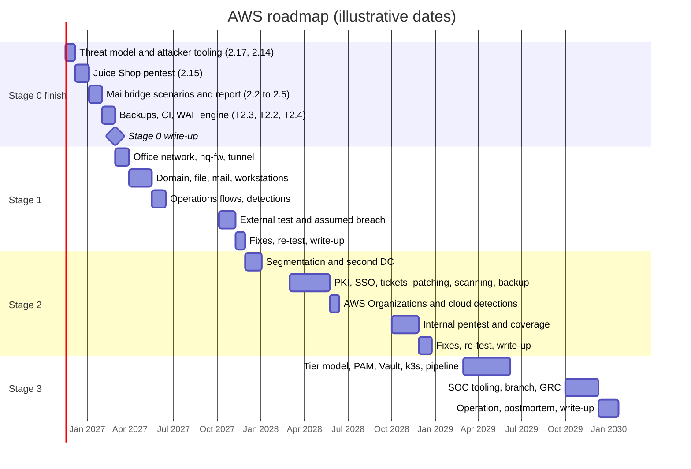

# AWS 04 · Roadmap and cost

> **Status: PROPOSED.** A phased roadmap for building the whole company on AWS, with entry and
> exit criteria per step, a mapping to the existing tasks in `docs/TASKS.md`, and cost estimates.

> **Assumptions**
>
> 1. **Dates in the chart are illustrative.** They assume about two sessions a week during
>    semesters and follow the semester plan in `shared/06-learning-path.md`. Move them freely;
>    the order and the gates matter, the dates don't.
> 2. **Every price is an estimate from memory for eu-central-1 and is marked (verify).** Only
>    Stage 0's numbers are measured (about $0.25 per hour for seven hosts; about $2.70 per month
>    idle). Re-measure after the first session of each stage, as was done on 2026-11-09.
> 3. Your AWS credit balance is unknown, so costs are given in dollars without assuming credits.
> 4. Step IDs (`S1-A04`) are labels for this roadmap. They aren't task numbers in `TASKS.md` and
>    not decision numbers; when a step is adopted, give it a real task number there.

---

## 1. The roadmap at a glance

| Bar | Who | Tool | Evidence | What can go wrong |
|---|---|---|---|---|
| Stage 0 finish | you, mostly in the red and purple roles | the existing Tier 2 tasks | `findings-report.md`, a restore-test record, a Stage 0 write-up | skipping the report to get to AD sooner. The gate forbids it |
| Stage 1 build | blue | Terraform, Packer, Ansible | each step's verify output | Windows on small burstable instances is slow; the golden AMI comes early for that reason |
| Stage 1 attack | red, a different session | the RoE | two reports | attacking the week after building, with every detail fresh |
| Stage 2 build | blue | the same | the same | the longest phase; cost between sessions starts to matter |
| Stage 2 attack | red | the RoE | the internal pentest report, the coverage layer | the layer-2 half is missing on AWS; say so in the report |
| Stage 3 | all roles | the same | the red team report, postmortem, controls map | too many tools at once. Section 6 lists what to drop first |

---

## 2. Gates

| Gate | Entry criteria | Exit criteria ("done") |
|---|---|---|
| **Stage 0 finish** | Tier 1 complete (met 2026-11-09) | every Tier 2 task in `TASKS.md` ticked with its verify output; `findings-report.md` complete; a database restore tested and recorded; a Stage 0 write-up |
| **Stage 1** | Stage 0 exit met; the Stage 1 design decided through your normal process (options, `decisions.md`, `rationale.md`, `ARCHITECTURE.md` updated) | deployed from code by one command; second Ansible run `changed=0` on every host; every flow in the Stage 1 table verified, including one forbidden flow logged as dropped; each operations flow run twice with tickets; both engagement reports written; every `W1-` weakness fixed and re-tested (or recorded as not exploitable on AWS); coverage matrix updated; write-up done |
| **Stage 2** | Stage 1 exit met; decision on stopping Windows hosts between sessions (D5) | as Stage 1, plus: segmentation test matches the flows table; three patch cycles and three vulnerability cycles recorded; one access review recorded; backup restored from the second copy; internal pentest report with before-and-after paths; Atomic Red Team coverage recorded; write-up done |
| **Stage 3** | Stage 2 exit met | as Stage 2, plus: no `t0-` logon outside Tier 0 in the logs; admin ports reachable only through `pam01`; the product runs on k3s with signed images; one SOAR playbook proven; IR plan rehearsed by a tabletop; controls map with evidence links; red team report with MTTD and MTTR, and its postmortem; write-up done |

"Done" keeps the meaning in `CLAUDE.md`: deploys from code, verified with stated commands, and
documented.

---

## 3. Steps

Each step is one role, module or rule set. "Maps to" names the existing task in `TASKS.md`, or
"new" where none exists.

### 3.1 Stage 0 finish

| ID | Step | Entry | Exit (verify) | Maps to |
|---|---|---|---|---|
| `S0-A01` | Threat model, written from the built lab | Tier 1 write-up | covers assets, trust boundaries, the four attacker positions; every threat names the layer expected to stop or detect it | 2.17 |
| `S0-A02` | Attacker certificate, scope file and wrapper, browser profile; GuardDuty on | `S0-A01` | the attacker profile gets 10.8.0.x; the wrapper refuses 10.0.0.2, a public address and the wrong site name; Grafana times out from the user pool; the trial's end date is in `progress.md` | 2.14 |
| `S0-A03` | Juice Shop pentest | `S0-A02` | one findings entry per finding with the per-layer result | 2.15 |
| `S0-A04` | Stolen VPN certificate scenario | `S0-A03` | reachability, visibility and time to revoke recorded; direct queries to the VPC resolver tested | 2.2 |
| `S0-A05` | Malicious e-mail scenario | `S0-A04` | sanitising and content security policy tested and recorded | 2.3 |
| `S0-A06` | Access-control scenario | `S0-A05` | user A can't read user B's mailbox by changing identifiers, or the finding is recorded | 2.4 |
| `S0-A07` | **PROPOSED:** cloud part: posture audit; metadata and role tests from `vuln`; credentials used from outside | `S0-A03` | the five steps in `03-attack-ranges.md` section 3.1 recorded, including the managed finding and its delay | new |
| `S0-A08` | Findings report complete | `S0-A04`–`S0-A07` | every scenario has attack, detection or miss, fix, re-test; TCP 443 confirmed closed | 2.5 |
| `S0-A09` | Backups: S3 gateway endpoint, separate `data` route table, nightly `pg_dump`, tested restore | `S0-A08` | a restore into a scratch host, timed, with a record | T2.3 |
| `S0-A10` | Application CI with OIDC to AWS | `S0-A08` | the pipeline builds, scans and pushes by digest with no stored key | T2.2 |
| `S0-A11` | WAF engine and current CRS | `S0-A08` | the missing fixes are closed; the test harness still passes, including must-block cases | T2.4 |
| `S0-A12` | Stage 0 write-up | all above | reviewed and merged | new (the Tier 2 write-up) |
| — | Production certificates | whenever you decide | `curl` without `-k` succeeds | 2.6 |

### 3.2 Stage 1

| ID | Step | Entry | Exit (verify) | Maps to |
|---|---|---|---|---|
| `S1-A01` | Decisions and docs: office VPC, tunnel, directory, weaknesses | Stage 0 exit | lines in `decisions.md`, sections in `rationale.md`, `ARCHITECTURE.md` and `TASKS.md` updated in the same commit | new |
| `S1-A02` | `terraform/hq`: VPC, five subnets, route tables with the more-specific routes, internet gateway, standalone `hq-fw` interface, flow logs | `S1-A01` | plan shows no NAT Gateway, ALB or endpoint; `describe-route-tables` shows the routes | new |
| `S1-A03` | Office security groups and coarse NACLs | `S1-A02` | checkov passes; line-by-line review against the flows table | new |
| `S1-A04` | `hq-fw` host and role, part 1: forwarding and NAT | `S1-A03` | a private test host in the office VPC is `Online` in SSM | new |
| `S1-A05` | Tunnel: keys as write-only parameters; `wg0` on both firewalls; prod route to 10.20.0.0/16 | `S1-A04` | `wg show` handshake under two minutes; ping between tunnel addresses | new |
| `S1-A06` | nftables: `hq-fw` policy for the Stage 1 flows; forward rules for `wg0` on `fw-ips` (written by Claude, reviewed by you, per `CLAUDE.md`) | `S1-A05` | `nft list ruleset`; an allowed and a forbidden flow tested, the second logged | new |
| `S1-A07` | Suricata on `hq-fw` | `S1-A06` | `suricata -T`; flows in `eve.json`; the realistic TLS captures stay silent | new |
| `S1-A08` | `siem` and `mon` accept the office: security group, mgmt NACL, nftables, scrape rules | `S1-A06` | a test agent from 10.20.0.0/16 enrols; a test target is `up` | new |
| `S1-A09` | Packer: golden Windows Server image | `S1-A04` | an instance from it joins SSM in minutes; build is repeatable | new |
| `S1-A10` | `dc01`: by hand first, then the `dc` role; DHCP options set | `S1-A09` | `dcdiag` passes; rebuild from code; second run `changed=0` | new |
| `S1-A11` | Directory objects as code: OUs, groups, personas, service accounts, audit policy and baseline GPOs | `S1-A10` | no user sits directly in an `ACL-` or `APP-` group; `auditpol` shows the policy on a member | new |
| `S1-A12` | Windows baseline: Wazuh agent, Sysmon, exporter | `S1-A11` | agent `Active`; a failed logon and a process creation appear in the dashboard; target `up` | new |
| `S1-A13` | `fs01`: shares, ACLs, file auditing; toggles for `W1-01`, `W1-05` | `S1-A12` | `l.voss` reads Finance, `t.rhee` is refused and the refusal is logged | new |
| `S1-A14` | `mail01`: Postfix, Dovecot, Rspamd, webmail, LDAPS sign-in | `S1-A12` | mail between two personas; a disabled user can't sign in | new |
| `S1-A15` | Workstations: domain join, LAPS; toggle for `W1-04` | `S1-A12` | helpdesk reads a LAPS password, a normal user is refused | new |
| `S1-A16` | Staff VPN pool with AD credentials and a one-time code | `S1-A14` | a staff profile gets 10.8.2.x and reaches webmail; the wrong code is refused | new |
| `S1-A17` | Tool roles from AD groups: Wazuh, Grafana | `S1-A11` | `p.lindqvist` reads and can't change; the local break-glass login still works and raises an alert | new |
| `S1-A18` | Windows detections with tests; L1 runbooks | `S1-A12` | each rule fires on its sample and stays silent on normal use; one runbook per rule at level 8+ | new |
| `S1-A19` | Operations, first run: joiner, mover, leaver, password reset, patch cycle (image rebuild), backup and restore | `S1-A13`–`S1-A16` | a ticket and evidence per flow | new |
| `S1-A20` | Stage 1 threat model and RoE; weaknesses on | `S1-A19` | blue's expectations written per step | new |
| `S1-A21` | External test | `S1-A20` | report; flow logs agree with the scan | new |
| `S1-A22` | Phishing and assumed breach (`hq-red`, `kali-int`, `phish01`) | `S1-A21` | report with the attack path; operation log | new |
| `S1-A23` | Fixes, re-test, coverage matrix | `S1-A22` | every `W1-` off and re-tested; matrix rows dated | new |
| `S1-A24` | Operations, second run; controls map started; Stage 1 write-up | `S1-A23` | write-up merged | T3.3 (starts) |

### 3.3 Stage 2

| ID | Step | Entry | Exit (verify) | Maps to |
|---|---|---|---|---|
| `S2-A01` | Decisions and docs, including stopping Windows hosts (D5) | Stage 1 exit | as `S1-A01` | new |
| `S2-A02` | New subnets, routes, groups, NACLs | `S2-A01` | plan reviewed; routes symmetric | new |
| `S2-A03` | `hq-fw` least-privilege rules (fixes `W1-02`); restricted RPC range | `S2-A02` | segmentation scan equals the flows table | new |
| `S2-A04` | `dc02` | `S2-A03` | `repadmin /replsummary` clean | new |
| `S2-A05` | `ops01` and the WinRM management plane | `S2-A03` | 5986 reachable from `ops01` only | new |
| `S2-A06` | `ca01`: enterprise CA, auto-enrolment, LDAPS certificates | `S2-A04` | members hold a certificate; LDAP on 389 without signing is refused | new |
| `S2-A07` | `kc01`: Keycloak, AD federation, second factor | `S2-A06` | sign-in with a correct password and no second factor fails | new |
| `S2-A08` | SSO for Grafana, the Wazuh dashboard and tickets | `S2-A07` | group claim maps to the right role; disabling a user ends access | new |
| `S2-A09` | `glpi01` | `S2-A07` | tickets move from Issues; helpdesk sees all, staff see their own | new |
| `S2-A10` | `wsus01` and rings | `S2-A04` | a ring-0 host patches first; compliance report | new |
| `S2-A11` | `gvm01` and the first scan cycle | `S2-A03` | authenticated scan report; tickets with deadlines | T3.2 |
| `S2-A12` | `bkp01`, bucket with versioning and object lock, restore from the second copy | `S2-A03` | a delete attempt from a domain account fails; restore recorded | new (extends T2.3) |
| `S2-A13` | `mx01` and the DMZ | `S2-A03` | outside mail reaches a mailbox only through `mx01` | new |
| `S2-A14` | Guest and IoT networks, `prn01` | `S2-A03` | the guest reaches no private address | new |
| `S2-A15` | `intra01` with `svc-intra` | `S2-A06` | the intranet works behind SSO | new |
| `S2-A16` | AWS Organizations, SCPs, log archive, Identity Center | `S2-A07` | an SCP denial in the log archive; sign-in through a permission set | new |
| `S2-A17` | CloudTrail and GuardDuty into Wazuh | `S2-A16` | a scratch IAM user raises an alert | new |
| `S2-A18` | Hardening by GPO, fine-grained password policies, LAPS delegation, honey account | `S2-A04` | CIS score before and after; touching the honey account alerts | new |
| `S2-A19` | Processes: approver role, three patch and vulnerability cycles, access review | `S2-A09`–`S2-A12` | records for each | new |
| `S2-A20` | Threat model and RoE; `W2-` set on | `S2-A19` | expectations written | new |
| `S2-A21` | Internal pentest | `S2-A20` | report with paths | new |
| `S2-A22` | Atomic Red Team coverage; fixes; re-test | `S2-A21` | Navigator layer; paths gone | new |
| `S2-A23` | One Traffic Mirroring session | `S2-A21` | comparison: sensor vs `hq-fw` | new |
| `S2-A24` | Stage 2 write-up | `S2-A22` | merged | new |

### 3.4 Stage 3

| ID | Step | Entry | Exit (verify) | Maps to |
|---|---|---|---|---|
| `S3-A01` | Decisions and docs | Stage 2 exit | as before | new |
| `S3-A02` | Tier model: OUs, `t0-`/`t1-`/`t2-` accounts, authentication policies; `hq-paw` and the PAWs | `S3-A01` | a `t0-` logon on `ws01` is refused and alerts | new |
| `S3-A03` | `pam01`; admin ports only from it | `S3-A02` | direct RDP refused; brokered session recorded | new |
| `S3-A04` | `vault01`; dynamic database credentials for Mailbridge | `S3-A01` | the application's database account changes per lease; audit log shows the read | new |
| `S3-A05` | k3s for the app tier; cluster hardening | `S3-A04` | the product works on k3s; kube-bench result; a privileged pod is refused | T3.1 |
| `S3-A06` | Pipeline: SBOM, signing, verification at deploy | `S3-A05` | an unsigned image is refused | new (extends T2.2) |
| `S3-A07` | `thehive01`, `shuffle01`, one playbook | `S3-A01` | a level-12 alert opens a case and runs the playbook | new |
| `S3-A08` | `misp01`, `velo01` | `S3-A07` | an indicator from MISP alerts in Suricata; a hunt runs on all clients | new |
| `S3-A09` | Detection as code: Sigma in CI | `S3-A07` | a rule that stops matching its sample fails the build | new |
| `S3-A10` | Branch VPC, `br-fw`, IPsec | `S3-A01` | tunnel up; drops logged | new |
| `S3-A11` | `dc03` (read-only), AD site, `ws-br01` | `S3-A10` | `repadmin /showrepl dc03` clean; branch logon works with the tunnel up | new |
| `S3-A12` | Sandbox account and the cloud attack range | `S2-A16` | scenarios A–D run; sandbox destroyed and empty | new |
| `S3-A13` | Risk register, six policies, ISO 27001 and NIS2 controls map, GDPR documents | `S3-A01` | each control links to evidence in the repo | T3.3 |
| `S3-A14` | IR plan and a tabletop | `S3-A07` | tabletop record with changes to the plan | new |
| `S3-A15` | Red team operation (manual techniques on AWS; with C2 on Proxmox) | `S3-A02`–`S3-A11` | operation log; goal reached or not | new |
| `S3-A16` | Postmortem, MTTD and MTTR, fixes, re-test | `S3-A15` | postmortem; coverage matrix | new |
| `S3-A17` | Stage 3 write-up | `S3-A16` | merged | new |

`radius01` (802.1X) has no AWS step: the platform has no ports to authenticate.

---

## 4. Cost

### 4.1 Per stage, everything running

| Stage | Hosts added | Added per hour (verify) | All hosts per hour | A 5-hour session |
|---|---|---|---|---|
| 0 | seven hosts | — | **$0.25 (measured)** | **about $1.35 (measured)** |
| 1 | `hq-fw` + address $0.03 · `dc01`, `fs01` $0.13 · `mail01` $0.02–0.05 · `ws01`, `ws02` $0.13 · `ws03` $0.05 · `kali-int` $0.05 · `phish01` $0.01 | about $0.43 | **about $0.70** | about $3.50 |
| 2 | `dc02`, `ca01` $0.11 · `wsus01` $0.12 · `kc01`, `glpi01`, `ops01`, `bkp01` $0.10 · `intra01` $0.07 · `gvm01` $0.10 · `mx01`, `prn01`, guest $0.04 · `ws04`, `ws05` $0.13 | about $0.67 | **about $1.35** | about $7 |
| 3 | PAWs $0.13 · `pam01`, `vault01` $0.07 · `thehive01`, `shuffle01` $0.15–0.19 · `misp01`, `velo01` $0.07 · k3s $0.07–0.15 · branch $0.16 | about $0.70 | **about $2.10** | about $10.50 |

Likely extra from Stage 2: `siem` will need more memory as agents multiply (the next size up is
roughly double its hourly price; verify by measuring, as was done for decision 99).

### 4.2 You never run everything: profiles

| Profile | Hosts | Approx. per hour |
|---|---|---|
| `stage0` | the seven built hosts | $0.25 |
| `ad-build` | `fw-ips`, `hq-fw`, `siem`, `dc01`, one member | $0.31 |
| `stage1-ops` | Stage 0's `fw-ips`, `siem`, `mon`, plus all office hosts without `hq-red` | $0.55 |
| `stage1-attack` | `stage1-ops` plus `kali-int`, `phish01` | $0.61 |
| `ad-attack` (Stage 2) | firewalls, `siem`, both DCs, `ca01`, `fs01`, `intra01`, two workstations, `kali-int` | $0.75 |
| `soc-stack` (Stage 3) | firewalls, `siem`, `mon`, `thehive01`, `shuffle01`, `velo01`, one DC, two workstations | $0.80 |

Build profiles as Terraform variables beside `hosts_enabled` and `vuln_enabled`.

### 4.3 Between sessions

| Stage | What stays | Approx. per month (verify) |
|---|---|---|
| 0 | two data volumes, ECR, CloudTrail's bucket | **$2.70 (measured)** |
| 1, hosts destroyed (option A) | plus golden image snapshots | about $5–7 |
| 2, **only DCs and the CA stopped** | plus three or four Windows disks of 30–40 GB | about $15–20 |
| 2, all Windows hosts stopped | ten disks | about $40–45 |
| 3, only Tier 0 stopped | — | about $20–25 |
| 3, all Windows hosts stopped | fourteen disks | about $55–60 |

**Recommendation:** stop only the hosts whose state is the lesson (domain controllers, the CA,
the patch server). Rebuild members from the golden image and re-join them from code.

### 4.4 A year, roughly

Assuming two 4-hour sessions a week for 40 weeks (320 hours), using typical profiles rather
than everything:

| Stage | Compute | Idle storage | Extras | **About, per year** |
|---|---|---|---|---|
| 0 | 320 h × $0.25 = $80 | $32 | GuardDuty after the trial: a few dollars | **$115** |
| 1 | 320 h × $0.55 = $176 | $70 | — | **$250** |
| 2 | 320 h × $0.80 = $256 | $200–500 | one month of Config and Security Hub; one mirroring session | **$500–800** |
| 3 | 320 h × $1.00 = $320 | $250–700 | customer-managed keys; the sandbox | **$600–1,050** |

These are order-of-magnitude figures to compare with the one-time hardware cost in
`proxmox/04-roadmap-and-cost.md`. **The crossover is around Stage 2:** before it AWS is clearly
cheaper; after it a home server pays for itself within a year or two.

### 4.5 Budgets

The two budgets in code (decision 144) are sized for Stage 0. **PROPOSED:** raise the monthly
budget per stage when the stage starts, as an explicit decision, for example $30 at Stage 1,
$60 at Stage 2, $90 at Stage 3, and keep the forecast alert, which warns before the money is
spent. A separate small budget on the sandbox account.

---

## 5. The guardrails: keep or bend

| Guardrail | Verdict | Reasoning |
|---|---|---|
| No NAT Gateway | **keep at every stage** | each site's firewall instance does NAT, which is also the teaching point |
| No load balancer | **keep** | `proxy` remains the entry to the product, including when it moves to k3s |
| No interface endpoints | **keep** | the only case for them is a segment with no internet path that you can still manage (for C2 or malware). That work belongs on Proxmox; paying hourly for endpoints to do it worse on AWS isn't justified |
| t3 with `standard` credits | **keep; one tolerated exception** | golden images remove most of the pain. If domain controller promotion still times out, `unlimited` on that one instance for that one session costs cents (surplus credits are billed per vCPU-hour, verify). Record it as a decision if you do |
| Destroy every host after each session | **bend from Stage 2 (D5)** | a domain's state is the subject matter. Limit the bending to the hosts that need it |
| No Transit Gateway, no managed VPN | **keep** | self-managed tunnels teach more and cost nothing extra |
| No managed directory | **keep** | section 1 of `02-platform-specifics.md` |
| Single availability zone | **keep** | multi-AZ doubles hosts to teach one concept you can explain on paper |
| Budget alarms | **raise deliberately per stage** | section 4.5 |

---

## 6. If time or money runs short: what to drop first

| Drop | Keep instead |
|---|---|
| `wsus01` | patch by image rebuild and Windows Update by GPO; explain rings on paper |
| `glpi01` | GitHub Issues |
| `mx01`, guest and IoT networks | one extra subnet to prove the segmentation idea |
| `shuffle01`, `misp01` | `thehive01` or plain tickets; indicators as a text list |
| the branch | explain read-only DCs and sites from the diagram |
| a third and later workstation | two are enough for lateral movement |
| **Never drop** | the second DC, `ca01`, `kc01`, `bkp01`, the tier model, and the write-ups |

---

## 7. Risks of the AWS route

| Risk | Effect | Mitigation |
|---|---|---|
| Idle storage creeps up | a monthly bill with no sessions | stop only what must persist; the forecast alert |
| A session left running | a day of everything costs $30–50 at Stage 3 | `make down` as the last step, already checked for zero instances; a Prometheus alert on uptime over a limit |
| Windows build times | sessions spent waiting | golden images; build profiles |
| The layer-2 gap | the internal pentest is incomplete | state it in every report; cover it on Proxmox |
| C2 not permitted | Stage 3's operation is weakened | Proxmox for that operation |
| Drift on stopped hosts | the code no longer describes them | the drift check at every session start |
| Policy change by AWS | an engagement plan becomes non-compliant | the RoE's "policy read on" line |
