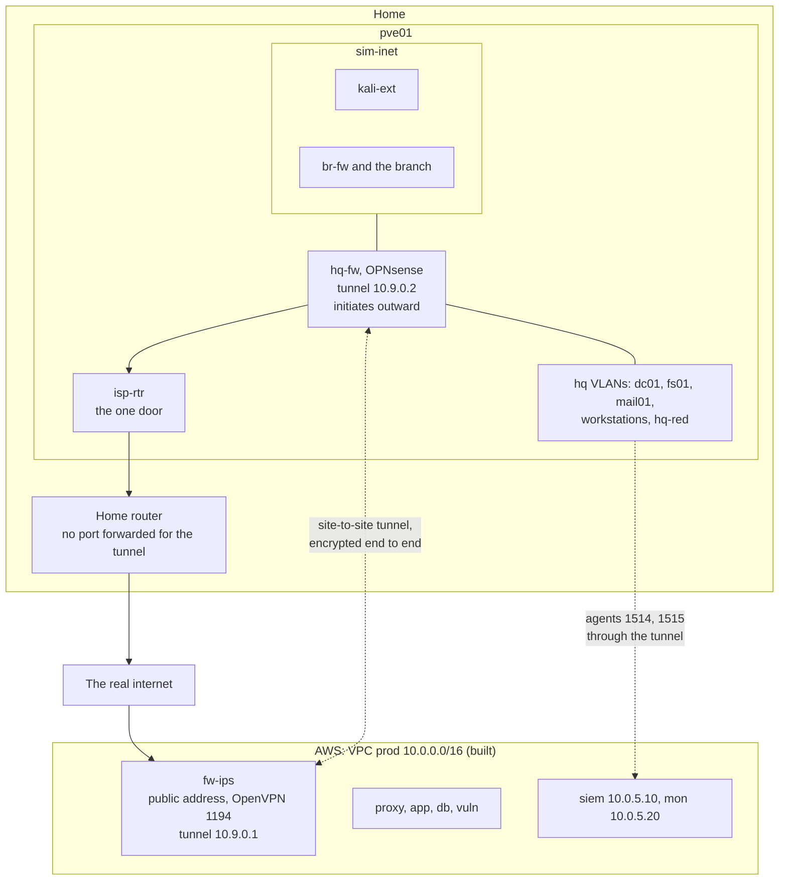
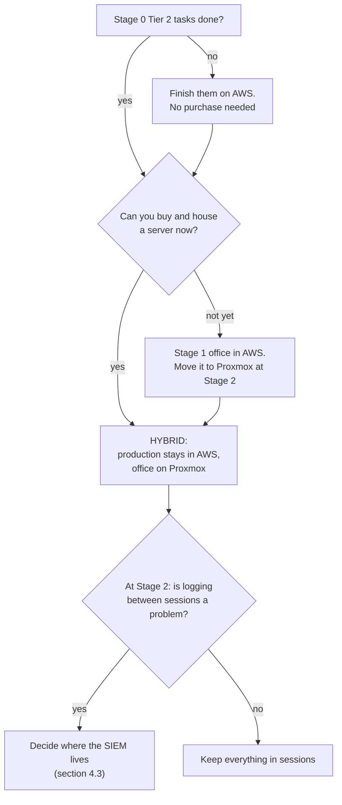

# Comparison: AWS, Proxmox, or both

> **Status: PROPOSED.** A side-by-side comparison of the two platform versions, a hybrid design
> that joins them, and a recommendation of what to build first. Details are in `aws/` and
> `proxmox/`; names and addresses are in `shared/00-naming-and-addressing.md`.

> **Assumptions**
>
> 1. Costs are the estimates from `aws/04-roadmap-and-cost.md` and
>    `proxmox/04-roadmap-and-cost.md`, with the same caveat: only Stage 0's AWS numbers are
>    measured; everything else is marked (verify).
> 2. Your hardware budget, home network (including whether your public address is stable) and
>    AWS credit balance are unknown. The recommendation says where each would change it.
> 3. "Job relevance" is the author's judgment of entry-level roles in Europe.

---

## 1. The recommendation in five lines

1. **Now:** finish Stage 0 on AWS (the Tier 2 tasks). It needs no purchase and it's the gate for
   everything else.
2. **Then:** build the **hybrid**. Production stays in AWS exactly as built; the office (Stage 1
   onwards) is built on a home Proxmox server; a site-to-site tunnel joins them.
3. **Hardware:** a used workstation with 128 GB of memory, bought once, sized for Stage 2.
4. **If you can't buy hardware yet:** build Stage 1's office in AWS (about $250 for the year),
   and move it to Proxmox at Stage 2. Identical names and addresses make that move a change of
   Terraform provider, not a redesign.
5. **Don't** build the Proxmox-only version first, and don't stay AWS-only past Stage 1.

The reasons are in sections 2 to 5.

---

## 2. Side by side

| Criterion | AWS only | Proxmox only | Hybrid |
|---|---|---|---|
| **Up-front cost** | none | €650–1,400 (used) or €1,150–2,100 (new) | the same as Proxmox |
| **Running cost** | about $250 → $500–800 → $600–1,050 per year across Stages 1–3 | a few euros of power a month if switched off between sessions | AWS at roughly Stage 0's level (about $115 a year) plus the power |
| **Three-year total** | about $1,350–2,100 | about €750–1,550 (used hardware) | about €750–1,550 plus about $350 |
| **Cost when idle** | grows with stopped Windows disks | zero when powered off | small |
| **Layer-2 realism** | none: no broadcast, ARP, DHCP or VLANs | full; with a switch, port-level too | full, in the office where it matters |
| **Cloud realism** | full | none | full |
| **Windows clients** | Windows Server standing in for clients | real client evaluation media | real client evaluation media |
| **Long-lived hosts** (patching, state, drift) | only if you pay for stopped disks | natural | natural in the office |
| **C2 and malware work** | restricted by policy; no truly offline segment | fully possible, under your own isolation | on the Proxmox side |
| **Forensics** | in-guest only | memory and disk snapshots from outside the guest | on the Proxmox side |
| **Managed detection** (GuardDuty, CloudTrail) | yes | no | yes, for production |
| **What it teaches best** | IAM, cloud network design, guardrails, cost discipline, infrastructure as code against an API | networking from the cable up, hypervisors, firewalls as products, backups, hardware limits | both, plus the thing neither has alone: **joining two sites with different trust** |
| **Job relevance** | cloud security, DevSecOps, platform engineering | internal pentesting, SOC and DFIR, sysadmin, network security | the widest |
| **Effort to reach Stage 1** | low: extend what exists | **high**: port the production stack first (about two months) | medium: build the platform, then the office; production untouched |
| **Operational effort** | low: no hardware | hardware, power, backups, evaluation timers | the same as Proxmox |
| **Main risk** | cost creep; a session left running; the layer-2 gap in every report | **your home network**; one machine holds everything | both sets, each smaller; plus the tunnel |
| **Works when you travel** | yes | only with remote access prepared | production yes; the office only with remote access |
| **Proves "rebuild from code"** | every session | only when you schedule it | every session for production; scheduled for the office |
| **Existing work reused** | all of it | reused after porting | **all of it, unchanged** |

---

## 3. What each platform can teach

| Topic | AWS | Proxmox | Note |
|---|---|---|---|
| Web and API pentest | ✔ | ✔ | same either way |
| WAF and IPS tuning | ✔ | ✔ | |
| IAM, SCPs, multi-account design | ✔ | ✘ | AWS only |
| Cloud attack paths (role passing, metadata theft, storage) | ✔ | ✘ | AWS only |
| CloudTrail and managed detections | ✔ | ✘ | AWS only |
| AD administration | ✔ | ✔ | better on long-lived hosts |
| AD attacks over routed protocols (Kerberoasting, AD CS, ACL paths, DCSync) | ✔ | ✔ | |
| Poisoning, relay by poisoning, ARP and DHCP attacks | ✘ | ✔ | Proxmox only |
| VLANs, trunks, 802.1X, wireless | ✘ | ✔ | Proxmox, partly needing a switch |
| Seeing traffic inside a network segment | paid mirroring | a bridge setting | |
| Monthly patching with rings | awkward | ✔ | needs hosts that live |
| Backup isolation and restore drills | ✔ (S3 with object lock) | ✔ (backup server, offline disk) | both valuable, different lessons |
| C2 operations and OPSEC | ✘ without approval | ✔ | Proxmox |
| Malware analysis | ✘ | ✔ | Proxmox |
| Memory forensics | in-guest | from the hypervisor | Proxmox is closer to real response |
| Tier model and PAM | ✔ | ✔ | on Proxmox the hypervisor itself becomes a Tier 0 lesson |
| Kubernetes security | ✔ | ✔ | |
| Site-to-site VPN | between two VPCs | between simulated sites | **hybrid: across the real internet** |
| Cost engineering | ✔ | hardware sizing instead | |
| GRC documents | ✔ | ✔ | platform-independent |

**The concept behind the table.** The two platforms aren't better and worse versions of one
thing. A cloud hides the wire and gives you an audited control plane. A hypervisor gives you
the wire and no control plane to speak of. A security career needs both views, and real
companies have both: production in a cloud, people in an office.

---

## 4. The hybrid design

### 4.1 Shape

| Site | Where | What | State |
|---|---|---|---|
| `prod` 10.0.0.0/16 | AWS | exactly the Stage 0 lab: `fw-ips`, `proxy`, `app`, `db`, `siem`, `mon`, `vuln` | **built** |
| `hq` 10.20.0.0/16 | Proxmox | the office from Stage 1 | PROPOSED |
| `branch` 10.30.0.0/16 | Proxmox | Stage 3 | PROPOSED |
| `sim-inet` 198.51.100.0/24 | Proxmox | the simulated internet for the external test, the redirector and the branch link | PROPOSED |
| The production copy on Proxmox | — | **not built** | this is what the hybrid saves |

| Boundary or hop | Who controls it | Enforced by | Evidence | What can go wrong |
|---|---|---|---|---|
| Office → home router → internet | you | `isp-rtr`: one extra allow rule, for the tunnel's destination and port only | `isp-rtr` counters | the rule written as "allow UDP out", which opens every UDP port to the internet |
| Internet → `fw-ips` | you | the security group of `fw-ips`: the tunnel port, from your home's public address if it's stable | flow logs | a home address that changes: the rule breaks, or gets widened to everyone |
| The tunnel | you | keys in the secret stores on both sides; allowed networks listed exactly | handshake time; a probe from `mon` to `dc01` | each side accepting the other's whole address space instead of the listed networks |
| Office → `siem` | SOC engineer | `hq-fw`, the tunnel, nftables on `fw-ips`, the `siem` security group, the mgmt NACL | agents `Active` | **the SIEM exists only while the AWS lab is up.** Section 4.3 |
| `prod` → office | you | nftables on `fw-ips`: only `mon`'s probes, the tools' LDAPS, and the conditional DNS forwarder | drops | treating the tunnel as trusted: a compromised `vuln` must still reach nothing in the office (its subnet already has no such route, decision 131) |
| Home LAN | — | `isp-rtr`'s isolation rule, unchanged | drops | the tunnel must never become a path between AWS and your home devices. It terminates on `hq-fw`, behind `isp-rtr`, and that's why |

### 4.2 The tunnel: options

The office is behind your home router, so **the office dials out**. No port is forwarded at
home.

| Option | How | New exposure on AWS | For | Against |
|---|---|---|---|---|
| **A. WireGuard, `hq-fw` initiates (recommended if your home address is stable)** | UDP 51820 to the public address of `fw-ips` | one UDP port, from one address | the same tunnel as in the AWS-only and Proxmox-only versions; simple | a changing home address breaks the source rule |
| **B. `hq-fw` as an OpenVPN client of `fw-ips` (recommended if it isn't)** | a "site" certificate from the existing offline CA; the office networks routed through that client | **none**: it uses the existing port 1194 | keeps "one way in" literally true; revocation by the existing CRL; no dependence on your home address | OpenVPN site routing is fiddlier; one more certificate role to manage |
| C. IPsec with IKEv2 | UDP 500 and 4500, with NAT traversal | two UDP ports | the enterprise standard | most to configure; save it for the branch link, where it's planned anyway |

**Differs from ARCHITECTURE:** option A adds one inbound rule to the security group of `fw-ips`
(UDP 51820 from `<home-public-ip>`). Option B adds none. Both add forward rules for the tunnel
interface on `fw-ips` and a route for 10.20.0.0/16 in the VPC's private route table. The home
address belongs in the gitignored variables file, never in the repository.

**The concept.** Whoever initiates decides which side needs an open port. Putting the open port
on the side with a stable address and a real firewall, and none on the home side, is the
difference between a site-to-site VPN and a hole in your home router.

### 4.3 The decision the hybrid forces: where does the SIEM live?

Production in AWS is torn down after every session. The office on Proxmox can run for days.
While AWS is down, office agents have nowhere to send events.

| Option | How | For | Against |
|---|---|---|---|
| **A. Everything runs in sessions (recommended for Stage 1)** | the office VMs are started and stopped with the AWS lab; `siem` stays at 10.0.5.10 as built | nothing changes in the built lab; one mental model | no logging outside sessions; long-running exercises (a week of patching, a slow attack) lose events |
| B. Move `siem` and `mon` to Proxmox | they become office hosts; AWS hosts ship logs to them through the tunnel | the SIEM is always on; AWS sessions get roughly half as expensive (those two hosts are about half of Stage 0's hourly cost); no persistent Wazuh volume to pay for | **their addresses change**, so this departs from `ARCHITECTURE.md` and from the address table; production's logging now depends on your home being up |
| C. A second, small collector on Proxmox that forwards when AWS is up | buffers office events | no events lost | a third moving part |

Decide this at Stage 2, when patch cycles and multi-day exercises make the gap real. It is also
a question real architects argue about (SIEM in the cloud or on premises), so the reasoning you
write will be useful twice.

### 4.4 Allowed flows across the tunnel

| # | Source | Destination | Port | Reason |
|---|---|---|---|---|
| H1 | `hq-fw`, as NATed by `isp-rtr` and your home router | `fw-ips` public address | UDP 51820 (option A) or UDP 1194 (option B) | the tunnel |
| H2 | all office and branch hosts | `siem` 10.0.5.10 | TCP 1514, 1515 | agents |
| H3 | `mon` 10.0.5.20 | office hosts | TCP 9100, 9182; probes on 443 and 53 | metrics and probes |
| H4 | `siem`, `mon` | `dc01`, `dc02`; later `kc01` | TCP 636; TCP 443 | tool sign-in with AD groups, later SSO |
| H5 | `dc01`, `dc02` ↔ Unbound 10.0.1.10 | each other | TCP/UDP 53 | conditional forwarders |
| H6 | staff VPN pool 10.8.2.0/24 | `mail01`, `fs01`, the DCs | as in the Stage 1 tables | remote staff reach the office through AWS |
| H7 | `fw-ips` | `dc01` | TCP 636 | VPN credential check |
| H8 | office users | `proxy` 10.0.2.10 | TCP 443 | staff use the product |
| — | `vuln`, `app`, `db`, `proxy` → office | — | — | **nothing.** Dropped and logged on `fw-ips` |
| — | office → `data`, `app` subnets | — | — | **nothing.** One hop at a time still holds |

Everything else in the office is the Proxmox Stage 1–3 flow tables unchanged. Everything else
in production is `ARCHITECTURE.md` §4 unchanged.

### 4.5 What the hybrid costs you

| Cost | Detail |
|---|---|
| A dependency on your home connection | if it's down, the office can't log or authenticate tools against AD from AWS |
| Latency across the tunnel | harmless for logs and sign-in |
| Data transfer | logs flowing into AWS are free; traffic from AWS to your home is billed per GB (verify), small at this scale |
| Two platforms to keep current | two Terraform providers, two inventories |
| An honest scope note | an attacker "in the office" who reaches production does so over a tunnel you built for a lab; say how a company's version would differ (redundant links, a managed service, monitoring) |

### 4.6 What the hybrid gives you that neither version has

- A **real** site-to-site VPN across the real internet, with NAT in the path.
- A realistic split of duties between a cloud edge and an office edge.
- The cross-over attack path that matters most in practice: **office compromise → cloud**
  (a workstation's user has an admin VPN profile, or a server holds cloud credentials) and
  **cloud compromise → office** (through the tunnel's allowed flows). Both are Stage 2 and 3
  engagement material.
- The comparison thesis topic from `shared/07-extra-ideas.md`: the same technique against both
  platforms, and what each let you detect.

---

## 5. Which to build first, and why

| Step | Who | Tool | Evidence | What can go wrong |
|---|---|---|---|---|
| Finish Stage 0 | you | the existing Tier 2 tasks | the findings report and write-up | buying hardware as a way of postponing the report |
| Decide on hardware | you | `proxmox/02-platform-specifics.md` section 1 | a decision with its rationale | buying for Stage 1 only (64 GB) and buying again a year later |
| Hybrid | you | `proxmox/04` without steps `S0-P09`–`S0-P14`; section 4 here | the tunnel up; office agents in the existing SIEM | skipping the isolation checks |
| Or: office in AWS first | you | `aws/04`, Stage 1 | the Stage 1 exit criteria, minus layer 2 | staying there out of habit past Stage 1 |
| SIEM placement | you | section 4.3 | a decision | drifting into option B without updating `ARCHITECTURE.md` |

### 5.1 Why the hybrid

1. **It reuses everything you built.** The verified Stage 0 lab stays as it is and stays in
   use. The Proxmox-only route spends about two months re-implementing it against different
   services before any new learning starts.
2. **Each platform does what it's good at.** Cloud production with IAM, CloudTrail and
   GuardDuty; an office with a real wire, real clients, hosts that live long enough to be
   patched, and segments that are truly offline for C2 and malware.
3. **It's what companies look like.** Almost every employer you'll interview with has
   production in a cloud and people in offices, joined by tunnels and identity. Being able to
   draw and defend that picture from experience is the point of the whole plan.
4. **It's the cheapest route from Stage 2 on.** AWS spending stays near Stage 0's level, and
   the hardware is bought once.
5. **It closes each platform's biggest gap with the other.** The AWS reports stop saying "layer
   2 not testable"; the Proxmox lab doesn't lose cloud skills.

### 5.2 Why not the others first

| Route | Why not first |
|---|---|
| Proxmox only | months of porting; the finished AWS lab goes idle; cloud security practice stops |
| AWS only, all stages | fine through Stage 1. From Stage 2: idle storage costs, no layer 2 for the internal pentest, no C2 for the red team operation, Windows Server instead of clients |

Both remain documented in full, because the Proxmox-only design is your fallback if you ever
want to leave AWS, and the AWS-only design is your fallback if you can't keep hardware at home.

### 5.3 What would change the recommendation

| If… | Then… |
|---|---|
| you have no budget or no place for a server for a year or more | AWS for Stage 1, and treat the layer-2 material as theory until you can |
| your AWS credits are large and expire unused otherwise | AWS for Stages 1 and 2; buy hardware for Stage 3's operation |
| you already own a suitable machine | start the Proxmox platform in parallel with the Stage 0 pentest |
| you aim squarely at cloud security | AWS for Stages 1–2 with the multi-account work brought forward; a small Proxmox host later for the layer-2 basics |
| you aim squarely at internal pentesting or DFIR | hardware first; AWS kept at Stage 0 |
| your home connection has no stable address and no inbound path | tunnel option B, which needs neither |

---

## 6. Moving between versions

The same names, addresses, groups and roles on every platform exist to make these moves cheap.

| Move | What changes | What doesn't |
|---|---|---|
| Office from AWS to Proxmox | the Terraform provider and stacks; `hq-fw`'s software (nftables → OPNsense, or keep nftables); DHCP moves to `dc01`; Windows Server stand-ins become client media; the secret store for office hosts | host names, addresses, AD design, groups, flows tables, Ansible roles for the guests, detections, runbooks |
| Production from AWS to Proxmox | every row of `proxmox/02-platform-specifics.md` section 3 | addresses, application roles, detections |
| The domain itself | **rebuild it from code rather than migrating it.** Directory objects are code; a rebuilt domain is also the proof the code is complete | — |

---

## 7. Decisions this file asks you to make

| # | Decision | Options | Recommendation |
|---|---|---|---|
| 1 | Platform route | AWS only · Proxmox only · hybrid | hybrid |
| 2 | Hardware, and when | section 1 of `proxmox/02-platform-specifics.md` | a used workstation with 128 GB, before Stage 1 |
| 3 | Tunnel in the hybrid | WireGuard · OpenVPN site client · IPsec | by whether your home address is stable |
| 4 | Where the SIEM lives | in AWS in sessions · on Proxmox always on · a forwarding collector | in AWS for Stage 1; decide again at Stage 2 |
| 5 | Stage 0's Tier 2 tasks | on the AWS lab · on a Proxmox copy | on the AWS lab, now |
| 6 | Whether to ever build the production copy | yes · no | no, unless you want to leave AWS |
| 7 | Where the Stage 3 operation with C2 runs | Proxmox · AWS with approval | Proxmox |

Each becomes a line in `decisions.md` and a section in `rationale.md` through your usual
process. Nothing here is decided until then.
