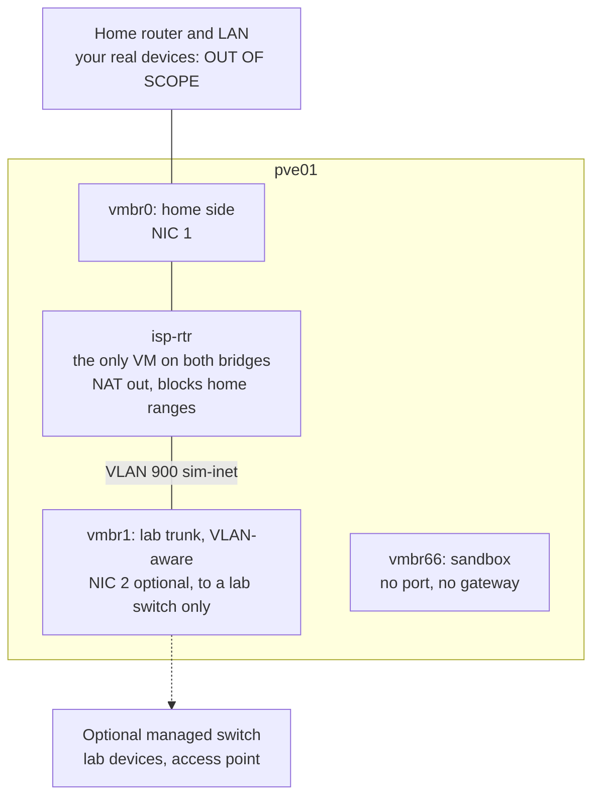
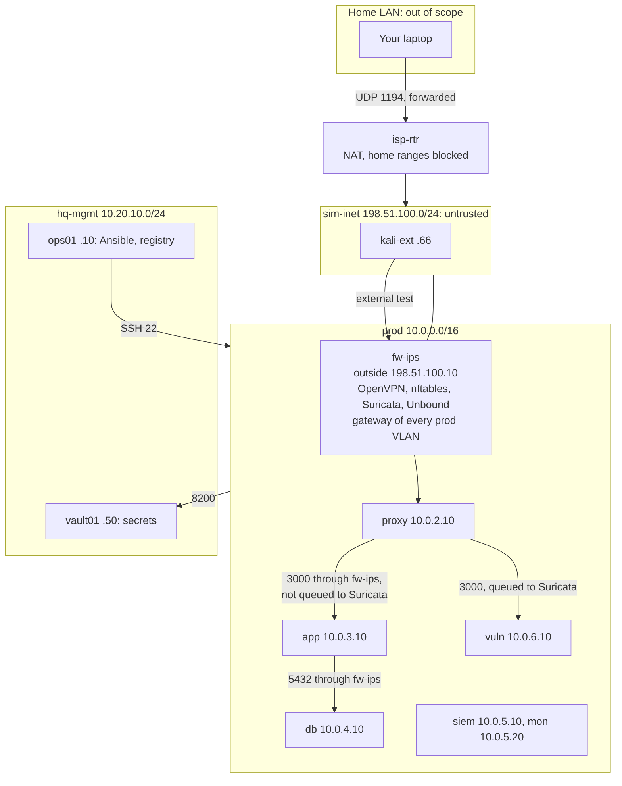
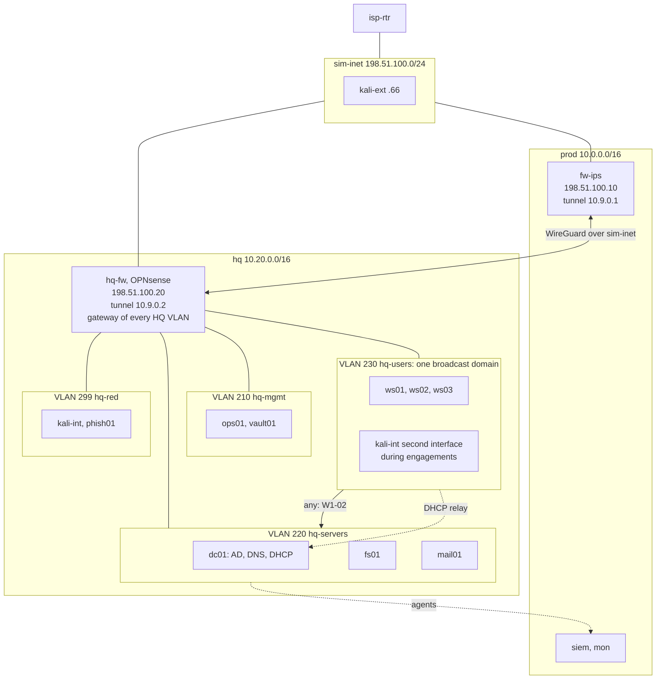
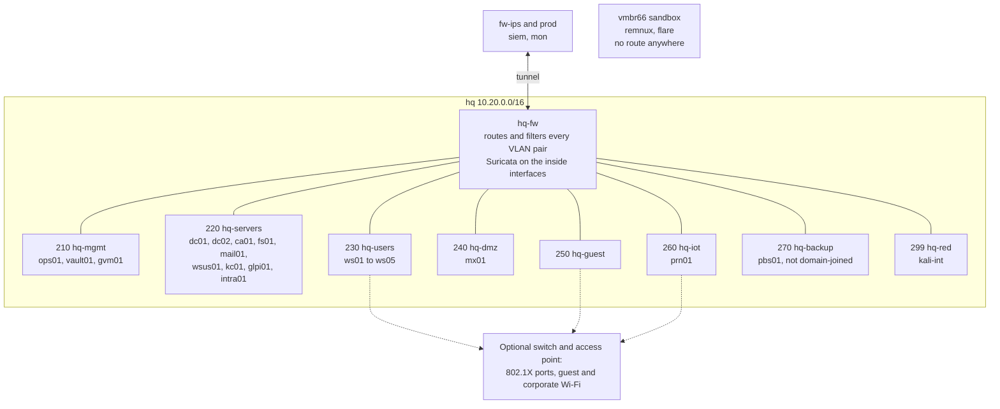
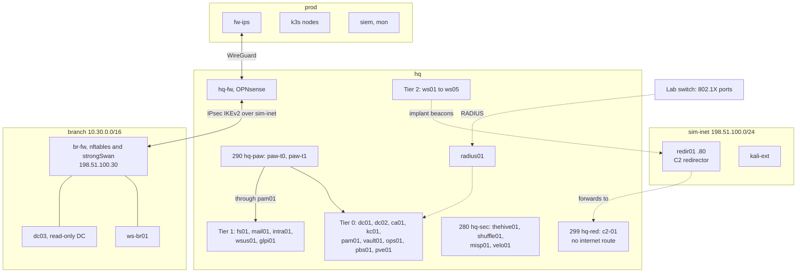

# Proxmox 01 · Architecture per stage

> **Status: PROPOSED.** This is the Proxmox-only version: the whole company, including a copy of
> the Mailbridge stack, lives on one home server, `pve01`. Nothing in this file exists yet.
> Names, addresses and VLAN IDs come from `shared/00-naming-and-addressing.md`.

> **Assumptions**
>
> 1. One physical server with at least two network ports. Sizing is in `02-platform-specifics.md`.
> 2. Your home network is an ordinary router with a private range. Its details are unknown, so
>    it appears as `<home-lan>`, and the server's address on it as `<pve-home-ip>`.
> 3. You are usually at home when you work on the lab. Remote access from elsewhere is optional
>    and discussed in section 2.4.
> 4. The copy of the Mailbridge stack reuses 10.0.0.0/16 (section 2.2).
> 5. Product behaviour (OPNsense, Proxmox firewall, bridges) is from memory (verify).

---

## 1. Where this differs from ARCHITECTURE.md

`ARCHITECTURE.md` describes the AWS lab. A copy on Proxmox can't be identical, because the AWS
services it relies on don't exist here. Each difference is listed once and explained where it
occurs.

| # | Differs from ARCHITECTURE | Why |
|---|---|---|
| P1 | Security groups and NACLs don't exist. Their job is done by the **Proxmox firewall's security groups** on each virtual NIC, and by a **host firewall** on each VM | to keep three independent filtering layers: per-interface, per-host, and the routing firewall |
| P2 | `fw-ips` has **two interfaces**: an outside one on `sim-inet` and an inside trunk where it is the gateway of every `prod` VLAN. On AWS it has one interface (decision 25) | there is no VPC router; something must route between VLANs |
| P3 | `proxy` → `app` → `db` now **crosses `fw-ips`**. On AWS that path uses the local route and never reaches Suricata (decision 68) | inter-VLAN traffic has to pass the router. The ruleset must exclude this path from Suricata's queue, so mail content still stays out of the IPS logs |
| P4 | SSM doesn't exist. Ansible connects by **SSH from `ops01`**, and port 22 (and 5986 for Windows) is open **from `ops01` only** | on AWS port 22 is never open to any network (decision 36). Here a management host replaces the managed service |
| P5 | SSM Parameter Store is replaced by **`vault01`**; ECR by a registry on **`ops01`**; instance roles by per-host identities in Vault | section 4 of `02-platform-specifics.md` |
| P6 | Hosts are **long-lived**. There is no per-session teardown; snapshots and "reset the range" replace it | the hardware is already paid for, and long-lived hosts are what make patching and state real |
| P7 | A **simulated internet**, `sim-inet`, and its router `isp-rtr` | to give sites something to be separated by, and the external test a starting point |
| P8 | CloudTrail, VPC flow logs, GuardDuty, Route 53 and budgets have no direct equivalent | replacements and gaps are listed in `02-platform-specifics.md` section 4 |

---

## 2. Design choices that shape every stage

### 2.1 Bridges, VLANs and the one door to your home

| Element | Who | Tool | Evidence | What can go wrong |
|---|---|---|---|---|
| `vmbr0`, home side | you | a Linux bridge on NIC 1 | only two things attached: the host's management address and `isp-rtr`'s outside interface | attaching any other VM to it "for a quick download" puts a lab machine on your home LAN |
| `isp-rtr` | you | Debian with nftables: masquerade outward; **drop every packet from the lab to private address ranges on the home side**; nothing inbound | drop counters; a ping from a lab VM to your home router's neighbours fails | forgetting that your home LAN is a private range the lab also uses internally: the rule must match the *interface*, not just the address |
| `vmbr1`, lab trunk | you | a VLAN-aware Linux bridge; each VM's NIC carries one VLAN tag, firewalls carry a trunk | `bridge vlan show` | a VM NIC with **no tag** on a VLAN-aware bridge can see every VLAN. That is the virtual version of a misconfigured trunk port, and a weakness you can stage on purpose |
| NIC 2 | you | optional uplink to a **lab-only** switch | the switch's VLAN table | plugging NIC 2 into the home router: the lab's VLANs are now on your home network |
| `vmbr66`, sandbox | you | a bridge with no physical port and no address on the host | `remnux` and `flare` can ping each other and nothing else | giving the host an address on it; adding a gateway "temporarily" |
| The kill switch | you | disconnect `isp-rtr`'s outside interface (one click, or one command) | the lab loses the internet and nothing else changes | not having practised it before you need it |

**The concept: a single choke point.** Isolation you can verify is isolation with one path.
Every packet between the lab and anything real passes one small VM whose ruleset fits on a
screen. Ask yourself for any design: "how many places would I have to check to be sure nothing
leaks?" Here the answer is one.

### 2.2 Addressing the copy of production

| Option | How | For | Against |
|---|---|---|---|
| **A. Reuse 10.0.0.0/16 (recommended)** | VLANs 101–106 carry the same subnets as the AWS lab | the existing roles, rule files and documentation apply with the fewest changes; one set of names and addresses for both platforms | the copy and the real AWS lab can never be routed together. In the hybrid design the copy is switched off |
| B. A new range, 10.10.0.0/16 | a separate "datacentre" site | both can run and be joined at once | every address in roles, rules and docs gets a second variant; more drift, more mistakes |

**The concept.** Overlapping address space is a classic problem when companies merge networks.
Option A accepts a constraint (never both at once) in exchange for sameness. Write that
constraint down as a decision.

### 2.3 The office firewall

| Option | For | Against |
|---|---|---|
| **A. OPNsense (recommended for `hq-fw`)** | what small and mid-size companies really run; a complete firewall with VPNs, DHCP relay, IPS and an API; teaches a product-style firewall after you already know raw nftables | UI-first: keeping it as code takes discipline (`02-platform-specifics.md` section 5.3) |
| B. pfSense | the same family; very widely known | licensing and edition changes in recent years (verify); slower release rhythm; weaker API |
| C. Ubuntu with nftables and Suricata | fully code-driven; reuses what you know | teaches nothing new; no product-firewall experience |
| D. VyOS | a network operating system with a command-line configuration model | less common in the SMB market |

**Recommendation:** OPNsense for `hq-fw`; **Ubuntu with nftables and strongSwan for `br-fw`** at
Stage 3. You then run two firewall styles and an IPsec tunnel between two different
implementations, which is what real multi-vendor networks look like.

### 2.4 Managing the hypervisor, and remote access

| Option | How | For | Against |
|---|---|---|---|
| **A. Management on the home side only (recommended for Stage 1)** | the Proxmox UI listens on `<pve-home-ip>`; the host firewall accepts 8006 and 22 from your laptop's address only; two-factor sign-in | the lab can't reach its own hypervisor at all | you must be at home; the host can't send logs into the lab or use lab identities |
| B. Add a lab-side address, 10.20.10.5 (from Stage 2) | a second management address in `hq-mgmt`; outbound to `siem`, the DCs and `kc01`; inbound 8006 from the admin path only | the hypervisor's logs reach Wazuh; sign-in with AD groups; realistic RBAC | a network path from the lab to the hypervisor now exists and must be defended as Tier 0 |
| C. Publish the UI through your home router | — | — | **never.** The hypervisor is the lab's Tier 0 |

**Remote access to the lab itself** is always the lab's own VPN: OpenVPN on `fw-ips`, reached
from your laptop on the home LAN through one forwarded UDP port on `isp-rtr`. From outside your
home, the cleanest choice is **none**. If you need it, forward that single UDP port on the home
router to `isp-rtr`: the exposure is then exactly what the AWS lab exposes today, one
`tls-crypt`-protected VPN port that doesn't answer unauthenticated packets.

---

## 3. Stage 0 copy: production on Proxmox

### 3.1 Address plan

| VLAN | Name | CIDR | Gateway | Hosts |
|---|---|---|---|---|
| 900 | `sim-inet` | 198.51.100.0/24 | `isp-rtr` .1 | `fw-ips` outside .10, `kali-ext` .66 |
| 101 | `public` | 10.0.1.0/24 | — | `fw-ips` inside 10.0.1.10 |
| 102 | `dmz` | 10.0.2.0/24 | `fw-ips` 10.0.2.1 | `proxy` .10 |
| 103 | `app` | 10.0.3.0/24 | `fw-ips` 10.0.3.1 | `app` .10 |
| 104 | `data` | 10.0.4.0/24 | `fw-ips` 10.0.4.1 | `db` .10 |
| 105 | `mgmt` | 10.0.5.0/24 | `fw-ips` 10.0.5.1 | `siem` .10, `mon` .20 |
| 106 | `vuln` | 10.0.6.0/24 | `fw-ips` 10.0.6.1 | `vuln` .10 |
| 210 | `hq-mgmt` | 10.20.10.0/24 | (`hq-fw` from Stage 1) | `ops01` .10, `vault01` .50: needed from the start (P5) |

`ops01` and `vault01` are office hosts by name, but the production copy can't be built without a
secret store, a registry and a place to run Ansible. Until `hq-fw` exists, `hq-mgmt` hangs off
`fw-ips` as one more inside VLAN.

### 3.2 Diagram

| Boundary or hop | Who controls it | Enforced by | Evidence | What can go wrong |
|---|---|---|---|---|
| Home → lab | you | `isp-rtr`: forwards one UDP port to `fw-ips`; nothing else inbound | `isp-rtr` counters | forwarding more "for convenience" |
| Lab → home | you | `isp-rtr`: drop to private ranges on the outside interface | drops logged | a rule by address only, defeated by an overlapping range |
| `sim-inet` → `fw-ips` | you | `fw-ips` nftables input: UDP 1194 only | `FW-INPUT-DROP` | the outside interface accidentally accepting inside-style traffic. Rules must name interfaces here, unlike on AWS |
| `proxy` → `app` → `db` (P3) | you | `fw-ips` forward rules by address; **excluded from the Suricata queue**; Proxmox security groups; host firewalls | forward counters; `eve.json` contains no flow to `app` | queueing it by mistake puts mail content in the IPS log, against decision 68. Test: `eve.json` must show zero flows to 10.0.3.10 |
| `proxy` → `vuln` | you | forwarded and queued, as on AWS | `eve.json` flows | — |
| `ops01` → every host (P4) | you | port 22 from 10.20.10.10 only, at all three layers | SSH logs | `ops01` holds the keys to everything. It is Tier 0 from day one |
| every host → `vault01` (P5) | you | 8200 from named hosts; each host's identity can read only its own path | Vault's audit log | one token shared by all hosts recreates the problem decision 22 solved |

### 3.3 Allowed flows, Stage 0 copy

The flows of `ARCHITECTURE.md` §4 apply with these substitutions.

| # | Source | Destination | Port | Reason |
|---|---|---|---|---|
| 1 | home laptop, through `isp-rtr` | `fw-ips` outside | UDP 1194 | the VPN, the only entry |
| 2 | VPN pools | as built: users → `proxy`:443; admins → `proxy`:443 and `mgmt` | as built | unchanged |
| 3 | `proxy` | `app` | TCP 3000 | now through `fw-ips`, **not queued** |
| 4 | `app` | `db` | TCP 5432 | now through `fw-ips`, not queued |
| 5 | `proxy` | `vuln` | TCP 3000 | through `fw-ips`, queued |
| 6 | all hosts | `siem` | TCP 1514, 1515 | agents |
| 7 | `mon` | all hosts | TCP 9100; 9187 on `db` | metrics |
| 8 | `ops01` | all hosts | TCP 22 | Ansible (replaces SSM) |
| 9 | all hosts | `vault01` | TCP 8200 | secrets (replaces Parameter Store) |
| 10 | `app`, `vuln` | `ops01` | TCP 5000 over TLS | image pulls (replaces ECR) |
| 11 | all hosts | internet through `fw-ips` and `isp-rtr` | TCP 443, UDP 123 | updates and time; logged |
| 12 | all hosts | Unbound on `fw-ips` | TCP/UDP 53 | **all** DNS. There is no cloud resolver here, so the known gap of decision 30 disappears on this platform |
| 13 | admin pool | `ops01` | TCP 22 | you reach the automation host |
| — | everything else | — | — | dropped and logged |

Row 12 is worth noticing: a gap that exists on AWS for a platform reason is simply absent on
Proxmox. Comparing the two is a finding in itself.

---

## 4. Stage 1: the office appears

### 4.1 Address plan (additions)

| VLAN | Name | CIDR | Gateway | Hosts |
|---|---|---|---|---|
| 900 | `sim-inet` | 198.51.100.0/24 | `isp-rtr` .1 | adds `hq-fw` outside .20 |
| 210 | `hq-mgmt` | 10.20.10.0/24 | `hq-fw` .1 (moved from `fw-ips`) | `ops01` .10, `vault01` .50 |
| 220 | `hq-servers` | 10.20.20.0/24 | `hq-fw` .1 | `dc01` .10, `fs01` .20, `mail01` .30 |
| 230 | `hq-users` | 10.20.30.0/24 | `hq-fw` .1 | `ws01` .101, `ws02` .102, `ws03` .103; DHCP pool .150–.199 from `dc01` |
| 299 | `hq-red` | 10.20.99.0/24 | `hq-fw` .1, **no default route to the internet** | `kali-int` .10, `phish01` .20 |

### 4.2 Diagram

| Boundary or hop | Who controls it | Enforced by | Evidence | What can go wrong |
|---|---|---|---|---|
| `sim-inet` → `hq-fw` | network admin | OPNsense WAN rules: UDP 51820 from 198.51.100.10 only | firewall log | the default "block private networks on WAN" rule doesn't apply to these documentation addresses; write explicit rules |
| Tunnel | network admin | WireGuard; keys in `vault01` | handshake time on both ends | a routing loop if both sides also learn each other's networks another way |
| `hq-users` → `hq-servers` | network admin | OPNsense: allow all (`W1-02`) | firewall log | as on AWS |
| **Inside `hq-users`** | nobody, by default | a shared layer-2 network: broadcast, ARP, multicast all work | a sensor on the VLAN (Suricata on the `hq-fw` interface sees only what is routed) | **this is the point of the platform.** Attacks between neighbours never touch the firewall. See `03-attack-ranges.md` |
| DHCP | sysadmin | `dc01` serves the scope; `hq-fw` relays | DHCP server log; leases | a second DHCP server on the VLAN answers faster (rogue DHCP): exactly the attack to practise |
| `hq-red` | the RoE | OPNsense: no internet route; rules as `hq-users` during an engagement | firewall log | the segment gets a default route for "updates" and the C2 isolation is gone |
| Proxmox firewall | you | security groups per VM NIC (P1): the per-interface layer | Proxmox firewall log | it is off by default at datacentre, node and VM level; all three must be enabled |

### 4.3 Allowed flows, Stage 1

| # | Source | Destination | Port | Reason |
|---|---|---|---|---|
| 14 | `fw-ips` 198.51.100.10 | `hq-fw` 198.51.100.20 | UDP 51820 | site-to-site tunnel |
| 15 | office VLANs | internet through `hq-fw` and `isp-rtr` | TCP 443, 80 for Windows Update's content delivery where needed, UDP 123 | updates and time; logged |
| 16 | `hq-users`, `hq-mgmt` | `dc01` | TCP/UDP 53, 88, 389, 464; TCP 135, 445, 636, 3268, 3269, 49152–65535; UDP 123 | domain membership |
| 17 | `hq-users` (broadcast) | `dc01` through the relay on `hq-fw` | UDP 67, 68 | DHCP |
| 18 | `hq-users` | `fs01` | TCP 445 | file shares |
| 19 | `hq-users` | `fs01` | TCP 21 and the passive range | **`W1-01`** |
| 20 | `hq-users` | `mail01` | TCP 443, 587, 993 | webmail, submission, IMAP |
| 21 | `hq-users` | `hq-servers` | **any** | **`W1-02`** |
| 22 | all office hosts | `siem` 10.0.5.10 | TCP 1514, 1515 | agents, over the tunnel |
| 23 | `mon` 10.0.5.20 | all office hosts | TCP 9100, 9182 | metrics |
| 24 | `dc01` ↔ Unbound 10.0.1.10 | each other | TCP/UDP 53 | conditional forwarders, both ways |
| 25 | `mon`, `siem` | `dc01` | TCP 636 | LDAPS sign-in for the tools |
| 26 | staff pool 10.8.2.0/24 | `mail01`; `fs01`; `dc01` | TCP 443; 445; row 16 ports | remote staff |
| 27 | `fw-ips` | `dc01` | TCP 636 | VPN checks staff credentials |
| 28 | `ops01` | all office hosts | TCP 22; TCP 5986 | Ansible to Linux and Windows |
| 29 | all hosts | `vault01` | TCP 8200 | secrets |
| 30 | `phish01` | `mail01` | TCP 25 | campaign delivery, engagement only |
| 31 | `hq-users` | `phish01` | TCP 443 | landing page, engagement only |
| 32 | `kali-int` | as `hq-users`, and **directly on VLAN 230** through its second interface | — | assumed breach; layer-2 attacks |
| 33 | admin pool | `phish01` | TCP 3333 | GoPhish admin |
| — | everything else | — | — | dropped and logged |

**No operator-console rule.** On AWS you needed RDP to "sit at" a workstation. Here you open
the VM's console in the Proxmox UI, which is the keyboard and screen. One artificial flow less.

---

## 5. Stage 2: segmentation

### 5.1 Address plan (additions)

| VLAN | Name | CIDR | Hosts |
|---|---|---|---|
| 210 | `hq-mgmt` | 10.20.10.0/24 | adds `gvm01` .30, and `pve01`'s lab-side address .5 (option B in 2.4) |
| 220 | `hq-servers` | 10.20.20.0/24 | adds `dc02` .11, `ca01` .15, `wsus01` .40, `kc01` .50, `glpi01` .60, `intra01` .70 |
| 230 | `hq-users` | 10.20.30.0/24 | adds `ws04` .104, `ws05` .105 |
| 240 | `hq-dmz` | 10.20.40.0/24 | `mx01` .10 |
| 250 | `hq-guest` | 10.20.50.0/24 | a throwaway client; from the optional access point, a guest Wi-Fi network |
| 260 | `hq-iot` | 10.20.60.0/24 | `prn01` .10; real devices on the optional switch |
| 270 | `hq-backup` | 10.20.70.0/24 | `pbs01` (`bkp01`) .10 |
| 966 | `sandbox` | 10.66.0.0/24 on `vmbr66` | `remnux` .10, `flare` .20 |

### 5.2 Diagram

| Boundary or hop | Who controls it | Enforced by | Evidence | What can go wrong |
|---|---|---|---|---|
| Every VLAN pair | network admin | OPNsense rules per interface, default deny; aliases named after the groups in `shared/00` | firewall log per rule | rule order: one early "allow" hides every later "block" |
| `hq-mgmt` | admins | management ports from `ops01` only | firewall log | as on AWS: `ops01`, `gvm01` and now `pve01` are Tier 0 |
| `hq-guest`, `hq-iot` | network admin | internet only; private ranges blocked. `W2-08` on `hq-iot` | drops | the access point bridging guest and corporate networks |
| `hq-backup` | sysadmin | `pbs01` is reached by the hypervisor and by `ops01`; nothing in the domain can delete from it | failed deletes; backup verification jobs | `pbs01` is a VM on the host it backs up. A second copy off the host is mandatory (`02-platform-specifics.md` section 6) |
| `sandbox` | you | no gateway, no host address; samples enter by ISO only | nothing leaves: a capture on `vmbr66` shows only the two VMs | shared folders, clipboard sharing or a second NIC "for updates" |
| The switch | network admin | 802.1X from Stage 3; VLANs pruned on the trunk | switch logs | the sandbox VLAN leaking onto a trunk. It has its own bridge for that reason |

### 5.3 Allowed flows, Stage 2 (changes from Stage 1)

| # | Source | Destination | Port | Reason |
|---|---|---|---|---|
| 21, 19 | — | — | — | **removed**: `W1-02` fixed; FTP gone |
| 34 | `gvm01` | all lab VLANs | all | vulnerability scans, in scan windows |
| 35 | `hq-users`, VPN pools | `kc01` | TCP 443 | single sign-on |
| 36 | `kc01` | `dc01`, `dc02` | TCP 636, 88 | federation |
| 37 | `siem`, `mon`, `glpi01`, `pve01` | `kc01` | TCP 443 | token exchange |
| 38 | `hq-users` | `glpi01`, `intra01` | TCP 443 | tickets, intranet |
| 39 | Windows hosts | `wsus01` | TCP 8531 | updates |
| 40 | `wsus01` | internet | TCP 443 | update metadata and content |
| 41 | domain members | `ca01` | TCP 135 and the RPC range | enrolment |
| 42 | `kali-ext` (an outside sender) | `mx01`, through a port forward on `hq-fw` | TCP 25 | inbound mail from the "internet" |
| 43 | `mx01` ↔ `mail01` | each other | TCP 25 | relay |
| 44 | `hq-guest` | internet | TCP 80, 443; DNS to `hq-fw` | guests |
| 45 | `hq-users`, `fs01` | `prn01` | TCP 9100, 631 | printing |
| 46 | `prn01` | `hq-servers` | any | **`W2-08`** |
| 47 | `pve01` | `pbs01` | TCP 8007 | VM backups |
| 48 | `pbs01` | a second copy: an off-host disk, or S3 through `isp-rtr` | — | off-host copy |
| 49 | `pve01` lab-side | `siem` | TCP 1514, 1515 | the hypervisor's own logs |
| 50 | `hq-users` | any DNS server other than the DCs | UDP/TCP 53 | **`W2-07`**, then blocked |

Row 42 is better than its AWS counterpart: the phishing mail can now arrive **from outside,
through the mail gateway**, as it would in reality.

---

## 6. Stage 3: tiers, a SOC, a branch, real ports

### 6.1 Address plan (additions)

| VLAN | Name | CIDR | Hosts |
|---|---|---|---|
| 900 | `sim-inet` | 198.51.100.0/24 | adds `br-fw` outside .30, `redir01` .80 |
| 210 | `hq-mgmt` | 10.20.10.0/24 | adds `pam01` .40, `radius01` .60 |
| 280 | `hq-sec` | 10.20.80.0/24 | `thehive01` .10, `shuffle01` .20, `misp01` .30, `velo01` .40 |
| 290 | `hq-paw` | 10.20.90.0/24 | `paw-t0` .10, `paw-t1` .11 |
| 299 | `hq-red` | 10.20.99.0/24 | adds `c2-01` .30 |
| 103 | `app` | 10.0.3.0/24 | `k3s01`–`k3s03` .21–.23 |
| 320 | `br-servers` | 10.30.20.0/24 | `dc03` .10 |
| 330 | `br-users` | 10.30.30.0/24 | `ws-br01` .101 |

### 6.2 Diagram

| Boundary or hop | Who controls it | Enforced by | Evidence | What can go wrong |
|---|---|---|---|---|
| Tier 0 | identity team | OPNsense per-host aliases; Proxmox security groups; AD authentication policies | Tier 0 logons elsewhere alert | **`pve01` and `pbs01` are Tier 0**: whoever controls the hypervisor or the backups can read a DC's disk. On this platform that isn't theory |
| PAW → `pam01` → targets | security engineering | admin ports accepted from `pam01` only | recordings | the Proxmox console is a second admin path that bypasses `pam01`. Restrict console rights to `APP-PVE-Admin` and alert on console opens |
| Implant → `redir01` → `c2-01` | the RoE | `hq-fw` allows `hq-users` → `sim-inet` on 443 as ordinary "internet" traffic; `isp-rtr` blocks 198.51.100.80 from ever leaving | `hq-fw` and Suricata logs; `isp-rtr` shows zero packets for the C2 | a redirector with a real internet path. Check `isp-rtr`'s counters before and after every operation |
| HQ ↔ branch | network admin | IPsec between OPNsense and strongSwan | tunnel state on both | proposal mismatches between two implementations: the realistic kind of problem |
| Switch ports | network admin | 802.1X: the switch asks `radius01`, which checks AD or a certificate from `ca01` | RADIUS accept and reject logs | devices that can't do 802.1X (the printer) get a MAC-based exception, which an attacker can copy: a classic bypass to demonstrate |

### 6.3 Allowed flows, Stage 3 (changes from Stage 2)

| # | Source | Destination | Port | Reason |
|---|---|---|---|---|
| 28 | — | — | — | **narrowed**: `ops01` manages Tier 1 and 2; Tier 0 changes come from `paw-t0` |
| 51 | `paw-t0` | Tier 0 hosts | TCP 3389, 5986, 9389, 22, 8006 | Tier 0 administration, including the hypervisor |
| 52 | `paw-t1`, `paw-t0` | `pam01` | TCP 443 | privileged session requests |
| 53 | `pam01` | Tier 1 and 2 hosts | TCP 22, 3389, 5986 | brokered sessions; the only source |
| 54 | application hosts, k3s | `vault01` | TCP 8200 | secrets |
| 55 | `vault01` | `db` | TCP 5432 | dynamic credentials |
| 56 | `siem` | `shuffle01`, `thehive01` | TCP 443 | alerts |
| 57 | `shuffle01` | `thehive01`, `misp01`, `hq-fw` API, `kc01` | TCP 443 | playbook actions |
| 58 | all agents | `velo01` | TCP 8000 | Velociraptor |
| 59 | the lab switch | `radius01` | UDP 1812, 1813 | 802.1X |
| 60 | `radius01` | `dc01`, `dc02`, `ca01` | TCP 636; certificate checks | authentication back end |
| 61 | `hq-fw` 198.51.100.20 ↔ `br-fw` 198.51.100.30 | each other | UDP 500, 4500 | IPsec |
| 62 | `dc03` | `dc01`, `dc02` | AD replication ports | read-only replica |
| 63 | `br-users` | `dc03`; `fs01`, `mail01`, `kc01` | domain ports; TCP 445, 443 | branch work |
| 64 | `hq-users`, `br-users` | `sim-inet` | TCP 443 | "internet" browsing, which is also how the beacon leaves |
| 65 | `redir01` | `c2-01` | TCP 443 | redirector to the C2, across `hq-fw` by one explicit rule that exists only during the operation |
| 66 | `proxy` | k3s ingress | TCP 443 | the product on k3s |

---

## 7. Infrastructure-as-code layout: PROPOSED

| Stack or role | Contains |
|---|---|
| `terraform/proxmox-base` | bridges, VLAN definitions, Proxmox firewall security groups, pools, roles and ACLs, image downloads |
| `terraform/proxmox-prod` | the production copy's VMs |
| `terraform/proxmox-hq`, `terraform/proxmox-branch` | office and branch VMs, behind per-stage and per-profile switches |
| `packer/` | templates: Ubuntu Server, Ubuntu Desktop, Windows Server, Windows client, Kali |
| Ansible roles | the existing roles with a platform variable (section 4 of `02-platform-specifics.md`); new roles as on AWS, plus `isp_rtr`, `opnsense` (through its API), `pbs`, `vault`, `registry` |
| Inventory | a Proxmox dynamic inventory plugin grouping by VM tags, so groups match the AWS `Role` tag groups |

---

## 8. How to verify the network of each stage

| Stage | Check | Expected |
|---|---|---|
| 0 copy | from any lab VM: ping an address on your home LAN | fails; `isp-rtr` logs the drop |
| 0 copy | from the home LAN: scan `isp-rtr`'s home-side address | only the forwarded VPN port, silent to unauthenticated packets |
| 0 copy | `eve.json` on `fw-ips` after using Mailbridge | flows to `vuln`; **zero** flows to `app` |
| 0 copy | `bridge vlan show` | every VM NIC has exactly one VLAN; only firewalls have trunks |
| 1 | from `ws01`: `ipconfig /all` | an address from `dc01`'s scope, through the relay |
| 1 | from `kali-int` on VLAN 230: capture for a minute | broadcast and multicast from the workstations are visible. This is the proof the layer-2 range works |
| 1 | disconnect `isp-rtr`'s outside interface | the lab keeps working internally; nothing reaches the internet |
| 2 | from every VLAN, scan every other | equals the flows table |
| 2 | from `flare`: reach anything outside `vmbr66` | nothing; a capture on `vmbr0` shows no sandbox traffic |
| 2 | as a domain admin: delete a backup on `pbs01` | refused |
| 3 | plug an unknown device into an 802.1X port | no network; a RADIUS reject is logged |
| 3 | during the operation: `isp-rtr` counters for 198.51.100.80 | zero packets forwarded outward |
| every stage | `terraform plan`; second Ansible run; OPNsense `config.xml` diff | no changes; `changed=0`; no difference |
