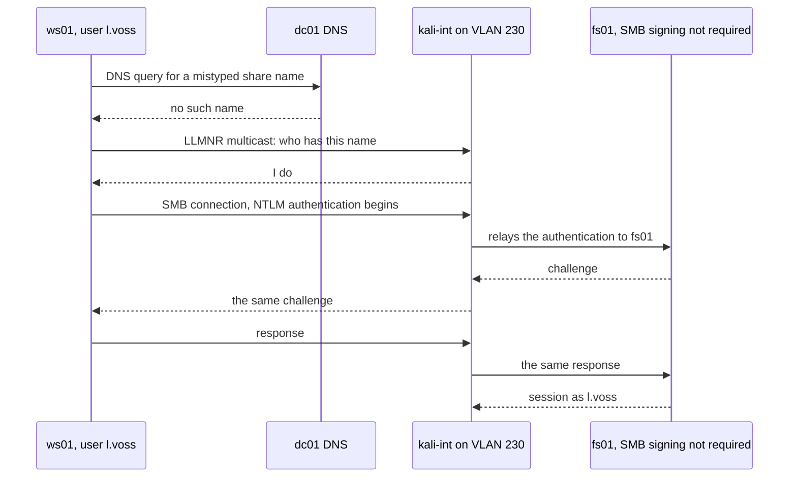
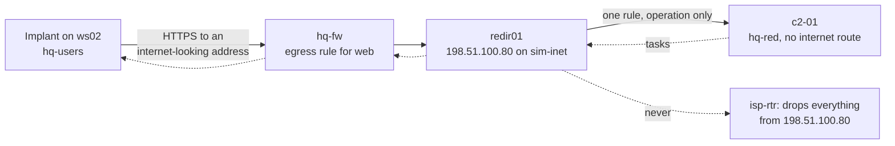
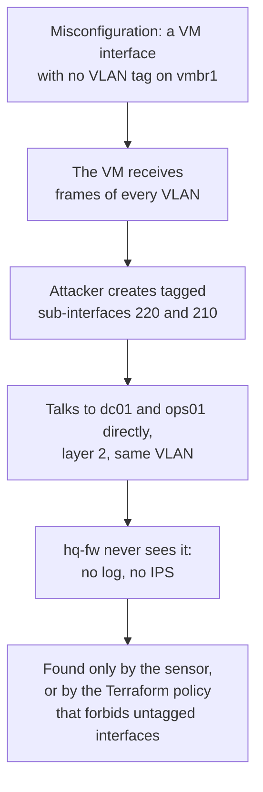

# Proxmox 03 · Attack ranges

> **Status: PROPOSED.** Everything the red role can do on a home hypervisor that AWS can't offer:
> real layer 2, port-based access control, wireless, C2 behind a redirector, malware analysis,
> and memory evidence from outside the guest. Engagement plans are in
> `shared/05-offensive-engagements.md`; this file adjusts them for Proxmox.

> **Assumptions**
>
> 1. The network is built as in `01-architecture-per-stage.md`: one door (`isp-rtr`), a lab trunk
>    (`vmbr1`), a sealed sandbox bridge.
> 2. Physical extras (a managed switch, an access point, a USB Wi-Fi adapter) are optional and
>    arrive at Stage 2 or 3.
> 3. Tool names are current common choices (verify they are maintained).
> 4. Default behaviour of the Proxmox firewall's address and DHCP filters is from memory (verify
>    on your version before relying on it in either direction).

---

## 1. Rules for attacking on Proxmox

No cloud provider's policy applies here. That removes a constraint, not your responsibility.

1. **Your home network is out of scope and must stay unreachable.** Before every engagement:
   check that a lab VM can't reach a home address, and that `isp-rtr`'s drop counters work.
2. **Only your own devices.** Every VM, switch port and access point in the range is yours.
3. **Wireless leaves the building.** Radio doesn't stop at your wall. Attack **only your own
   network name and your own client devices**, at low transmit power. Never send
   deauthentication or any other frame at a network you don't own; that is illegal in most
   countries, and it harms your neighbours.
4. **C2 and malware stay in their segments** (`hq-red`, `sim-inet`, `sandbox`), with the checks
   in `02-platform-specifics.md` section 8.
5. **Snapshot before, evidence before revert, revert after.**
6. **A written RoE** as always, with the additions in section 8.
7. **The hypervisor is in scope only by explicit choice.** Attacking `pve01` itself (section 6)
   is a separate exercise with its own RoE, because a mistake there affects everything.

---

## 2. What this platform adds

| Technique | Works because | Weakness | How red does it | What blue can see | Fix to demonstrate |
|---|---|---|---|---|---|
| **LLMNR, NBT-NS and mDNS poisoning** | workstations share a broadcast domain | `W1-07` | answer name queries with a poisoning tool on VLAN 230; capture challenge-response hashes | queries for names that don't exist, answered by a workstation address; a network sensor; a honey query from a scheduled task | disable LLMNR and NetBIOS by GPO |
| **NTLM relay** | the captured authentication can be forwarded live | `W2-09` | relay to a server without SMB signing, to LDAP, or to the certificate enrolment web service | a logon on the target from the attacker's address under the victim's name (4624 type 3) | require SMB signing; LDAP signing and channel binding; no NTLM where possible |
| **IPv6 DNS takeover** | Windows asks for IPv6 configuration by default and prefers it | (add as a Stage 2 exercise) | answer DHCPv6 requests, become the DNS server, serve a proxy auto-configuration answer, relay the authentication | DHCPv6 replies from a workstation; new IPv6 DNS server on clients | block DHCPv6 and router advertisements from client ports; disable IPv6 where unused, by policy |
| **ARP spoofing** | ARP has no authentication | — | claim to be the gateway; read or change traffic in between | the gateway's MAC address changing; duplicate address warnings; a sensor on the VLAN | dynamic ARP inspection on a real switch; the hypervisor's address filter as its virtual analogue; encryption and signing so interception yields nothing |
| **Rogue DHCP** | the fastest answer wins | — | hand out your own gateway and DNS | offers from an unknown server address | DHCP snooping on a real switch; the hypervisor's DHCP filter |
| **Passive sniffing** | a mirror port, or an interface that sees a trunk | `W1-01` | capture FTP credentials in clear text | nothing: passive attacks are invisible. That is the lesson | remove clear-text protocols |
| **VLAN hopping, virtual form** | a VM interface with no VLAN tag on a VLAN-aware bridge receives every VLAN | a staged misconfiguration | create tagged sub-interfaces and talk to other VLANs directly, around `hq-fw` | traffic between VLANs that the firewall never logged; found only by comparing a sensor with the firewall | one tag per interface, enforced by the Terraform policy |
| **VLAN hopping, switch form** | trunk negotiation left on; a native VLAN shared with users | on the optional switch | negotiate a trunk, or double-tag | switch logs | fixed access ports, negotiation off, unused native VLAN, pruned trunks |
| **802.1X bypass** | devices that can't authenticate get an exception by MAC address | Stage 3 | copy the printer's MAC address; or sit between an authenticated device and its port | the same MAC on two ports; RADIUS logs | certificate-based authentication; profiling; no MAC exceptions onto sensitive VLANs |
| **Wireless** | your own access point | Stage 3 | capture and crack a pre-shared-key handshake; an evil twin against enterprise Wi-Fi with weak server validation | rogue access point detection; RADIUS logs | long random pre-shared keys for guests; certificate-based enterprise authentication with server validation enforced by policy |
| **C2 with a redirector** | `sim-inet` behaves like an internet | Stage 3 | implant → `redir01` → `c2-01` | beacon timing, TLS fingerprints, process behaviour | egress filtering, TLS inspection decisions, endpoint detections |
| **Malware analysis** | a sealed bridge | — | static and dynamic analysis of your own implants | — | — |
| **Memory forensics from outside** | the hypervisor can snapshot RAM | — | (blue technique) snapshot a compromised VM with memory; analyse offline | injected code, credentials, network connections | — |
| **Physical-style attacks** | consoles, virtual media and USB pass-through | — | boot a VM from an attached ISO to read an unencrypted disk ("evil maid"); a keystroke-injection USB device passed to a workstation VM | hypervisor task log; device-connect events | disk encryption with a pre-boot secret; device control policy |
| **Office macro payloads** | client Windows evaluation media | — | a document with a macro, if you add an office suite | process ancestry: an office program starting a script host | attack-surface-reduction rules; macro policy |

The pattern, mirrored from the AWS file: **everything that depends on sharing a wire works
here, and only here.**

---

## 3. Turning the layer-2 range on and off

The hypervisor can filter spoofed addresses, which is a real control (the virtual cousin of
port security). To practise the attacks you turn it off on one VLAN; to demonstrate the control
you turn it back on.

| State | Setting on the VMs of `hq-users` | Effect |
|---|---|---|
| **Range open** (during a layer-2 engagement) | address and MAC filters off; `kali-int` has a second interface tagged 230 | spoofing and poisoning work |
| **Range closed** (normal) | filters on; `kali-int`'s second interface removed | spoofed frames are dropped at the virtual port |

Both states are Terraform variables, changed through a reviewed plan. **Running the same attack
in both states and recording the difference is itself a finding**: it shows what port-level
controls are worth.

---

## 4. Seeing the wire: the sensor

AWS needs a paid mirroring service to see traffic inside a subnet. Here it is a bridge setting.

| Item | Proposal |
|---|---|
| Sensor | `nsm01`: Zeek and Suricata in detection mode, management address 10.20.10.70 in `hq-mgmt`, a second interface that receives mirrored traffic |
| Mirror | traffic of VLAN 230 (and later 220) copied to the sensor's capture interface on the host |
| Output | Zeek logs and Suricata `eve.json` to Wazuh through the agent |
| What it adds | everything `hq-fw` can't see: neighbour-to-neighbour traffic, ARP, DHCP, name-resolution broadcasts, Kerberos and SMB detail between hosts in one VLAN |
| Stage | 2 |

**The comparison to make:** run one attack and list what `hq-fw` logged, what the endpoints
logged, and what the sensor logged. Three columns, one attack. It is the clearest demonstration
of why defence needs more than a perimeter.

---

## 5. Attack flows

### 5.1 Name-resolution poisoning into a relay (`W1-07`, `W2-09`)

| Step | Who | Tool | Evidence | What can go wrong |
|---|---|---|---|---|
| A name that doesn't resolve | the user, by a typo; or a stale mapped drive | Windows | Sysmon 22 (DNS query) with a failed result | waiting for a typo is slow. Real testers wait; in the lab the persona makes one |
| Multicast query | Windows | LLMNR, UDP 5355 | visible only on the wire: the sensor, or a capture | on AWS this packet is never delivered, which is why the technique doesn't exist there |
| Poisoned answer | red | a poisoning tool | the answer comes from a workstation address; a sensor rule on "LLMNR response from a non-server" | answering everything is noisy; answer selectively to practise OPSEC |
| Authentication to the attacker | Windows | SMB with NTLM | on `ws01`: an outbound SMB connection to a workstation address (Sysmon 3) | if the tool only captures the hash, it must be cracked: a long password ends the attack here |
| Relay | red | a relay tool | on `fs01`: event 4624 type 3 for `l.voss` **from the attacker's address** | relaying to the machine the authentication came from fails by design |
| Session | red | SMB as the victim | 5145 share access on `fs01` | `l.voss` has few rights; relaying an administrator's authentication is what makes this dangerous |

**Fixes, each one closing a different step:** disable LLMNR and NetBIOS (the query never goes
out); require SMB signing (the relay is refused); long passwords (the captured hash can't be
cracked); the hypervisor's address filter or switch port security (the attacker can't answer).
Apply them one at a time and re-run: you get a table of which fix stops which step.

**Detection worth building:** a logon on a server where the source address belongs to a
workstation that isn't the account's usual machine. It needs an inventory of who uses what,
which is why inventories matter to detection.

### 5.2 An operation with a C2 behind a redirector (Stage 3)

| Step | Who | Tool | Evidence | What can go wrong |
|---|---|---|---|---|
| Implant runs | blue places it on request (assumed breach) | a Sliver implant | Sysmon 1 (process), 3 (network), 7 (image load) depending on the technique | generating it with defaults: detections written against defaults are brittle. Vary it |
| Beacon out | the implant | HTTPS on 443 | `hq-fw` flow log; Suricata TLS event with the fingerprint and server name; DNS query if a name is used | a fixed interval with no jitter is trivially visible. Try both |
| Redirector | red | a reverse proxy that forwards only the C2's expected paths | `redir01`'s own access log (red's evidence) | a redirector that forwards everything exposes the C2 to anyone who scans it. In the lab, `kali-ext` plays that scanner |
| To the C2 | `redir01` → `c2-01` | one firewall rule that exists only during the operation | `hq-fw` log | leaving the rule in place afterwards |
| Tasking | red | the C2 console | the operation log with timestamps | no log, no MTTD |
| The guard | you | `isp-rtr` rule 3 and the missing route | zero forwarded packets for that address, checked before and after | believing the diagram instead of the counters |

**What to measure:** time from each action to the first alert a human would see; which actions
produced no event at all (logging gap), an event but no alert (rule gap), or an alert
(`shared/05-offensive-engagements.md`, section 7).

### 5.3 Around the firewall: the untagged interface

| Step | Who | Tool | Evidence | What can go wrong |
|---|---|---|---|---|
| The misconfiguration | blue, on purpose, on a throwaway VM | a NIC without a tag | the Terraform plan shows it; the custom policy should fail the build | staging it on a real server instead of a throwaway |
| Trunk access | red | sub-interfaces on the VM | nothing on `hq-fw` | — |
| Direct access | red | ordinary tools against the servers | endpoint logs on `dc01`; the sensor | assuming the firewall log is the whole truth |
| The lesson | blue | compare firewall, endpoint and sensor logs | the three-column table | — |

On a physical switch the equivalent is a user port left in trunk mode. The fix is the same
idea in both worlds: every port has exactly one job, declared in code and checked.

---

## 6. The hypervisor as a target (optional, Stage 3)

**The question:** what does an attacker gain from the hosts that manage the platform?

| Start | Path | Result | Control to demonstrate |
|---|---|---|---|
| a compromised `ops01` | the Terraform API token | create, stop or reconfigure any VM | the token's role is limited to named pools; a separate token for Tier 0 VMs, held elsewhere |
| a Proxmox account with console rights | open the console of `dc01` | a keyboard on the domain controller | console rights only for `APP-PVE-Admin`; an alert on console opens of Tier 0 VMs |
| a Proxmox account with backup or disk rights | attach a DC's disk to another VM, or restore its backup | the directory database offline: every password hash | this is why the hypervisor and the backup server are Tier 0; encrypt backups with a key the hypervisor admins don't hold |
| the lab-side management address | attack the UI itself | — | the address accepts 8006 from `paw-t0` only |

Run it as a paper exercise first (a threat model of the management plane), then test the two or
three controls you actually built. This is the exercise that makes the sentence "the hypervisor
is Tier 0" concrete, and very few students can describe it from experience.

---

## 7. Engagement adjustments per stage

### 7.1 Stage 0 copy

| Part | Adjustment on Proxmox |
|---|---|
| Web and API tests | unchanged, against the copy, from the attacker certificate |
| Cloud part | doesn't apply. Replace it with: (a) from `vuln`, try to read another host's path in `vault01` and try the registry; (b) from `vuln`, try `ops01`'s SSH; (c) from any VM, try the hypervisor |
| DNS gap (decision 30) | doesn't exist here; note it in the comparison |
| Flow evidence | no VPC flow logs. Ground truth for "was it dropped" is each firewall's own log and a capture |

### 7.2 Stage 1

| Part | Adjustment on Proxmox |
|---|---|
| External test | from `kali-ext` on `sim-inet` against 198.51.100.10 and .20: a clean, realistic starting point with no carrier in between to distort results |
| Phishing | as planned. You act as the persona on the VM console |
| Assumed breach | `kali-int` with its second interface on VLAN 230, range open |
| `W1-01` | sniff the FTP password off the wire (after an ARP spoof, or from a mirror) |
| `W1-07` | fully exploitable: section 5.1 |
| Office macros | possible with client evaluation media, if you choose to add an office suite |

### 7.3 Stage 2

| Part | Adjustment on Proxmox |
|---|---|
| AD paths | unchanged |
| `W2-09` | poisoning-based relay, section 5.1; also relay to the certificate enrolment web service if `ca01` offers it |
| IPv6 takeover | add as an exercise |
| Segmentation test | includes the untagged-interface test, section 5.3 |
| Second start position | `hq-guest` with no account: what can a visitor reach? From Stage 3, through the guest Wi-Fi for real |
| Inbound phishing | from `kali-ext` through `mx01`: the mail arrives from "outside" |
| Sensor comparison | section 4 |
| Memory forensics | after the test, snapshot a compromised workstation with memory and analyse it |

### 7.4 Stage 3

| Part | Adjustment on Proxmox |
|---|---|
| Red team operation | the full plan with `c2-01` and `redir01`: section 5.2. **This is the platform it belongs on** |
| 802.1X | bypass by MAC copy on the lab switch |
| Wireless | your own networks only, rule 3 |
| Hypervisor | section 6 |
| Incident response | contain by moving a VM to a quarantine VLAN; preserve by a snapshot with memory; this is far closer to a real responder's options than AWS offers |

---

## 8. What each RoE must add on Proxmox

- [ ] Isolation check done and recorded: a lab VM can't reach a home address; `isp-rtr` logs the drop.
- [ ] `isp-rtr` counters noted before the engagement, and compared after.
- [ ] Layer-2 range state: open or closed, on which VLAN, from when to when.
- [ ] Snapshot set name; the list of VMs in it; DCs snapshotted together.
- [ ] C2: where it runs, the redirector's address, proof of no route out.
- [ ] Wireless: the network names in scope (yours), the client devices in scope (yours), transmit power.
- [ ] Physical devices in scope, by label.
- [ ] Whether the hypervisor is in scope (default: no).
- [ ] Engagement-only firewall rules, and who removes them.
- [ ] Evidence export before the revert.

---

## 9. Coverage this range adds

| ATT&CK | Technique | Section | Platform |
|---|---|---|---|
| T1557.001 | LLMNR/NBT-NS poisoning and SMB relay | 5.1 | Proxmox only |
| T1557.002 | ARP cache poisoning | 2 | Proxmox only |
| T1557.003 | DHCP spoofing | 2 | Proxmox only |
| T1040 | Network sniffing | 2 | Proxmox only |
| T1599 | Network boundary bridging (around the firewall) | 5.3 | Proxmox only |
| T1200 | Hardware additions (a rogue device on a port) | 2 | Proxmox with a switch |
| T1091 | Replication through removable media (as a concept: USB pass-through) | 2 | Proxmox |
| T1071.001, T1090 | Web protocols for C2; proxy (the redirector) | 5.2 | Proxmox |
| T1573 | Encrypted channel | 5.2 | Proxmox |
| T1204.002 | User execution of a malicious file (macros) | 7.2 | Proxmox |
| T1003.003 | NTDS from an offline disk or backup | 6 | Proxmox |

(Verify technique IDs against the current ATT&CK version.)

**Lab vs real.** Virtual switches forgive things physical networks don't, and the reverse.
Spanning-tree attacks, switch CAM-table exhaustion and trunk negotiation need real switch
hardware; a Linux bridge doesn't behave like a vendor's switch. The optional used switch is
worth its small price for that reason, and its absence should be named in the scope of any
report written from the purely virtual range.
