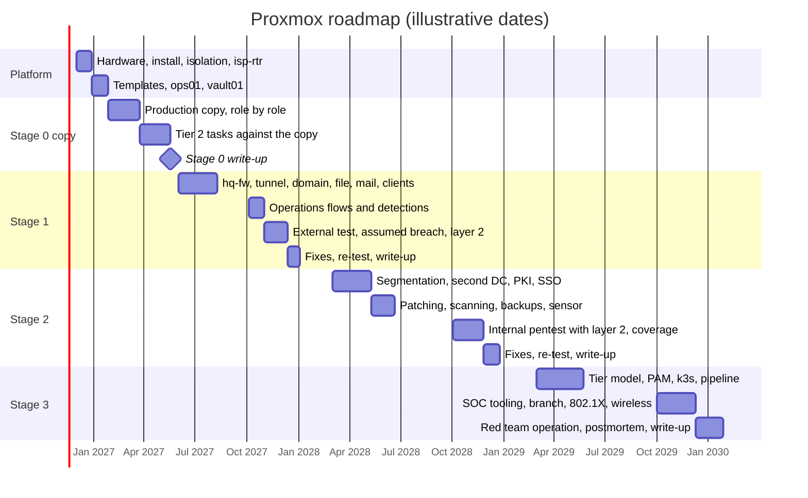

# Proxmox 04 · Roadmap and cost

> **Status: PROPOSED.** A phased roadmap for building the whole company on one home Proxmox
> server, with entry and exit criteria per step, a mapping to the existing tasks in
> `docs/TASKS.md`, and cost estimates.

> **Assumptions**
>
> 1. **Dates are illustrative**, as in the AWS roadmap: about two sessions a week in semesters.
> 2. **Every price and wattage is a rough estimate from memory, in euros, marked (verify).**
>    Check current local listings; memory prices in particular change quickly.
> 3. This roadmap is the **Proxmox-only** route: the production copy is built here too. If you
>    choose the hybrid in `comparison.md`, skip steps `S0-P09` to `S0-P14` and keep production
>    in AWS.
> 4. Step IDs (`S1-P04`) are labels for this roadmap, not task or decision numbers.

---

## 1. The roadmap at a glance

| Bar | Who | Tool | Evidence | What can go wrong |
|---|---|---|---|---|
| Platform | you | Proxmox, Packer, Terraform, Ansible | isolation checks pass; the host is rebuilt once from your own notes | skipping the isolation checks because "it's just my home lab" |
| Stage 0 copy | blue | the existing roles with a platform variable | each role's verify steps, on Proxmox | the largest hidden cost of this route: every AWS service needs a replacement (`02-platform-specifics.md` section 3). It adds about two months compared with the hybrid |
| Tier 2 tasks | red and purple | the existing task list | `findings-report.md` | running the pentest here **instead of** on the AWS lab leaves the finished AWS lab unused. See `comparison.md` |
| Stage 1 | all roles | as on AWS, plus the layer-2 range | reports, including poisoning and relay | — |
| Stage 2 | all roles | plus the sensor, the sandbox, the backup server | internal pentest report with the layer-2 half | memory: profiles become necessary on a 96 GB host |
| Stage 3 | all roles | plus the switch, the access point, the C2 | red team report, postmortem | hardware extras arriving late; order them a stage early |

---

## 2. Gates

The exit criteria are those of `aws/04-roadmap-and-cost.md` section 2, with these changes.

| Gate | Entry | Exit: additions and replacements for Proxmox |
|---|---|---|
| **Platform** | hardware chosen (`comparison.md`) | the host is installed from written steps; management reachable from your laptop only; a lab VM can't reach a home address and the drop is logged; the kill switch was tested; bridges, VLANs and firewall groups come from Terraform with a clean plan; an off-host backup exists |
| **Stage 0 copy** | Platform exit | every role's Tier 1 verify step passes on Proxmox; `eve.json` shows zero flows to `app`; each host reads only its own secret path; **level 3 reset** (rebuild from code) passes with `changed=0`; then the Tier 2 tasks and the write-up, as on AWS |
| **Stage 1** | Stage 0 exit; design decided through your normal process | as AWS, plus: DHCP works through the relay; the layer-2 range was run open and closed; every `W1-` weakness, including `W1-07`, exploited, fixed and re-tested |
| **Stage 2** | Stage 1 exit | as AWS (without Organizations and cloud detections), plus: a restore from the off-host copy; the sandbox proven sealed; the three-column comparison (firewall, endpoint, sensor) for one attack; **a level 3 reset of the office** |
| **Stage 3** | Stage 2 exit | as AWS, plus: the operation ran with C2 and a redirector, and `isp-rtr`'s counters prove nothing left; 802.1X enforced on at least one physical port; **a level 4 drill** (bare-metal rebuild), timed |

---

## 3. Steps

### 3.1 Platform and Stage 0 copy

| ID | Step | Entry | Exit (verify) | Maps to |
|---|---|---|---|---|
| `S0-P01` | Decisions and docs: platform, addressing option, firewall product, secret store, certificates | — | lines in `decisions.md`, sections in `rationale.md`; a Proxmox section added to `ARCHITECTURE.md` | new |
| `S0-P02` | Hardware; Proxmox installed **by hand from notes you write as you go**; host hardening; two-factor sign-in | `S0-P01` | port 8006 reachable from the laptop only; the notes are enough to do it again | new |
| `S0-P03` | Bridges, VLANs, firewall security groups: by hand, then in Terraform, then compared | `S0-P02` | `terraform plan` shows no changes; `bridge vlan show` matches the table | new |
| `S0-P04` | Packer: Ubuntu Server template | `S0-P03` | a clone boots with cloud-init and accepts the Ansible key | new |
| `S0-P05` | `isp-rtr`: NAT, isolation rules, resolver (drafted by Claude, reviewed by you rule by rule) | `S0-P04` | the checks in `02-platform-specifics.md` section 2.2; the kill switch tested | new |
| `S0-P06` | `ops01`: Ansible control node, registry | `S0-P05` | an image pushed by digest; a second push under the same tag is refused | new |
| `S0-P07` | `vault01`: storage, unseal procedure, audit log, one path and identity per host | `S0-P06` | a host reads its own path and is denied another's; the denial is in the audit log | new |
| `S0-P08` | Platform variable in the `common` role; Proxmox inventory with the same group names | `S0-P07` | `ansible-inventory --graph` shows the familiar groups | new |
| `S0-P09` | `fw-ips` copy: two interfaces, gateway of the production VLANs, OpenVPN, the nftables variant with the Suricata exclusion for `proxy` → `app`, Unbound | `S0-P08` | VPN connects from the laptop; user pool reaches `proxy`:443 only; `FW-DROP` logged | new (repeats 1.6–1.12 on this platform) |
| `S0-P10` | `db`, then `app`, then `proxy`: one step each | `S0-P09` | each role's original verify steps | new (repeats 1.13–1.15) |
| `S0-P11` | `siem` and the agents | `S0-P10` | all agents `Active`; a test event per source | new (repeats 1.16, 1.17) |
| `S0-P12` | `mon` and the exporters; a Proxmox exporter instead of the CloudWatch one | `S0-P11` | all targets `up`; alerts fire on a forced test | new (repeats 1.22, 1.23) |
| `S0-P13` | `vuln` | `S0-P12` | container egress blocked and logged; `eve.json` shows flows to `vuln` and none to `app` | new (repeats 2.8–2.13) |
| `S0-P14` | A first backup to an external disk; `make` targets for this platform; **level 3 reset** | `S0-P13` | rebuilt from nothing; second run `changed=0`; verify passes | new (repeats 1.20) |
| `S0-P15` | Threat model for the copy | `S0-P14` | as task 2.17, naming this platform's boundaries | 2.17 |
| `S0-P16` | Attacker certificate, scope file and wrapper, browser profile | `S0-P15` | as task 2.14, without GuardDuty | 2.14 |
| `S0-P17` | Juice Shop pentest | `S0-P16` | as task 2.15 | 2.15 |
| `S0-P18` | Mailbridge scenarios | `S0-P17` | as tasks 2.2–2.4; the DNS-gap test is replaced by the platform tests in `03-attack-ranges.md` section 7.1 | 2.2, 2.3, 2.4 |
| `S0-P19` | Findings report | `S0-P18` | as task 2.5 | 2.5 |
| `S0-P20` | Database backup into the backup store, tested restore | `S0-P19` | a timed restore, recorded | T2.3 |
| `S0-P21` | Application CI: build and scan on hosted runners; **the image reaches the home registry by a pull from `ops01`**, not by a runner pushing into your home | `S0-P19` | the deployed digest equals the built digest | T2.2 |
| `S0-P22` | WAF engine and current CRS | `S0-P19` | as T2.4 | T2.4 |
| `S0-P23` | Stage 0 write-up | all above | merged | new |

**A warning that belongs to `S0-P21`.** A hosted CI runner can't reach a registry inside your
home, and a self-hosted runner attached to a public repository lets a stranger's pull request
run code on your network. The safe pattern is the one in the table: CI publishes the image
somewhere it can reach, and `ops01` **pulls** it by digest after you approve.

### 3.2 Stage 1

| ID | Step | Entry | Exit (verify) | Maps to |
|---|---|---|---|---|
| `S1-P01` | Decisions and docs | Stage 0 exit | as before | new |
| `S1-P02` | Packer: Windows Server and Windows client templates (answer file, VirtIO drivers, guest agent, Sysprep) | `S1-P01` | a clone boots to a usable, generalised system | new |
| `S1-P03` | `hq-fw`: OPNsense by hand, then through its API from Ansible; exported configuration in Git | `S1-P02` | the drift check shows no difference | new |
| `S1-P04` | Office VLANs and firewall groups in Terraform; `hq-mgmt` moves behind `hq-fw` | `S1-P03` | `ops01` and `vault01` still reachable; plan clean | new |
| `S1-P05` | Tunnel `hq-fw` ↔ `fw-ips`; keys in `vault01` | `S1-P04` | handshake on both sides; ping between tunnel addresses | new |
| `S1-P06` | Office firewall rules for the Stage 1 flows; forward rules on `fw-ips` (Claude drafts, you review) | `S1-P05` | one allowed and one forbidden flow tested | new |
| `S1-P07` | Suricata on `hq-fw`, alert mode | `S1-P06` | events in `eve.json`; realistic captures stay silent | new |
| `S1-P08` | `dc01`: by hand, then the `dc` role; DNS; DHCP with relay | `S1-P06` | `dcdiag` passes; a client gets a lease through the relay | new |
| `S1-P09` | Directory objects as code; audit policy and baseline GPOs | `S1-P08` | as `S1-A11` | new |
| `S1-P10` | Windows baseline: Wazuh agent, Sysmon, exporter | `S1-P09` | as `S1-A12` | new |
| `S1-P11` | `fs01` | `S1-P10` | as `S1-A13` | new |
| `S1-P12` | `mail01` | `S1-P10` | as `S1-A14` | new |
| `S1-P13` | Workstations `ws01`–`ws03`; LAPS | `S1-P10` | as `S1-A15` | new |
| `S1-P14` | Staff VPN pool with AD credentials and a one-time code | `S1-P12` | as `S1-A16` | new |
| `S1-P15` | Tool roles from AD groups: Wazuh, Grafana, OPNsense | `S1-P09` | read-only users can't change anything | new |
| `S1-P16` | Windows detections with tests; L1 runbooks | `S1-P10` | as `S1-A18` | new |
| `S1-P17` | Operations, first run: all flows, including **real monthly patching** on long-lived hosts | `S1-P11`–`S1-P14` | tickets and evidence | new |
| `S1-P18` | `kali-ext`, `kali-int`, `phish01`; the layer-2 range switch | `S1-P13` | a capture on VLAN 230 shows neighbours' broadcasts when open, and spoofed frames dropped when closed | new |
| `S1-P19` | Threat model, RoE, snapshot set, weaknesses on | `S1-P17`, `S1-P18` | expectations written | new |
| `S1-P20` | External test from `kali-ext` | `S1-P19` | report | new |
| `S1-P21` | Phishing, assumed breach, poisoning and sniffing | `S1-P20` | report with the path | new |
| `S1-P22` | Fixes, re-test, coverage matrix; revert (level 2) | `S1-P21` | every `W1-` closed | new |
| `S1-P23` | Operations, second run; controls map started; write-up | `S1-P22` | merged | T3.3 (starts) |

### 3.3 Stage 2

| ID | Step | Entry | Exit (verify) | Maps to |
|---|---|---|---|---|
| `S2-P01` | Decisions and docs | Stage 1 exit | — | new |
| `S2-P02` | New VLANs; least-privilege rules; restricted RPC range | `S2-P01` | segmentation scan equals the flows table | new |
| `S2-P03` | `dc02` | `S2-P02` | replication clean | new |
| `S2-P04` | `pbs01`; off-host copy; create-only token | `S2-P02` | a delete from the domain fails; restore from the off-host copy recorded | new (extends T2.3) |
| `S2-P05` | `ca01`; auto-enrolment; LDAPS | `S2-P03` | as `S2-A06` | new |
| `S2-P06` | `kc01`; second factor; SSO for Grafana, Wazuh, tickets, **and Proxmox** | `S2-P05` | sign-in to the hypervisor with an AD group role | new |
| `S2-P07` | `glpi01` | `S2-P06` | as `S2-A09` | new |
| `S2-P08` | `wsus01` and rings | `S2-P03` | as `S2-A10` | new |
| `S2-P09` | `gvm01` and scan cycles | `S2-P02` | as `S2-A11` | T3.2 |
| `S2-P10` | `mx01`, DMZ, inbound mail from `sim-inet` | `S2-P02` | outside mail arrives only through `mx01` | new |
| `S2-P11` | Guest and IoT, `prn01` | `S2-P02` | as `S2-A14` | new |
| `S2-P12` | `intra01`, `svc-intra` | `S2-P05` | as `S2-A15` | new |
| `S2-P13` | `nsm01` and the mirror | `S2-P02` | Zeek logs for VLAN 230 in Wazuh | new |
| `S2-P14` | Hypervisor logs to Wazuh; lab-side management address | `S2-P06` | a console open raises an event | new |
| `S2-P15` | `sandbox`, `remnux`, `flare` | `S2-P02` | sealed: nothing on `vmbr0` during a detonation | new |
| `S2-P16` | Hardening by GPO; honey account | `S2-P03` | as `S2-A18` | new |
| `S2-P17` | Optional: managed switch on the trunk | `S2-P02` | VLANs pruned; a physical device gets a lease in the right VLAN | new |
| `S2-P18` | Processes: three patch and vulnerability cycles, access review | `S2-P07`–`S2-P09` | records | new |
| `S2-P19` | Threat model, RoE, snapshot set, `W2-` on | `S2-P18` | — | new |
| `S2-P20` | Internal pentest, with relay, IPv6 takeover and the untagged-interface test | `S2-P19` | report | new |
| `S2-P21` | Atomic Red Team coverage; fixes; re-test; memory forensics on one host | `S2-P20` | Navigator layer; a forensic note | new |
| `S2-P22` | Level 3 reset of the office; write-up | `S2-P21` | `changed=0`; merged | new |

### 3.4 Stage 3

| ID | Step | Entry | Exit (verify) | Maps to |
|---|---|---|---|---|
| `S3-P01` | Decisions and docs | Stage 2 exit | — | new |
| `S3-P02` | Tier model; `hq-paw`; PAWs; the hypervisor, backup and automation hosts listed as Tier 0 | `S3-P01` | as `S3-A02`; console rights restricted | new |
| `S3-P03` | `pam01` | `S3-P02` | as `S3-A03` | new |
| `S3-P04` | `vault01`: dynamic database credentials; PKI engine | `S3-P01` | as `S3-A04` | new |
| `S3-P05` | k3s; cluster hardening | `S3-P04` | as `S3-A05` | T3.1 |
| `S3-P06` | Pipeline: SBOM, signing, verification at deploy | `S3-P05` | an unsigned image is refused | new (extends T2.2) |
| `S3-P07` | `thehive01`, `shuffle01`, a playbook | `S3-P01` | as `S3-A07` | new |
| `S3-P08` | `misp01`, `velo01` | `S3-P07` | as `S3-A08` | new |
| `S3-P09` | Sigma in CI | `S3-P07` | as `S3-A09` | new |
| `S3-P10` | Branch VLANs; `br-fw` with nftables and strongSwan; IPsec to OPNsense | `S3-P01` | tunnel up between two different implementations | new |
| `S3-P11` | `dc03`, AD site, `ws-br01` | `S3-P10` | as `S3-A11` | new |
| `S3-P12` | `radius01`; 802.1X on switch ports | `S2-P17` | an unknown device is refused; the MAC-copy bypass demonstrated, then closed | new |
| `S3-P13` | Access point: guest and enterprise networks | `S3-P12` | enterprise sign-in with a certificate; guest reaches the internet only | new |
| `S3-P14` | `c2-01`, `redir01`; the operation-only rule | `S3-P02` | a beacon reaches the C2; `isp-rtr` counters show nothing outward | new |
| `S3-P15` | Risk register, policies, controls map, GDPR documents | `S3-P01` | as `S3-A13` | T3.3 |
| `S3-P16` | IR plan and a tabletop | `S3-P07` | record | new |
| `S3-P17` | Red team operation | `S3-P02`–`S3-P14` | operation log; goal reached or not | new |
| `S3-P18` | Postmortem, MTTD and MTTR, fixes, re-test | `S3-P17` | — | new |
| `S3-P19` | Level 4 drill; Stage 3 write-up | `S3-P18` | timed rebuild; merged | new |

---

## 4. Cost

### 4.1 One-time

| Item | Rough cost (verify) | Needed from |
|---|---|---|
| Server, option B (used workstation, 128 GB) | €400–900 | the start |
| Server, option D (new small machine, 96 GB) | €900–1,600 | the start |
| A second NVMe drive for a mirror | €60–150 | recommended from the start |
| A second network port, if the machine has one | €15–40 | the start |
| External disk for the off-host backup | €60–100 | the start |
| Plug-in power meter | €10–20 | the start |
| Used managed switch | €30–80 | Stage 2 |
| USB Wi-Fi adapter with monitor mode | €25–50 | Stage 3 |
| Access point | €30–60 | Stage 3 |
| Small uninterruptible power supply (optional) | €80–150 | optional |
| **Typical total, option B** | **about €650–1,400** | |
| **Typical total, option D** | **about €1,150–2,100** | |

Software cost is zero: Proxmox and Proxmox Backup Server without a subscription, open-source
tools, Windows evaluation media (verify the terms).

### 4.2 Running

| Use pattern | Option B, about 80–100 W | Option D, about 25–35 W |
|---|---|---|
| Only during sessions, about 40 hours a month | about 4 kWh a month | about 1.5 kWh a month |
| All day, every day | about 60–70 kWh a month | about 20–25 kWh a month |

Multiply by your tariff. Session-only use costs about the price of one coffee a month on either
machine; the difference between the options only matters if the server runs continuously.

### 4.3 Per stage

| Stage | New spending | What limits you |
|---|---|---|
| Platform and Stage 0 copy | the server, the backup disk | your time: about two months more than the hybrid |
| 1 | nothing | 64 GB machines are full here |
| 2 | the switch (optional) | memory: 96 GB needs profiles |
| 3 | Wi-Fi adapter, access point | memory: 128 GB needs profiles |

### 4.4 Against AWS, over the whole plan

Using the yearly estimates from `aws/04-roadmap-and-cost.md` section 4.4 and one year per stage
for Stages 1–3:

| Route | Stage 1 year | Stage 2 year | Stage 3 year | **Three years** |
|---|---|---|---|---|
| AWS only | about $250 | about $500–800 | about $600–1,050 | **about $1,350–2,100** |
| Proxmox only, option B, session-only power | €650–1,400 once, plus about €10–20 of power | about €10–20 | about €10–20 plus €55–110 of extras | **about €750–1,550** |
| Proxmox only, option D | €1,150–2,100 once, plus a few euros of power | a few euros | a few euros plus extras | **about €1,250–2,250** |

All figures are estimates with wide ranges (verify). The honest reading:

- **Through Stage 1, AWS is cheaper.**
- **From Stage 2, a used workstation is cheaper**, and it keeps its value: it can be resold, or
  reused after the lab.
- **Money is not the main difference.** What each platform can teach is. See `comparison.md`.

---

## 5. If time or money runs short: what to drop first

| Drop | Keep instead |
|---|---|
| **The production copy** (`S0-P09`–`S0-P14`) | production stays in AWS; build only the office here. This is the hybrid, and it's the recommended route |
| The physical switch, 802.1X and wireless | the virtual layer-2 range; explain 802.1X from the diagram |
| `wsus01`, `glpi01`, `shuffle01`, `misp01`, the branch | as in `aws/04-roadmap-and-cost.md` section 6 |
| The malware sandbox | analyse only your own implants, statically |
| **Never drop** | the isolation checks, the off-host backup, the level 3 resets, the second DC, `ca01`, `kc01`, the tier model, the write-ups |

---

## 6. Risks of the Proxmox route

| Risk | Effect | Mitigation |
|---|---|---|
| The lab reaches your home network | real devices and data exposed to deliberately vulnerable machines and attack tools | one door (`isp-rtr`); the checks at every engagement; the kill switch |
| Hardware failure | the lab is gone | the off-host backup; code for everything; a level 4 drill |
| Building the platform takes months before any security work | motivation drops | the hybrid: no production copy |
| Snapshots replace rebuilding | drift; after a year nobody can rebuild it | level 3 at every gate |
| Too little memory | sessions spent juggling VMs | buy for Stage 2 at the start; profiles |
| Evaluation licences expire mid-stage | hosts stop working | rebuilds from templates are routine; check the timers at each session start |
| Noise, heat, power | the server gets switched off and stays off | choose hardware for the room it will live in |
| Cloud skills aren't practised | a gap for cloud security roles | keep the AWS lab alive (the hybrid) |
| A VM escape from the sandbox | the hypervisor and the home network | patched hypervisor; conservative choice of samples |
| You move house or travel | no physical access | remote access through the lab's own VPN, forwarded as one UDP port, if you set it up before you need it |
