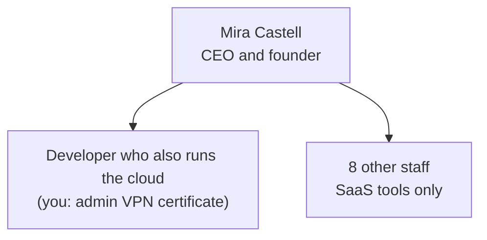
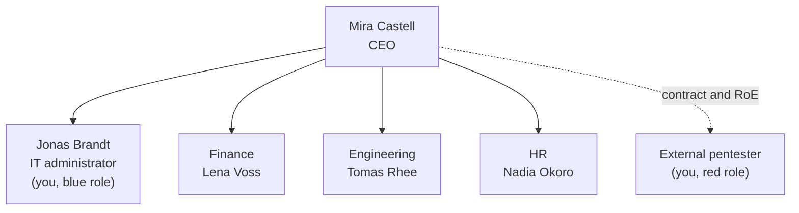
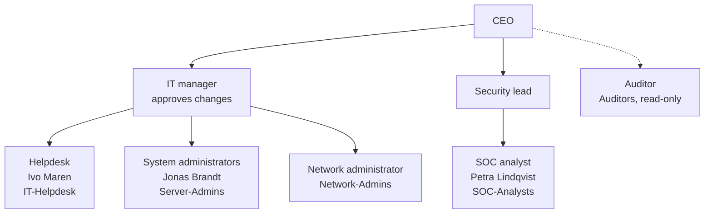
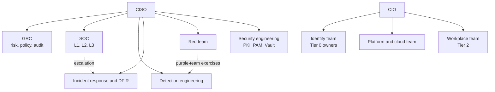

# 01 · Company profiles: how IT and security are organised at each size

> **Status: PROPOSED.** This file describes how real companies of four sizes typically work, and
> how Quillmere imitates each one. The descriptions of real companies are generalisations from
> common practice, not statistics. Names and addresses come from `00-naming-and-addressing.md`.

> **Assumptions**
>
> 1. Headcounts (10, 30, 300, "large") are round numbers that mark a change in how work is
>    organised, not exact thresholds.
> 2. Quillmere is an EU software company, so GDPR applies at every stage and NIS2 becomes relevant
>    as it grows (whether NIS2 applies to a given company depends on its sector and size; verify
>    for any real case).

---

## 1. The idea: security follows the organisation

A company's security isn't mainly a list of tools. It is a set of **people with defined duties,
processes they repeat, and tools that support both**. What changes with size is specialisation:

- At 10 people, one person does everything, so nothing is reviewed and nothing is written down.
- At 30, one IT generalist exists. Processes exist in that person's head.
- At 300, there is a team. Work is handed between people, so it must be written down, ticketed
  and approved. **Separation of duties** becomes possible: the person who requests a change isn't
  the one who approves it.
- In a large company, each duty is a team. The hard problems become coordination, privilege
  boundaries between teams, and proving to auditors that the processes run.

This is why the lab grows in stages. A domain controller built in a "startup" lab teaches the
technology. The same domain controller operated with a joiner/mover/leaver process, a patch
cycle and an access review teaches the job.

**Interview line:** "Controls that depend on one person remembering are not controls. I learned
that by running the same lab first as one admin, then with tickets and reviews, and seeing what
the second way caught."

---

## 2. The four sizes side by side

| Area | Stage 0: startup (~10) | Stage 1: small (~30) | Stage 2: mid-size (~300) | Stage 3: large (slice) |
|---|---|---|---|---|
| IT staff | none; a developer does it | 1 generalist, maybe an external provider | 5–10: helpdesk, sysadmins, network | hundreds, in specialised teams |
| Security staff | none | none; IT does it "as well" | 1–3: a security lead, an analyst | SOC, engineering, red team, GRC, each a team |
| Who decides | the founder | the founder, on IT's advice | IT manager; a change board for big changes | CISO, architecture boards, risk committees |
| Identity | SaaS accounts, shared logins | one AD domain, one DC | two DCs, SSO, group-based access | tiered admin model, PAM, identity governance |
| Network | cloud VPC only | one office LAN, one firewall | segmented VLANs, DMZ, guest, IoT | many sites, NAC, micro-segmentation |
| Endpoints | personal or unmanaged laptops | domain-joined, local admin common | managed, patched centrally, hardened by GPO | EDR everywhere, PAWs for admins |
| Logging | whatever the cloud keeps | some logs on each server | central SIEM, L1 runbooks | SIEM, SOAR, case management, detection as code |
| Patching | automatic or never | "when I have time", monthly at best | WSUS or equivalent, test ring, deadlines | per-tier pipelines, measured SLAs |
| Backups | cloud snapshots, never restored | a backup server or NAS, rarely tested | 3-2-1, isolated, restore tests scheduled | immutable, DR site, tested continuity plans |
| Change | someone changes it | the admin changes it | ticket + PR + approval | change types, CAB, automated pipelines |
| Compliance driver | customer questionnaires | GDPR, first customer audit | ISO 27001 project, cyber insurance | ISO 27001, NIS2, sector regulation, internal audit |
| Typical breach | leaked cloud key, vulnerable web app | phishing → one password → everything | AD attack path to Domain Admin, ransomware | targeted intrusion, supply chain, insider |

The last row is why each stage has the red engagement it has.

---

## 3. Org chart per stage

### 3.1 Stage 0: startup (built)

| Box | Who | Owns | Evidence they produce | What can go wrong |
|---|---|---|---|---|
| CEO | Mira Castell | every decision, including risk acceptance | nothing written | risk is accepted without anyone noticing it was a decision |
| Developer-admin | you | the whole `prod` site: Terraform, Ansible, the VPN CA | Git history, `decisions.md`, CloudTrail | one person holds every key; no review; if they leave, nobody can operate it |
| Other staff | not modelled | their SaaS accounts | none | password reuse, no MFA |

**Lab vs real.** The built lab is far more disciplined than a real 10-person startup: reviewed
plans, an offline CA, least-privilege roles. Keep that. The "startup" label describes the size of
the system, not a licence to be careless.

### 3.2 Stage 1: small company (~30)

| Box | Who | Owns | Evidence they produce | What can go wrong |
|---|---|---|---|---|
| IT administrator | Jonas Brandt (`j.brandt`, `adm-j.brandt`) | AD, file server, mail, firewall, backups, helpdesk | tickets (GitHub Issues), AD audit events, backup reports | uses the admin account for daily work; processes live in his head |
| HR | Nadia Okoro | tells IT about joiners and leavers | the joiner or leaver request | tells IT late, so leavers keep access for weeks |
| Finance, Engineering | Lena Voss, Tomas Rhee | their data on `fs01` | file access events | the developer has local admin "to get work done" |
| External pentester | you, as a different person | the engagement report | scope, RoE, findings report | testing without written permission; scope creep |

### 3.3 Stage 2: mid-size (~300)

| Box | Who | Owns | Evidence they produce | What can go wrong |
|---|---|---|---|---|
| IT manager | a role you play when approving | change approval, patch deadlines | approved PRs, change records | approving your own change without reading it (rubber stamp) |
| Helpdesk | Ivo Maren | password resets, joiner tasks | tickets in `glpi01`, AD events 4724 | resets a password for a caller it didn't verify (`shared/03`, flow 3) |
| System administrators | Jonas Brandt | servers, AD, patching, backups | Ansible runs, WSUS reports, restore-test records | admin accounts with rights far beyond the task |
| Network administrator | a role you play | `hq-fw`, VLANs, VPN | firewall rule PRs, configuration exports | "temporary" allow rules that stay for years |
| Security lead | a role you play | policies, vulnerability management, risk register | risk register, exception records | security reports to IT, so findings about IT get softened |
| SOC analyst | Petra Lindqvist | alert triage, L1 runbooks | closed alerts with notes, escalations | alert fatigue: closing alerts without reading them |
| Auditor | a role you play once per stage | access reviews, checking that processes ran | the access-review record | reviews the document, not the system |

Note the reporting line: **security doesn't report to IT.** When it does, the people being
checked control the checker. A real company of 300 often gets this wrong; you should be able to
explain why it matters.

### 3.4 Stage 3: a slice of a large company

| Box | Who | Owns | Evidence they produce | What can go wrong |
|---|---|---|---|---|
| GRC | you | risk register, policies, ISO 27001 controls map (task T3.3) | SoA, risk register, audit findings | paper compliance: a policy exists but nothing enforces it |
| SOC L1–L3 | you | alert handling in `thehive01` | cases, MTTD and MTTR numbers | L1 escalates everything, or nothing |
| Detection engineering | you | Sigma rules in CI, the ATT&CK coverage map | rule tests, coverage map | rules without tests; coverage claimed but never exercised |
| Incident response | you | the IR plan, tabletop exercises, forensics with `velo01` | timelines, postmortems | the plan was never rehearsed |
| Red team | you, as a separate identity | goal-driven operations with `c2-01` | operation log, executive report | running outside the RoE; C2 with an internet route |
| Security engineering | you | `pam01`, `vault01`, internal PKI | access logs, certificate inventory | the security tools themselves become Tier 0 without being treated as such |
| Identity team | you, with `t0-` accounts | DCs, `ca01`, the tier model | Tier 0 change records | a Tier 0 credential used on a lower tier (`W3-01`) |
| Platform, Workplace | you | servers and k3s; workstations | pipelines, patch compliance | teams bypass each other's controls to meet deadlines |

**Lab vs real.** You are every box. You can't reproduce the real difficulty of a large company,
which is that these teams have different managers, budgets and priorities. What you can
reproduce is the **technical boundary** between them: separate accounts, separate networks, and
a rule that you may only cross a boundary through the documented path. Treat that rule as real.

---

## 4. Typical weaknesses of real companies at each size

| Size | Weakness | Why it happens | What it leads to |
|---|---|---|---|
| Startup | secrets in code or chat; over-broad cloud keys | speed; nobody owns security | account takeover, data leak |
| Startup | no backups anyone has restored | "the cloud does that" | unrecoverable loss |
| Small | flat network; everyone reaches every server | one LAN is the default | one compromised laptop reaches everything |
| Small | the same local administrator password on every PC | imaging from one master | lateral movement in minutes |
| Small | legacy protocols left on (FTP, SMBv1, LLMNR) | "the scanner needs it" | credential theft on the wire |
| Small | the admin browses and reads mail as Domain Admin | convenience | one phish equals the domain |
| Small | leavers' accounts stay active | HR and IT don't talk | access by former staff |
| Mid-size | service accounts with weak passwords and high privilege | set up once, never rotated | Kerberoasting → Domain Admin |
| Mid-size | AD permissions nobody understands | years of delegation | hidden attack paths (BloodHound) |
| Mid-size | AD CS templates left at insecure defaults | PKI is "install and forget" | certificate-based domain takeover |
| Mid-size | patch deadlines missed on servers | fear of downtime | exploitation of known CVEs |
| Mid-size | alerts nobody reads | a SIEM bought, not staffed | detection without response |
| Large | tier violations: privileged credentials on ordinary hosts | process exceptions | credential theft from a low-value host |
| Large | too many secrets, pipelines and identities to track | scale | supply-chain and CI/CD compromise |
| Large | controls on paper only | audit-driven security | a clean audit and a real breach |

---

## 5. Deliberate weaknesses in the lab: PROPOSED

The red role needs something realistic to find. Each weakness is built **on purpose, from code,
with a variable that turns it off**, so the purple loop can measure before and after. Each one
has a fix and a detection; both are part of the stage's exit criteria.

| ID | Weakness | Where | Platform | How red uses it | Detection (blue) | Fix |
|---|---|---|---|---|---|---|
| `W1-01` | plain FTP with a shared scanner account | `fs01` | both | sniff or guess the password; read scans | Suricata FTP events; logon events | remove FTP; SFTP or an SMB drop folder |
| `W1-02` | allow-all between `hq-users` and `hq-servers` | `hq-fw` | both | reach every server port from a workstation | firewall flow logs | Stage 2 least-privilege rules |
| `W1-03` | weak password policy; one user with a seasonal password | AD | both | password spraying | many 4625 or 4771 events from one source | policy of 14+ characters, banned-password list, lockout |
| `W1-04` | one local administrator password on all workstations | `ws01`, `ws02` | both | pass-the-hash from one workstation to the next | 4624 type 3 with the local admin account | Windows LAPS |
| `W1-05` | a share readable by everyone, containing a script with a password | `fs01` | both | share enumeration | file access auditing (4663) | fix the ACL; remove the secret; scan shares |
| `W1-06` | no attachment or link filtering in mail | `mail01` | both | the phishing e-mail is delivered | Rspamd logs, proxy logs | Rspamd rules, macro policy by GPO |
| `W1-07` | LLMNR and NBT-NS enabled | workstations | **Proxmox only** | poisoning with Responder → hash capture | Suricata or Zeek on the VLAN; honey name queries | disable both by GPO |
| `W2-01` | `svc-intra` has a weak password and reaches Domain Admin through a nested group | AD | both | Kerberoasting | 4769 with RC4 for a service account; honey SPN | gMSA, 25+ character password, remove the nesting |
| `W2-02` | a legacy user without Kerberos pre-authentication | AD | both | AS-REP roasting | 4768 with pre-authentication type 0 | require pre-authentication |
| `W2-03` | a certificate template where the requester supplies the subject (ESC1) | `ca01` | both | request a certificate as a Domain Admin | AD CS events 4886 and 4887 with a mismatched subject | fix the template; manager approval |
| `W2-04` | unconstrained delegation | `intra01` | both | capture a privileged ticket | 4624 on the host, then unusual 4769 | constrained delegation or none; "account is sensitive" |
| `W2-05` | `IT-Helpdesk` can reset passwords of a group that leads to Domain Admin | AD ACLs | both | BloodHound finds the path | 4724 for a privileged account; 5136 | delegate on `OU=Staff` only; AdminSDHolder review |
| `W2-06` | a logon script in SYSVOL with a password | `dc01` | both | read SYSVOL as any user | honey credentials in the script | remove; use gMSA or LAPS |
| `W2-07` | unrestricted DNS from a segment | `hq-fw` | both | DNS tunnelling for C2 or exfiltration | long or high-entropy names, query volume per client | force DNS through the DCs; block direct DNS; response policy zones |
| `W2-08` | a printer with default credentials and a rule that lets it reach `hq-servers` | `prn01`, `hq-fw` | both | pivot from IoT to servers | new flows from `hq-iot` | change the credentials; IoT may only receive print jobs |
| `W2-09` | SMB signing not required on member servers | `fs01`, `intra01` | **Proxmox only** | NTLM relay | 4624 type 3 from an unexpected address | require SMB signing by GPO |
| `W2-10` | one server deliberately left a patch cycle behind | `intra01` | both | exploit or just report it | Greenbone finding | patch; the vulnerability-management flow |
| `W3-01` | a Tier 0 admin once signed in to a Tier 1 server | `intra01` | both | steal the cached credential | 4624 of a `t0-` account outside Tier 0 | authentication policy silos; logon restrictions |
| `W3-02` | a k3s service account with cluster-admin | k3s | both | pod → cluster takeover | Kubernetes audit log | least-privilege RBAC; admission policy |
| `W3-03` | a long-lived token in a CI variable, readable by a pull-request job | CI | both | steal the token through a PR | CI audit log; token use from a new address | OIDC short-lived credentials; protect variables |
| `W3-04` | the branch RODC caches passwords of privileged accounts | `dc03` | both | compromise the branch → privileged hashes | changes to the password replication policy (5136) | deny group in the replication policy |
| `W3-05` | an IAM role that can pass a stronger role to a new instance | AWS sandbox account | **AWS only** | IAM privilege escalation | CloudTrail `RunInstances` with `PassRole`; GuardDuty | scope `iam:PassRole` to named roles |
| `W3-06` | a folder excluded from Sysmon and Wazuh monitoring | workstations | both | stage tools in the blind spot | none by design: found by hunting | remove the exclusion; review exclusions quarterly |

**Rules for deliberate weaknesses**

1. Never on a host that holds anything real. Stage 0's `/mailbridge/*` secrets and the VPN CA are
   out of scope for every weakness.
2. Each weakness is one Ansible variable, default **off** (`weakness_w1_01_enabled: false`). A
   stage's red engagement turns its set on; the fix turns each off again.
3. Each weakness is listed in the stage's threat model before the engagement, in a sealed section
   the red role "doesn't read". See section 7.

---

## 6. Job roles: which exist at which size, and what trains them

| Role | Exists from | A normal day | Lab stage that trains it | File |
|---|---|---|---|---|
| Cloud or DevOps engineer | startup | Terraform, pipelines, cost, IAM | 0 | `aws/` |
| IT administrator | small | users, mail, files, patching, backups, everything | 1 | `shared/03` |
| Penetration tester (consultant) | any, as an outsider | scoped tests, reports, retests | 0–2 | `shared/05` |
| Helpdesk technician | mid-size | tickets, resets, joiners | 2 | `shared/03` flows 2, 3 |
| System administrator (Windows or Linux) | mid-size | AD, GPO, servers, patch cycles | 1–2 | `shared/02`, `shared/03` |
| Network engineer | mid-size | firewall rules, VLANs, VPNs | 1–2 | platform `01` files |
| SOC analyst L1 | mid-size | triage alerts with runbooks | 2 | `shared/04` section 2 |
| Vulnerability management analyst | mid-size | scan, prioritise, chase owners | 2 | `shared/04` section 5 |
| Security engineer | mid-size | hardening, SSO, PKI, secrets | 2–3 | `shared/02`, `shared/07` |
| SOC analyst L2 / threat hunter | large | investigations, hunts | 3 | `shared/04` sections 3, 8 |
| Detection engineer | large | write, test and tune rules as code | 2–3 | `shared/04` section 4 |
| DFIR analyst | large | memory, disk and timeline analysis | 3 | `shared/04`, `shared/06` |
| Red team operator | large | goal-driven operations, C2, OPSEC | 3 | `shared/05` |
| Cloud security engineer | startup (cloud-native) or large | IAM, guardrails, CSPM, detections | 0–3 | `aws/02`, `aws/03` |
| AppSec / DevSecOps engineer | mid-size software company | SAST, DAST, SCA, pipeline security, threat models | 0, 3 | `shared/06` |
| GRC analyst | mid-size | risk register, policies, audits | 2–3 | `shared/06`, `shared/07` |
| Identity engineer | large | tier model, PAM, access governance | 3 | `shared/02` |

---

## 7. Playing three roles honestly

You know everything about the lab, so a "pentest" can become a walk through your own notes. Three
habits keep the exercise honest:

1. **Blue writes its expectations first.** Before each engagement, the threat model states for
   every threat which layer should stop or detect it (this is already the plan for task 2.17,
   decision 141). The result is then a test of a written claim, not a story told afterwards.
2. **Red starts from the attacker's position only.** The red role uses its own identity (the
   `attacker` certificate, `kali-ext`, `kali-int`), its own notes file, and only information an
   attacker in that position could obtain. If you use knowledge from the blue side, record it in
   the report as "assumed knowledge", as a real assumed-breach test does.
3. **Time separates the roles.** Build in one session, attack in another, at least a few days
   apart. You will have forgotten enough details to be surprised.

**Lab vs real.** A real red team doesn't know the network and a real blue team doesn't know
the attack time. You can't have either. What you can have is the discipline of evidence:
every claim in a report points to a log line, a capture or a screenshot. That discipline is what
employers look for.
