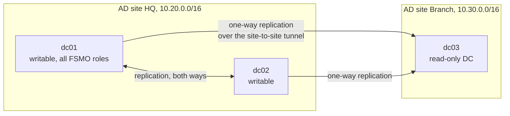
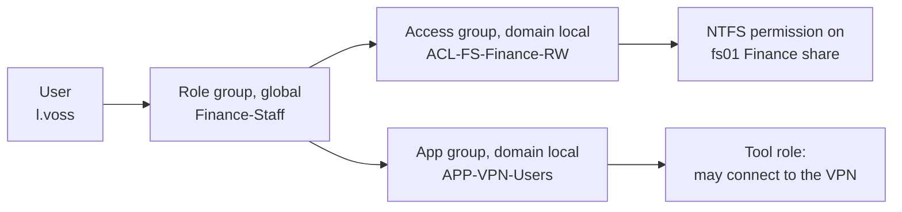
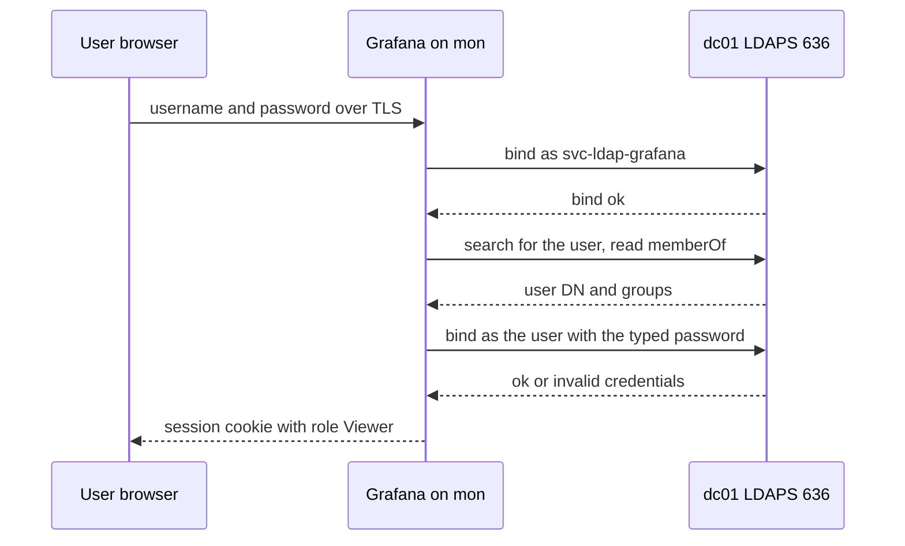
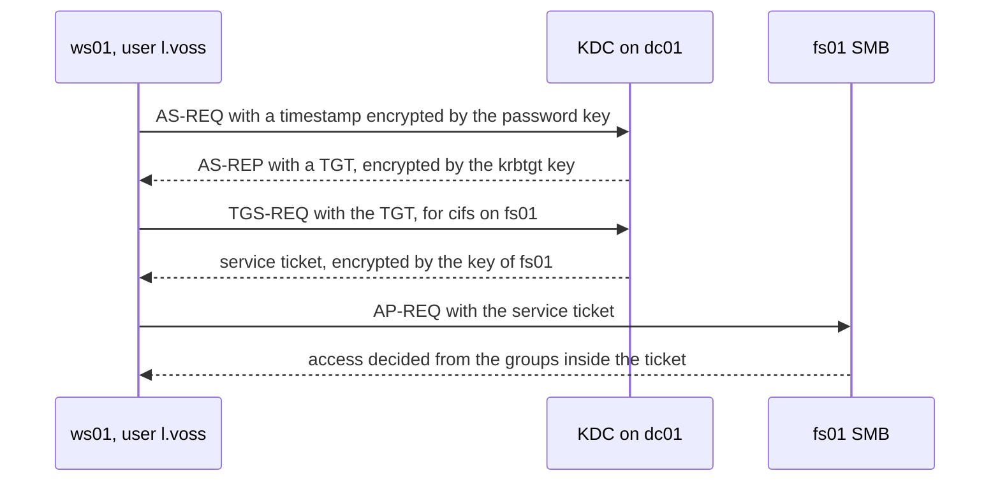
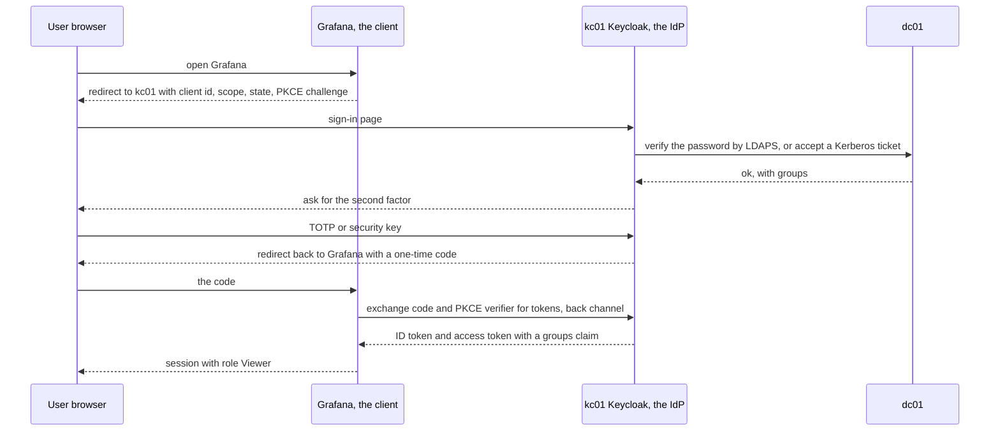
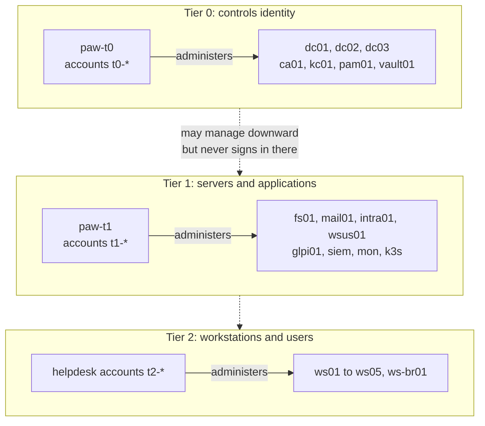
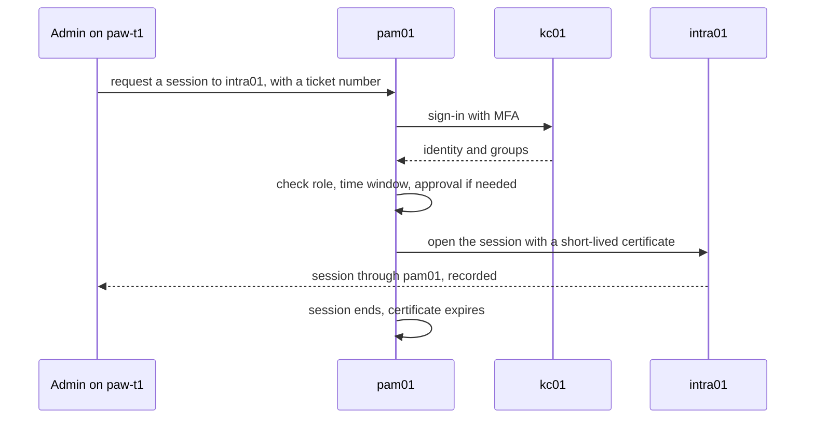
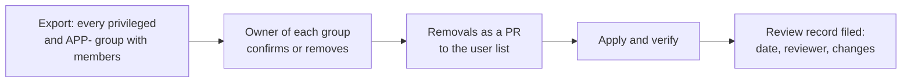

# 02 · Identity and access

> **Status: PROPOSED.** Names, groups and addresses come from `00-naming-and-addressing.md`.
> Nothing here exists yet except the Stage 0 items marked **(built)**: one VPN certificate per
> device, IAM roles per instance, and local admin accounts in Wazuh and Grafana with passwords
> from SSM.

> **Assumptions**
>
> 1. One AD forest with one domain is enough for all stages. Multi-forest designs are described
>    only as an extra idea (`07-extra-ideas.md`).
> 2. Windows Server and client versions are whatever is current when you build (verify feature
>    availability, especially Windows LAPS and authentication policy silos).
> 3. Product details of how each tool maps directory groups to its own roles are from memory
>    (verify against each tool's current documentation).

---

## 1. Concepts you must be able to explain

| Concept | One-sentence explanation | Where the lab shows it |
|---|---|---|
| Authentication vs authorisation | proving who you are vs deciding what you may do | Kerberos proves identity; group membership decides access |
| Directory vs identity provider | a directory stores identities (AD); an IdP issues tokens that applications trust (Keycloak) | Stage 1 has only a directory; Stage 2 adds an IdP |
| Least privilege | every identity has only the rights its task needs | per-instance IAM roles (built); delegated OU rights instead of Domain Admin |
| Separation of duties | no one person can both request and approve, or both act and erase the trace | PR author vs approver; `SOC-Analysts` can read logs but not change rules |
| Role-based access control | rights attach to roles, people get roles | section 3 |
| Credential exposure | a credential is only as safe as the least safe host where it was used | the tier model, section 7 |
| Identity lifecycle | joiner, mover, leaver | `03-operations-flows.md`, flow 2 |

**Why identity is the main attack surface.** Firewalls control which machines talk. Once an
attacker holds a valid identity, most traffic they generate looks legitimate. In an AD
environment nearly every lateral-movement technique is an identity attack: stealing, forging,
relaying or abusing credentials. That is why Stage 2's red engagement is about AD, not about
exploits.

---

## 2. Directory design per stage

### 2.1 Options for the directory itself

| Option | What it is | Teaches | Cost | Verdict |
|---|---|---|---|---|
| **A. Windows Server AD DS (recommended)** | the real thing | everything employers ask about: GPO, Kerberos, AD CS, the attack paths | licence included on EC2; evaluation media on Proxmox | choose this; the job market's default |
| B. Samba AD DC | an AD-compatible DC on Linux | Kerberos and LDAP basics; free | free | many attack paths and GPO features differ; fine as a side experiment, not the main domain |
| C. FreeIPA | the Linux-native directory | Linux identity, sudo rules, host-based access | free | valuable for Linux-heavy shops; add as an extra idea with a trust to AD |
| D. Cloud-only (Entra ID) | no on-premises directory | modern identity | free tier | it is a Microsoft service; blue-side configuration only, never attacked (see `07-extra-ideas.md`) |

**The concept behind the choice.** Pick the directory whose failure modes you'll meet at work.
Most companies with an office run Windows AD, and most internal pentests are AD pentests.

### 2.2 What changes per stage

| Item | Stage 1 | Stage 2 | Stage 3 |
|---|---|---|---|
| Domain controllers | `dc01` | `dc01`, `dc02` | plus `dc03`, a read-only DC at the branch |
| AD sites | `HQ` | `HQ` | `HQ`, `Branch`, with a site link |
| DNS | AD-integrated on `dc01` | on both DCs | plus `dc03` |
| DHCP | `dc01` (Proxmox); AWS's own on AWS | the same, with a failover scope on `dc02` (Proxmox) | plus a branch scope |
| PKI | none | `ca01`: enterprise CA, auto-enrolment | offline root concept explained; `ca01` stays the issuing CA |
| Admin accounts | `adm-` accounts | `adm-` accounts, delegated per OU | `t0-`, `t1-`, `t2-` accounts and PAWs |
| Password policy | 14+ characters, lockout (after `W1-03` is fixed) | fine-grained policies: longer for admins and service accounts | banned-password filter; FIDO2 or smart card for Tier 0 |
| Local admin passwords | Windows LAPS | LAPS, read rights delegated to `IT-Helpdesk` for workstations only | LAPS per tier |
| Service accounts | ordinary users with long passwords | gMSA wherever the product supports it | gMSA; secrets for the rest in `vault01` |
| Application sign-in | LDAPS bind to AD | OIDC or SAML through `kc01` | plus `pam01` for admin sessions |
| MFA | VPN, and the AWS console (built) | every application behind `kc01` | phishing-resistant for admins |
| Audit | advanced audit policy by GPO; Sysmon; Wazuh agent on the DC | the same, plus honey accounts | plus Tier 0 change alerts |

### 2.3 Sites and replication (Stage 3)

| Step | Who | Tool | Evidence | What can go wrong |
|---|---|---|---|---|
| `dc01` ↔ `dc02` replication | AD, automatically | `repadmin /replsummary` | Directory Service event log; 0 failures | time drift over 5 minutes breaks Kerberos and replication; a firewall rule missing the RPC range |
| HQ → `dc03` one-way | AD, on the site-link schedule | `repadmin /showrepl dc03` | replication events on `dc03` | the tunnel is down, so branch logons use cached data only |
| Password caching on `dc03` | you, through the password replication policy | AD Users and Computers, or PowerShell | the policy's allowed and denied lists | caching privileged accounts at the branch (`W3-04`) |

**Why a read-only DC at the branch.** A branch office has weaker physical security. A read-only
DC holds no writable copy of the directory and caches only the passwords you allow, so stealing
it doesn't give the attacker the domain. It is a classic interview topic.

---

## 3. The group model

| Step | Who | Tool | Evidence | What can go wrong |
|---|---|---|---|---|
| User → role group | IT, in the joiner flow | Ansible `microsoft.ad.group` from a reviewed user list | event 4728 (member added to a global group) | adding a user directly to an access group "just this once": the role no longer describes the person |
| Role group → access or app group | IT, once, when the role is designed | the same, in code | event 4732 (member added to a domain local group) | nesting a role group into a privileged group by mistake (`W2-01`) |
| Access group → permission | the server's owner | NTFS ACL on the folder | the ACL itself; file auditing 4663 | permissions given to a user instead of a group; `Everyone` (`W1-05`) |
| App group → tool role | the tool's owner | each tool's group mapping, section 4 | the tool's own audit log | the mapping is done in the tool's UI and drifts from the code |

**Why three layers and not one.** With users placed directly on resources, answering "what can
Lena access?" means reading every ACL in the company. With AGDLP, her role groups answer it, and
changing her department changes one membership. This is what makes a mover process and an access
review possible at all.

---

## 4. RBAC matrix: one identity, every tool

Read as: members of the role group in the row get the role in the cell.

| Role group | Wazuh dashboard | Grafana | Firewall (`hq-fw`) | Hypervisor (Proxmox) | Cloud (AWS) | Tickets (`glpi01`) | File shares |
|---|---|---|---|---|---|---|---|
| `All-Staff` | none | none | none | none | none | create own tickets | `ACL-FS-Public-RO` |
| `IT-Helpdesk` | none | Viewer | none | none | none | Technician | none |
| `Server-Admins` | read-only | Editor | read-only | `APP-PVE-Admin` on the VM pool | read-only | Technician | by request |
| `Network-Admins` | read-only | Editor | **admin** | `APP-PVE-Auditor` | read-only on networking | Technician | none |
| `SOC-Analysts` | **read-only** | **Viewer** | read-only | `APP-PVE-Auditor` | read-only on security services | Technician | none |
| `SOC-Engineers` | **admin** | Editor | read-only | `APP-PVE-Auditor` | security-tooling permission set | Technician | none |
| `Auditors` | read-only | Viewer | read-only | `APP-PVE-Auditor` | read-only | read-only | read-only where the audit needs it |
| `IT-Admins` (Stages 1–2 only) | admin | Admin | admin | `APP-PVE-Admin` | admin | Admin | none by default |

Two things in this table are deliberate:

- **`SOC-Analysts` can't change detection rules.** They read. Rule changes go through a PR by
  `SOC-Engineers`. An attacker who steals an analyst's session can't blind the SIEM.
- **`IT-Admins` disappears at Stage 3.** A single "can do everything" group is exactly what the
  tier model removes.

### 4.1 How each tool learns the role

| Tool | Stage 1 mechanism | Stage 2 mechanism | Where it is configured | Verify |
|---|---|---|---|---|
| Wazuh dashboard | LDAPS back end in the indexer's security plugin; AD groups arrive as back-end roles and are mapped to `readall` or `all_access`; the Wazuh API maps the same roles to its own `readonly` or `administrator` | OIDC through `kc01`, the groups in a token claim | the `siem` role (files, not the UI) | sign in as `p.lindqvist`: dashboards load, the rules editor refuses |
| Grafana | `ldap.toml` group mappings → Viewer, Editor, Admin | generic OAuth with a role expression on the `groups` claim | the `mon` role | `p.lindqvist` can't save a dashboard (dashboards are provisioned read-only already, decision 122) |
| `hq-fw` on Proxmox (OPNsense) | LDAP authentication server; groups given page privileges | the same; OPNsense has no general OIDC sign-in for the UI (verify) | exported `config.xml` in Git | a read-only user sees rules but has no Save button |
| `hq-fw` on AWS (nftables) | there is no UI. "Admin" means: may merge a PR that touches the firewall path, and has sudo on the host through an SSSD group rule | the same, with `CODEOWNERS` | branch protection and `CODEOWNERS` | a PR to the ruleset can't merge without the owner's review |
| Proxmox | realm of type AD or LDAP with group sync; ACL entries give groups PVE roles (`PVEAuditor`, `PVEVMAdmin`) | OpenID Connect realm against `kc01` | Terraform (bpg provider) for ACLs (verify coverage) | an Auditor can open a VM's summary but not its console |
| AWS | IAM user with MFA (built) | IAM Identity Center with permission sets, identities from `kc01` by SAML | Terraform in `persistent` | `aws sts get-caller-identity` shows the permission-set role |
| `glpi01` | LDAP directory with group-to-profile rules | OIDC or SAML through `kc01` (verify plugin) | the `glpi` role | helpdesk sees all tickets; staff see only their own |
| `mail01` | Dovecot and Postfix authenticate against AD by LDAPS | Roundcube behind `kc01` | the `mail_internal` role | a disabled AD user can't sign in to webmail |

**An interview-worthy observation.** When the firewall is code, the firewall's access control *is
the repository's access control*. Branch protection, required reviews and `CODEOWNERS` are RBAC.
Protect the repository as you would the firewall's admin password.

**Local accounts stay, as break-glass.** If `dc01` is down, LDAP sign-in to Wazuh fails exactly
when you need Wazuh. Each tool keeps one local admin whose password is in the secret store, never
used in normal work, with an alert on every sign-in.

---

## 5. Sign-in flows

### 5.1 LDAP bind (Stage 1): the application checks the password itself

| Step | Who | Tool | Evidence | What can go wrong |
|---|---|---|---|---|
| Password sent to the application | the user | browser, TLS 1.3 | Grafana log: login attempt | **the application sees the password**; a compromised application harvests every user's password |
| Service bind | Grafana | `svc-ldap-grafana`, a read-only account, password from the secret store | DC event 4624 type 3 for the service account | the bind account is over-privileged, or its password is in a config file readable by others |
| Search and group read | Grafana | LDAP search over 636 | none by default | plain LDAP on 389 without signing: the password crosses the network in clear, and LDAP relay becomes possible |
| User bind | Grafana | LDAP simple bind | 4624 on success, 4625 or 4771 on failure, with Grafana's address as the source | every failure appears to come from `mon`, so brute-force detection must use Grafana's own log for the real client |
| Role mapping | Grafana | `ldap.toml` | Grafana log: user's org role | a group renamed in AD silently removes access |

**Trade-off of LDAP sign-in.** Simple and universal, but every application handles passwords,
there is no MFA, and no single sign-on. That is acceptable at 30 people and is the reason Stage 2
adds an IdP.

### 5.2 Kerberos: how a domain user reaches a file share

| Step | Who | Tool | Evidence | What can go wrong |
|---|---|---|---|---|
| AS-REQ / AS-REP | Windows, at logon | Kerberos, port 88 | event 4768 on the DC | pre-authentication disabled → anyone can request data to crack offline (AS-REP roasting, `W2-02`) |
| TGT | the KDC | signed with the `krbtgt` key | 4768 | a stolen `krbtgt` hash lets an attacker forge any TGT ("golden ticket"); rotate `krbtgt` twice after a domain compromise |
| TGS-REQ / service ticket | Windows, on first access to a service | port 88 | event 4769, with the service name and encryption type | any user may request a ticket for any SPN and crack it offline (Kerberoasting, `W2-01`); RC4 tickets (type 0x17) are the weak ones |
| AP-REQ | the client to the service | SMB, port 445 | 4624 type 3 on `fs01` | a ticket for a service whose account has delegation can be abused (`W2-04`) |
| Access decision | `fs01` | group SIDs in the ticket vs the NTFS ACL | 4663 if file auditing is on | group changes apply only at the next logon, because the ticket carries the old groups |

**Why Kerberos needs time and DNS.** Tickets carry timestamps and are rejected beyond a
five-minute skew, so every host needs NTP from the DCs. Service names come from DNS, so a wrong
DNS record sends the client to NTLM as a fallback, which is weaker. Two boring services, and most
AD outages.

### 5.3 OIDC through Keycloak (Stage 2): the application never sees the password

| Step | Who | Tool | Evidence | What can go wrong |
|---|---|---|---|---|
| Redirect to the IdP | Grafana | OIDC authorisation code flow | Grafana log | a redirect URI registered with a wildcard lets an attacker receive the code |
| Password check | Keycloak | LDAP user federation to AD | Keycloak login event; 4624 or 4625 on the DC | Keycloak importing password hashes or caching more than needed; the federation bind account over-privileged |
| Second factor | Keycloak | TOTP, or WebAuthn | Keycloak event with the credential type | TOTP is phishable through a real-time proxy; WebAuthn isn't. Know the difference |
| Code → tokens | Grafana, server to server | TLS to `kc01`, client secret from the secret store, PKCE | Keycloak token event | a leaked client secret; missing `state` check allows login CSRF |
| Groups claim → role | Grafana | role expression | Grafana log | the claim lists every group the user has, leaking structure; map only `APP-` groups |
| Session | Grafana | its own cookie | Grafana log | **disabling the AD user doesn't end existing sessions**; the leaver flow must also end sessions in Keycloak |

**Why this is better than LDAP sign-in.** One sign-in page handles the password, so MFA and
lockout policy are enforced once; applications receive a signed statement instead of a secret;
and disabling one account at the IdP closes every door. The cost: the IdP becomes a Tier 0
system. If `kc01` is compromised, the attacker can sign in to everything as anyone.

### 5.4 Options for the IdP

| Option | For | Against | Verdict |
|---|---|---|---|
| **A. Keycloak (recommended)** | open source, runs in the lab, full OIDC and SAML, AD federation, widely deployed | Java, memory-hungry, many settings | choose this: it's the one that can be attacked and rebuilt freely |
| B. Authentik | lighter, modern UI, good for home labs | rarer in job adverts | fine alternative |
| C. AD FS | Microsoft-native | legacy; Microsoft steers customers away from it | read about it, don't build it |
| D. Entra ID | what most companies actually use; pairs with SC-300 | a Microsoft service: configuration only, no attacks | extra idea, blue side only |

---

## 6. Passwords, MFA, LAPS and service accounts

| Control | What it is | Why companies need it | Lab implementation | Verify |
|---|---|---|---|---|
| Password policy | length, lockout, banned words | spraying works wherever one user has a guessable password | default domain policy by code; fine-grained policy for `adm-` and `svc-` at Stage 2 | `Get-ADDefaultDomainPasswordPolicy`; a spray of 3 guesses per user locks nobody and alerts |
| MFA | a second proof | stolen passwords are the top initial access | Stage 1: OpenVPN certificate plus TOTP for office users; Stage 2: Keycloak for all applications; Stage 3: security keys for admins | sign-in with a correct password and no second factor fails |
| Windows LAPS | a unique, rotated local administrator password per machine, stored in AD | one shared local admin password turns one compromised PC into all of them | GPO plus the AD schema update; read rights for `IT-Helpdesk` on `OU=Workstations` only | `Get-LapsADPassword ws01` works as helpdesk and is refused as `l.voss` |
| gMSA | a service account whose 120-character password AD rotates | service accounts are the classic Kerberoasting target | `intra01`'s application pool, after `W2-01` is fixed | `Test-ADServiceAccount`; the account has no password anyone knows |
| Protected Users group | disables weak authentication for its members | protects admin credentials from caching and NTLM | all `adm-` and `t0-` accounts | an NTLM logon by a member fails |
| Honey account | an account nobody uses, with an SPN and a tempting name | any ticket request for it is an attack | `svc-sqlbackup`, no real service | a 4769 for it raises a level-12 Wazuh alert |

**MFA in AD is harder than it sounds.** AD's own logon has no built-in second factor except
smart cards and Windows Hello for Business. In practice companies put MFA where the internet
touches them: VPN, web sign-in, cloud consoles. Say this plainly in an interview; claiming "MFA
everywhere" for a Kerberos domain is a red flag to an experienced interviewer.

---

## 7. The tier model (Stage 3)

**The problem it solves.** When an administrator signs in to a machine, that machine can obtain
the administrator's credential. If a Domain Admin signs in to a workstation that malware already
controls, the attacker now has Domain Admin. So the rule is: **a credential must never be exposed
to a system less trusted than the systems it controls.**

| Element | Who | Tool | Evidence | What can go wrong |
|---|---|---|---|---|
| Tier 0 assets | the identity team | DCs, `ca01`, `kc01`, `pam01`, `vault01` | Tier 0 change records | forgetting that the backup server, the hypervisor and the patch server can also take over a DC: they are Tier 0 too |
| `t0-` accounts sign in only on Tier 0 | AD | authentication policies and silos; "deny log on" rights by GPO | 4624 for a `t0-` account on any other host = alert | one exception "for a quick fix" (`W3-01`) |
| `paw-t0` | Tier 0 admins | a hardened workstation in `hq-paw` with no mail and no browsing | firewall logs: `paw-t0` reaches only Tier 0 management ports | using the PAW for daily work |
| Tier 1, Tier 2 | server admins, helpdesk | `t1-`, `t2-` accounts | the same pattern | a server admin who is also local admin on workstations bridges two tiers |
| Downward control without logon | Tier 0 | GPO, remote management that doesn't leave credentials (for example Remote Credential Guard) | — | interactive RDP to a lower tier leaves a credential there |

**The tools that are secretly Tier 0.** Anything that can run code on a DC or read its disk:
the hypervisor (`pve01`), the backup system (`bkp01`), the patch server (`wsus01`), the
configuration management host (`ops01`) and the SIEM agent's manager if it supports active
response. In Stage 3, list them and treat them accordingly. Most real tier models fail here.

### 7.1 Privileged session through PAM

| Step | Who | Tool | Evidence | What can go wrong |
|---|---|---|---|---|
| Request | the admin | `pam01` (Teleport or JumpServer) | access request with a reason | a reason field nobody reads |
| Sign-in | `pam01` via `kc01` | OIDC with MFA | Keycloak event | the PAM tool has a local admin that bypasses SSO |
| Policy check | `pam01` | role mapping; optional second-person approval | approval record | approving your own request |
| Session | `pam01` → target | short-lived certificate; no standing password | full session recording; audit event | a direct path to the server still exists, so PAM is optional in practice. The firewall must allow admin ports **only from `pam01`** |
| End | `pam01` | certificate lifetime | session end event | long-lived certificates defeat the point |

**Options.** A: Teleport (recommended for learning: certificate-based, good Linux and Kubernetes
story; check the current licence and edition limits, verify). B: JumpServer (open source,
bastion-style, RDP recording). C: Apache Guacamole plus your own controls (a gateway, not a full
PAM). The concept to defend: **replace standing privilege with just-in-time, recorded, brokered
access.**

---

## 8. Access review (from Stage 2)

| Step | Who | Tool | Evidence | What can go wrong |
|---|---|---|---|---|
| Export | the auditor role | a script: `Get-ADGroupMember` for each group, plus local admins and tool-local accounts | a dated CSV, stored outside the repo if it contains anything sensitive | reviewing groups but not nested members, or not tool-local accounts |
| Confirm | each group's owner | the ticket | the owner's answer in the ticket | "all fine" without looking; the fix is to ask the owner to state why each member needs it |
| Remove | IT | PR to the user list in code | events 4729 and 4733 (member removed) | removing in the UI, so the next Ansible run adds them back |
| Record | the auditor role | a short markdown record per quarter | the record | no record means, for an auditor, it didn't happen |

Run it once per stage at least. Compare the export with the group design in
`00-naming-and-addressing.md`: any difference is either a finding or a missing documentation
update.

---

## 9. How to verify identity controls (commands to keep)

| Claim | Command or action | Expected |
|---|---|---|
| Both DCs replicate | `repadmin /replsummary` | 0 failures |
| DNS and services are healthy | `dcdiag /v` on each DC | all tests pass |
| Time is right | `w32tm /query /status` on a member | source is a DC; offset under a second |
| No user is directly in an access group | script: members of `ACL-*` and `APP-*` that are users | none |
| Privileged groups are small | members of Domain Admins, Enterprise Admins, Schema Admins | only the break-glass account (Stage 3) |
| No Kerberoastable privileged account | users with an SPN and `adminCount=1` | none |
| No account without pre-authentication | users with `DoesNotRequirePreAuth` | none (after `W2-02` is fixed) |
| LDAP is signed or encrypted only | a plain bind on 389 from a test host | refused |
| A leaver is really out | sign in as the disabled user to webmail, VPN, Grafana | all refused; existing sessions ended |
| The state matches the code | run the AD Ansible role again | `changed=0` |

**Lab vs real.** Your domain has eight users. Real ones have thousands of users, decades of
history and permissions nobody remembers granting. The lab can't reproduce that mess, which is
exactly what tools such as BloodHound and PingCastle were built to untangle. Two ways to get
closer: generate a few hundred users and random delegations with a script (for example
BadBlood, in an isolated copy of the domain only; verify the tool's current state), and run the
same assessment tools a consultant would, then fix what they report.
