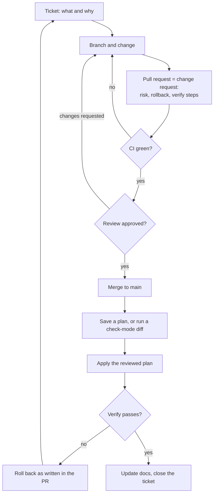
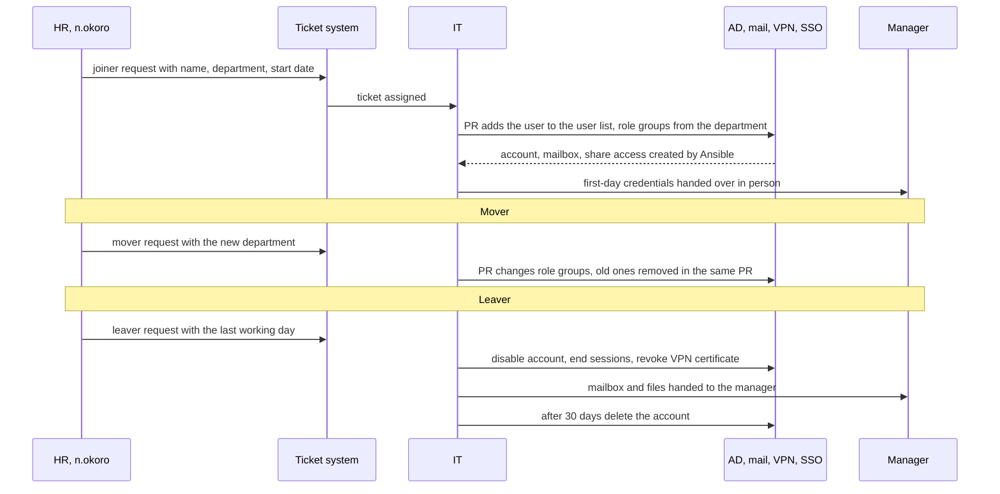
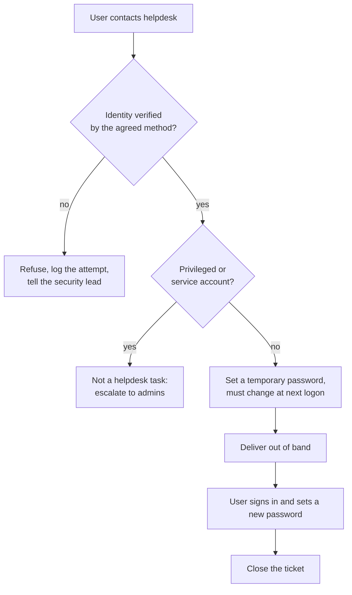
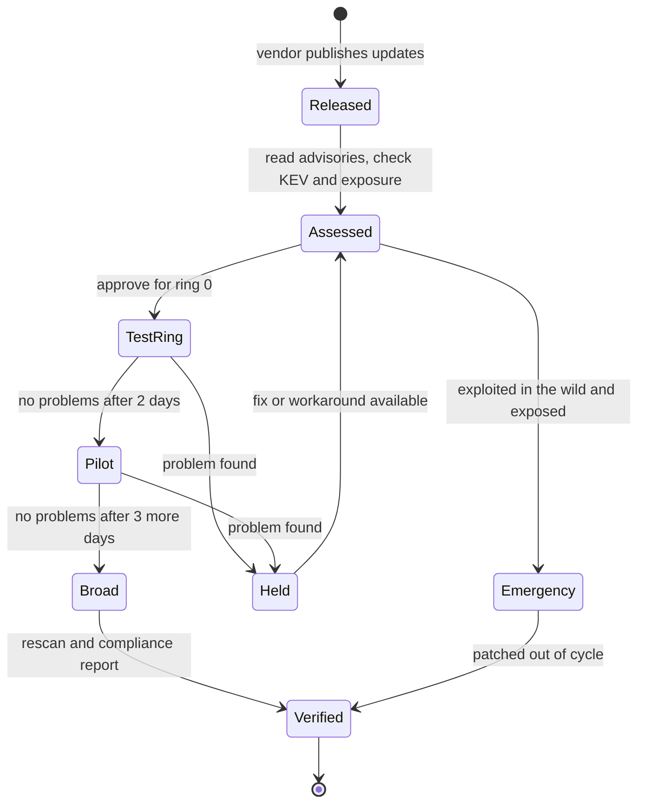
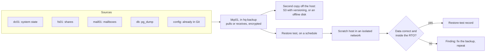
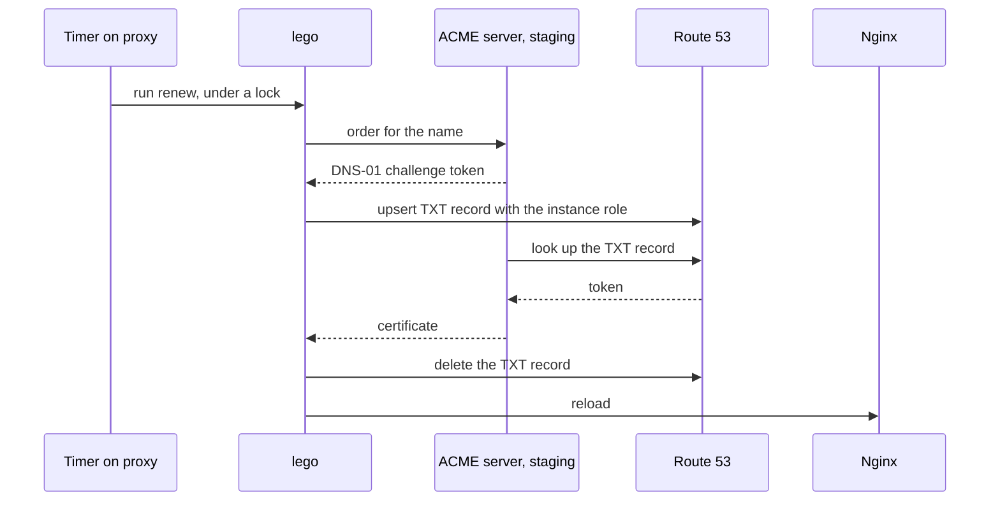
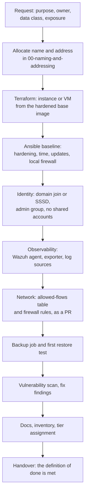
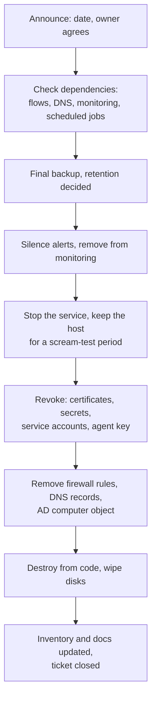

# 03 · Operations flows

> **Status: PROPOSED.** Eight flows, each with a diagram, a step table and a runbook. The flows
> describe how Quillmere's IT works from Stage 1 on; Stage 0 already follows flow 1 in a simpler
> form (branch per change, merge on green CI, reviewed plans, decision 142). Names come from
> `00-naming-and-addressing.md`.

> **Assumptions**
>
> 1. Tickets are GitHub Issues at Stage 1 and `glpi01` from Stage 2. Either works for every flow.
> 2. You keep applying Terraform yourself from a saved, reviewed plan, as today.
> 3. Windows event IDs are from memory and standard, but check them against your audit policy
>    (verify): an event appears only if the matching audit subcategory is enabled.
> 4. Deadlines and intervals (patch windows, retention) are common policy values, not rules. A
>    real company sets them from its own risk assessment.

---

## 1. Why processes, and how to practise them alone

A process is a decision made once so it need not be remade under pressure. A leaver process
exists because the day someone is fired isn't the day to work out which systems they could
reach.

In the lab, "running a process" means three concrete things:

1. A **ticket** exists for each run (who asked, when, what).
2. The **runbook** was followed step by step, and deviations are written in the ticket.
3. The **evidence** named in the step table was actually looked at.

Run each process at least twice per stage. The first run finds the gaps in the runbook; the
second proves the runbook.

---

## 2. The UI principle

**The rule.** Configuration changes go through reviewed code. Web UIs are for looking.

**The concept: configuration drift.** A system has a *declared* state (the repository) and an
*actual* state (what is running). Every change made outside the repository widens the gap.
Drift costs you:

| What breaks | Why |
|---|---|
| Rebuild from code | the rebuilt system lacks the clicked change, so it behaves differently from the one you tested |
| Review | nobody approved the click; separation of duties is gone |
| Audit trail | "who changed this rule and why?" has no answer in Git |
| Incident response | you can't tell an attacker's change from an admin's undocumented one |

**Read-only UIs in the lab**

| UI | Shows | Read-only how |
|---|---|---|
| Wazuh dashboard | SIEM alerts | `APP-Wazuh-ReadOnly`; rules live in the `siem` role |
| Grafana | health and firewall dashboards | dashboards provisioned read-only (decision 122); `APP-Grafana-Viewer` |
| EveBox (PROPOSED) | Suricata events and flows | no rule management in it; rules live in `suricata-rules/` |
| Proxmox UI | VM state, consoles | `APP-PVE-Auditor` for everyone except break-glass |
| OPNsense UI | rules, states, logs | a read-only group; changes through the API from Ansible |

**How to detect drift**

| System | Check | Expected |
|---|---|---|
| Terraform-managed | `terraform plan` | no changes |
| Ansible-managed | `ansible-playbook site.yml --check --diff` | `changed=0` |
| OPNsense | export `config.xml`, diff against the last committed export | no difference |
| AD | run the AD role in check mode; compare group members with the user list | no difference |

Run the checks at the start of every session. A non-empty diff is a finding: either someone
(you) changed something by hand, or the code is wrong.

**Where a real company accepts a UI**

| Case | Why it's accepted | The condition |
|---|---|---|
| Break-glass during an outage | the pipeline may depend on the thing that is broken | named emergency account, alert on use, change back-ported to code within a day |
| Investigation | analysts need ad-hoc queries | read-only role |
| Products without a usable API | common with appliances and older Windows roles | export and commit the configuration after each change |
| Day-to-day data | resetting a password or closing a ticket is data, not configuration | the tool's own audit log |
| Small teams with no automation skills | honest reality at 30 people | at least: a change ticket and a configuration backup |

**Interview line:** "I treat the UI as a monitor and Git as the keyboard. Where I had to click,
I exported the result and committed it, so a diff still shows every change."

---

## 3. Flow 1: change management (a PR is the change request)

| Step | Who | Tool | Evidence | What can go wrong |
|---|---|---|---|---|
| Ticket | the requester | GitHub Issues or `glpi01` | the ticket | a change with no stated reason can't be reviewed against its goal |
| Branch and change | the author | Git, in a worktree | commits (Conventional Commits) | a PR that changes five things; nobody can tell which one broke |
| Pull request | the author | PR template: what, why, risk, rollback, verify | the PR text | "rollback: revert" for a change that migrates data, which a revert can't undo |
| CI | automation | `terraform fmt` and `validate`, tflint, checkov, ansible-lint, gitleaks (built) | check results on the PR | CI is green because the changed path isn't tested at all |
| Review | Stage 1: you, the next day. Stage 2: the IT manager role. Stage 3: the path's `CODEOWNERS` | PR review | approval record | approving your own change at once; reviewing the diff but not the plan |
| Merge | the author | branch protection (built) | merge commit | applying from an unmerged branch (it happened once: see the note under task 1.23) |
| Plan | you | `make plan-up`, or `--check --diff` | the saved plan file | the plan was saved before a later merge, so it's stale |
| Apply | you | `make up` applies only the saved plan (decision 142) | Terraform output, Ansible recap | a partial apply; a handler lost when a run is interrupted (decision 103) |
| Verify | you | the PR's verify commands | command output pasted in the PR or ticket | verifying that the service runs, not that the change works |
| Rollback | you | as written in the PR | a second PR or a documented manual step | discovering during an outage that the rollback was never tested |
| Close | you | docs, `decisions.md` if a decision was made | closed ticket | docs left behind; they then describe a system that no longer exists |

**Change types (ITIL's terms, worth knowing)**

| Type | Meaning | Lab example | Approval |
|---|---|---|---|
| Standard | low-risk, done often, pre-approved | add a user from the joiner flow; bump a pinned version with a checksum | none beyond CI and the merge |
| Normal | everything else | a new firewall rule; a new GPO | review before merge |
| Emergency | must happen now to stop harm | disable a Suricata rule that drops real traffic (it happened: decision 82) | act first by the documented manual step, PR and review within a day |

**Runbook: normal change**

- [ ] Ticket exists and states the goal.
- [ ] The PR changes one thing (one role, module or rule set).
- [ ] The PR text has risk, rollback and verify commands with expected output.
- [ ] CI is green.
- [ ] A reviewer other than the author-in-the-same-hour approved.
- [ ] The plan or check-mode diff was read after the merge, not before.
- [ ] Applied from `main`.
- [ ] Verify output is recorded.
- [ ] Second Ansible run reports `changed=0`.
- [ ] Docs updated; ticket closed.

**Lab vs real.** A real change board also weighs business timing (not during month-end closing)
and communicates downtime to users. Add one line to your PR template, "who is affected and
when", so you practise thinking about it.

---

## 4. Flow 2: joiner, mover, leaver

| Step | Who | Tool | Evidence | What can go wrong |
|---|---|---|---|---|
| Joiner request | HR | ticket | the ticket; it's the authorisation | IT creates accounts on a hallway request, so no record exists of who authorised access |
| Create from code | IT | PR to the user list; Ansible `microsoft.ad.user` | event 4720 (created), 4722 (enabled), 4728 (added to group) | copying an existing user "like Tomas", which copies Tomas's excess rights too |
| First credentials | IT → manager | temporary password, must change at first logon | 4723 (password change) on day one | the first password sent by e-mail or chat |
| Mover | HR → IT | PR that adds new and **removes old** role groups | 4728 and 4729 | only adding: privilege creep, the most common access-review finding |
| Leaver: disable | IT, on the last day at the agreed hour | disable, move to `OU=Disabled`, reset the password | 4725 (disabled), 4724 (reset) | disabling next week; or disabling AD but forgetting the paths below |
| Leaver: sessions and other doors | IT | end Keycloak sessions; revoke the OpenVPN certificate and publish the CRL; remove from tool-local accounts | Keycloak admin event; the CRL's new serial; OpenVPN log refusing the certificate | **a disabled AD account doesn't end an open VPN tunnel, a web session or an SSH key** |
| Hand-over | IT → manager | mailbox converted or delegated; home folder moved | ticket note | deleting data the company must keep; keeping personal data longer than GDPR allows |
| Delete | IT, after 30 days | PR removes the user | 4726 (deleted) | deleting at once, then needing the account for an investigation |

**Runbook: leaver (the one that matters most)**

- [ ] Ticket from HR with the exact date and time.
- [ ] Disable the AD account; reset its password to a random value.
- [ ] Move it to `OU=Disabled`; remove all group memberships (record them in the ticket first).
- [ ] End sessions at `kc01` (Stage 2+).
- [ ] Revoke the VPN certificate; publish the CRL; confirm the old profile is refused.
- [ ] Check tool-local accounts: Wazuh, Grafana, `glpi01`, `hq-fw`, Proxmox, AWS.
- [ ] Remove SSH keys and personal access tokens (Git hosting, CI).
- [ ] Rotate any shared secret the person knew. List them honestly; there are always some.
- [ ] Hand mailbox and files to the manager.
- [ ] Verify from the outside: sign-in to webmail, VPN and SSO is refused.
- [ ] Diary entry: delete after 30 days.

**Lab vs real.** Real identity governance tools start the leaver flow automatically from the HR
system. You have a user list in code, which is a small version of the same idea: HR's record is
the source, and the directory follows it.

**Public repository note.** The user list contains only invented personas. If you ever put a
real name in it, it must leave the public repo.

---

## 5. Flow 3: password reset

| Step | Who | Tool | Evidence | What can go wrong |
|---|---|---|---|---|
| Contact | the user | phone, in person, ticket from a colleague's account | ticket | a request by e-mail from the "locked" account itself |
| Verify identity | helpdesk (`i.maren`) | the agreed method: call back on the number in the directory, or the manager confirms | ticket note saying how | **this is a social-engineering target.** Helpdesks reset passwords for callers who sound stressed and senior |
| Privilege check | helpdesk | the account's OU and groups | — | helpdesk able to reset admin passwords at all (`W2-05`); delegate the right on `OU=Staff` only |
| Reset | helpdesk | delegated "reset password" right | event 4724 on the DC, with who reset whom | resetting to a standard password everyone knows ("Welcome1") |
| Deliver | helpdesk | in person, or by phone to the verified number | ticket note | chat or e-mail to a mailbox the attacker may already read |
| First logon | the user | Windows | 4723 (change), 4624 | the user sets the old password pattern again; a banned-password list stops it |

**Detections that belong to this flow**

| Signal | Why it matters | Wazuh rule (PROPOSED range 100300–100499) |
|---|---|---|
| 4724 where the target is in a privileged group | helpdesk accounts are stolen in order to reset admin passwords | level 12 |
| many 4724 by one account in a short time | a compromised helpdesk account | level 10 |
| 4724 followed by a logon from a new address within minutes | account takeover through the helpdesk | correlation, level 10 |

**Runbook**

- [ ] Ticket opened before anything else.
- [ ] Identity verified by the agreed method; the method is written in the ticket.
- [ ] The account isn't privileged and isn't a service account.
- [ ] Temporary random password, "must change at next logon".
- [ ] Delivered out of band.
- [ ] Ticket closed after the user confirms.

**From Stage 2:** self-service reset through `kc01` with MFA. It removes the human target, and
moves the risk to the enrolment of the second factor: how does a user who lost the phone prove
who they are? That question is flow 3 again.

---

## 6. Flow 4: patching

| State | Who | Tool | Evidence | What can go wrong |
|---|---|---|---|---|
| Released | vendors | Microsoft's monthly release (second Tuesday); Ubuntu security notices | the advisory list | not knowing an update exists: no inventory, no patching |
| Assessed | the sysadmin, with the security lead | advisories, CISA KEV, EPSS, your own exposure | a ticket per cycle with the decision | sorting by CVSS only; a 9.8 on an unreachable host waits while an exploited 7.5 on the perimeter should not |
| Test ring | the sysadmin | Stage 1: Windows Update by GPO on `ws02`. Stage 2: `wsus01` approval for ring 0. Linux: `unattended-upgrades` already applies security updates (built) | update history; WSUS report | the test ring is a machine nobody uses, so nothing is ever tested |
| Pilot, Broad | the sysadmin | WSUS computer groups by GPO; Ansible `ansible.windows.win_updates`; reboots in the window | WSUS compliance; Ansible recap | servers patched but never rebooted: installed isn't the same as active |
| Verified | the vulnerability analyst | `gvm01` rescan; Wazuh's inventory | scan report with the finding gone | trusting the patch tool's own "success" |
| Held | the sysadmin | the ticket | reason and review date | a hold with no review date is a permanent exception |
| Emergency | the security lead decides | the emergency change path of flow 1 | ticket, timeline | patching both DCs at once |

**Rings**

| Ring | Hosts | When |
|---|---|---|
| 0 Test | `ws02`, and at Stage 2 one member server | day 0–2 |
| 1 Pilot | `ws01`, `ws03`, `fs01`, `dc02` | day 2–5 |
| 2 Broad | everything else; `dc01` last and never together with `dc02` | day 5–10 |

**Deadlines (a common policy; pick your own and write the reason)**

| Severity and context | Deadline |
|---|---|
| Exploited in the wild (KEV) and reachable | 48–72 hours |
| Critical | 7 days |
| High | 30 days |
| Medium | 90 days |
| Low | next maintenance cycle |

**Runbook: monthly cycle**

- [ ] Cycle ticket opened; advisories read; KEV checked.
- [ ] Snapshot or backup confirmed for ring 0 hosts.
- [ ] Ring 0 patched and rebooted; smoke test (logon, share, mail, web sign-in).
- [ ] Ring 1 after two clean days; ring 2 after three more.
- [ ] DCs one at a time; `repadmin /replsummary` clean before the next.
- [ ] Rescan with `gvm01`; compliance numbers in the ticket.
- [ ] Holds recorded with a review date.
- [ ] Pinned third-party versions (Wazuh, Grafana, Prometheus, CRS, lego) checked for new releases; each bump is its own PR, as today.

**Lab vs real: an important one.** The lab is rebuilt from code every session on AWS, so hosts
are patched at build time and "monthly patching" would be invisible. To practise patching you
need hosts that **live**: the Windows fleet from Stage 2 on AWS (stopped, not destroyed) and
everything on Proxmox. This is one of the strongest arguments for Proxmox in `comparison.md`.

---

## 7. Flow 5: backup and restore test

| Step | Who | Tool | Evidence | What can go wrong |
|---|---|---|---|---|
| Decide what and how often | the sysadmin, with the data owners | a table of RPO and RTO per system | the table, in the docs | backing up what is easy, not what matters |
| Back up | `bkp01` | Proxmox: PBS for whole VMs. AWS: restic to S3, `pg_dump` (task T2.3), Windows Server Backup for system state | job logs; an alert when a job is missed | the job has failed silently for months; alert on **absence** of a success |
| Isolate | the network admin | `hq-backup` VLAN; the backup server isn't domain-joined; it pulls, clients can't delete | firewall rules; a delete attempt from a client fails | backups reachable and deletable with Domain Admin: ransomware deletes them first |
| Second copy | `bkp01` | S3 with versioning and object lock, or a disk that is unplugged | the copy's own listing | both copies on the same host or the same account |
| Restore test | the sysadmin, quarterly and after any design change | restore into a scratch host with no route to production | **the restore-test record**: date, what, how long, result | restoring a file but never a whole system; restoring a DC into the live network |
| Check | the data owner | compare checksums; start the application; sign in | the record | "the restore finished" without opening the data |

**RPO and RTO.** The recovery point objective is how much data you may lose (time since the last
good backup). The recovery time objective is how long the restore may take. Both are business
decisions with a cost, not technical defaults.

| System | RPO | RTO | Method | Lab note |
|---|---|---|---|---|
| `db` (Mailbridge) | 24 h | 4 h | nightly `pg_dump` to S3 (T2.3) | already planned; the restore test is part of the task |
| `dc01`, `dc02` | 24 h | 8 h | system state; the second DC is the first line of recovery | restoring a single DC into a domain that still has a healthy one is usually wrong: rebuild and re-promote instead |
| `fs01` | 24 h | 8 h | file-level, with versions | previous versions teach users to self-restore |
| `mail01` | 24 h | 8 h | Maildir and configuration | |
| `siem` data | 24 h | 24 h | the persistent volume (built), plus snapshots | logs are evidence; losing them during an incident is the worst time |
| Configuration | 0 | — | Git | a rebuild from code is itself a restore test |

**The 3-2-1 rule.** Three copies, on two different media or systems, one off-site. Ransomware
added two more ideas: one copy **immutable or offline**, and **zero errors** in restore tests.

**Runbook: quarterly restore test**

- [ ] Pick one system by rotation, and once a year "everything, from nothing".
- [ ] Start a scratch host in an isolated network.
- [ ] Restore from the **second** copy, not the first.
- [ ] Time it from the start to "the application works".
- [ ] Verify the content: checksums, row counts, sign-in.
- [ ] Record: date, system, backup date, duration against RTO, result, problems.
- [ ] Destroy the scratch host.
- [ ] Any problem becomes a ticket.

**Interview line:** "A backup that was never restored is a hope, not a backup. My record shows
the last restore of each system and how long it took."

---

## 8. Flow 6: certificate renewal

Quillmere has four kinds of certificate. Each has a different owner, lifetime and failure.

| PKI | Issues | Lifetime | Renewal | The classic outage |
|---|---|---|---|---|
| Public ACME (Let's Encrypt staging) **(built)** | `mail.<domain>`, `vuln.<domain>` | about 90 days or less (verify the current policy) | automatic: `lego-renew@` timers | the DNS-01 permission is removed, and renewal fails silently until expiry |
| VPN CA, easy-rsa, offline **(built)** | server and device certificates, the CRL | certificates: long; **the CRL: short** | manual, on the laptop | the CRL passes `nextUpdate` and **every** VPN login is refused |
| Wazuh root CA **(built)** | SIEM and Grafana certificates | 10 years and about 2 years | manual re-sign procedure | the people who knew the procedure have left |
| AD CS on `ca01` (PROPOSED, Stage 2) | computer, user and LDAPS certificates | 1–2 years | auto-enrolment by GPO | the issuing CA's own certificate or CRL expires |

| Step | Who | Tool | Evidence | What can go wrong |
|---|---|---|---|---|
| Timer | systemd on `proxy` | `lego-renew@<name>.timer` (decision 136) | journal entry per run | the host exists only during sessions, so a timer may never run; renewal then happens at build time |
| Challenge | lego | ACME DNS-01 | lego log | rate limits on the production endpoint (the reason for staging) |
| TXT record | lego | Route 53, with the narrow IAM condition (decision 60) | CloudTrail `ChangeResourceRecordSets` | the IAM condition is too narrow for a new name; or too wide, so `proxy` could repoint `vpn.<domain>` |
| Issue | the CA | — | the certificate, and for production a Certificate Transparency entry | the name becomes public knowledge through CT logs |
| Reload | lego hook | `nginx -s reload` | Nginx log; the probe's expiry metric jumps | the new certificate is on disk but Nginx still serves the old one |
| Watch | `mon` | blackbox exporter and `CertExpiresSoon` (built) | the alert | monitoring only public certificates; the CRL and internal CAs expire unseen |

**Runbook: certificate inventory and renewal**

- [ ] Keep an inventory: name, issuer, where installed, expiry, renewal method, owner.
- [ ] Every certificate with a network listener is probed for expiry.
- [ ] The VPN CRL's `nextUpdate` is in the inventory and has an alert (PROPOSED: a small exporter or a scheduled check).
- [ ] Manual renewals have a written procedure that was tested on a throwaway CA (as done for Wazuh, decision 90).
- [ ] After each renewal: the served certificate is checked from a client, not only the file on disk.
- [ ] CA private keys are offline or in a host no service role can read (built).

**Lab vs real.** Public certificate lifetimes are getting shorter by industry decision (verify
the current schedule). This makes manual renewal unworkable and is why automation, which you
already have, is the job-relevant skill.

---

## 9. Flow 7: onboarding a new server

| Step | Who | Tool | Evidence | What can go wrong |
|---|---|---|---|---|
| Request | the service owner | ticket | owner and data class recorded | a server with no owner: nobody patches it, nobody dares remove it |
| Allocate | the network admin | the tables in `00-naming-and-addressing.md` (later NetBox, see `07-extra-ideas.md`) | the PR to that file | address reuse; a name that says nothing |
| Create | the platform team | Terraform; Packer image | plan, apply | a hand-made VM "for now" |
| Baseline | the platform team | the `common` role (built) and a Windows equivalent: CIS-based hardening | Ansible recap; a CIS scan score | hardening applied once and never checked again |
| Identity | the identity team | domain join by Ansible; local admin by LAPS; an admin group per server | event 4741 (computer account created) | the join account can add unlimited machines; local accounts with standing passwords |
| Observability | the SOC engineer | `wazuh_agent` and `node_exporter` roles (built); Sysmon on Windows | the agent is `Active`; the target is `up`; a test event arrives | a host that is running but invisible. **No agent, no production** |
| Network | the network admin | PR to the flows table and the rules | drop logs show nothing unexpected | "allow any from the new server for now" |
| Backup | the sysadmin | a job on `bkp01` | first successful job; first restore | added "later" |
| Scan | the vulnerability analyst | `gvm01`, authenticated | the report | scanning unauthenticated and calling the host clean |
| Docs | the owner | `ARCHITECTURE.md`, inventory | the PR | docs drift from day one |

**Definition of done for a server** (extends "Done means" in `CLAUDE.md`)

- [ ] Built from code; rebuild tested; second run `changed=0`.
- [ ] Listed in the inventory with an owner and a tier.
- [ ] Hardened baseline applied and measured.
- [ ] No shared or default credentials.
- [ ] Wazuh agent active and a test event visible.
- [ ] Prometheus target `up` and alert rules cover it.
- [ ] Only the flows in the table are allowed; a forbidden flow was tried and logged as dropped.
- [ ] Backed up, and restored once.
- [ ] Scanned; findings fixed or accepted in writing.
- [ ] Docs updated.

---

## 10. Flow 8: decommissioning

| Step | Who | Tool | Evidence | What can go wrong |
|---|---|---|---|---|
| Announce | the owner | ticket | agreement | removing a server someone still uses |
| Dependencies | the platform team | firewall and flow logs for the last 30 days; DNS query logs | the list of clients | missing the job that runs once a quarter |
| Final backup | the sysadmin | `bkp01` | the backup and a retention date | keeping personal data forever "just in case" |
| Monitoring | the SOC engineer | remove targets and agent | no `TargetDown` alert fires | the alert fires at 03:00 and is ignored, which teaches people to ignore alerts |
| Scream test | the owner | stop the service for a week | no complaints | skipping it |
| Revoke | the identity team | revoke certificates; delete parameters or Vault paths; disable service accounts; remove the Wazuh agent | CRL entry; 4725; secret store audit | credentials that outlive the server are the main risk of this flow |
| Network clean-up | the network admin | PR removing rules and records | the diff | **orphaned firewall rules** that a later host with the same address inherits; **dangling DNS** records that an attacker can claim |
| Destroy | the platform team | `terraform destroy` of that resource, from a reviewed plan | plan and apply output | orphaned volumes and snapshots that keep billing or keep data |
| Inventory | the owner | docs | the PR | the inventory still lists it, so the next audit hunts a ghost |

**Runbook**

- [ ] Ticket, owner's agreement, date.
- [ ] 30 days of flow logs checked for clients.
- [ ] Final backup taken; retention date set.
- [ ] Monitoring and agent removed first.
- [ ] Scream test passed.
- [ ] Certificates revoked; secrets deleted; service accounts disabled.
- [ ] Firewall rules, DNS records and the AD computer object removed.
- [ ] Destroyed from a reviewed plan; no volume, snapshot or address left.
- [ ] Inventory, flows table and docs updated.

**Lab vs real.** You already decommission the whole lab after every session with `make down`,
and you already check that no instance, address or volume is left. That is this flow in its
bulk form. The single-host version above adds what bulk teardown hides: the references *other*
systems still hold to the host that is gone.

---

## 11. Which flow starts at which stage

| Flow | Stage 0 | Stage 1 | Stage 2 | Stage 3 |
|---|---|---|---|---|
| 1 Change | built: PR, CI, reviewed plan | plus tickets | plus a separate approver role, change types | plus `CODEOWNERS`, Tier 0 change records |
| 2 JML | — | manual, ticketed, from code | plus SSO session revocation | plus access requests through `pam01` |
| 3 Password reset | — | by the IT admin | by helpdesk with delegation; self-service | privileged accounts never through helpdesk |
| 4 Patching | at build time | monthly by GPO | WSUS rings, deadlines, rescan | measured SLAs per tier |
| 5 Backup | T2.3 | file, mail, system state | isolated `bkp01`, second copy | immutable copy, DR exercise |
| 6 Certificates | built: ACME, offline CAs | inventory | AD CS auto-enrolment | short-lived certificates from `vault01` or `pam01` |
| 7 Onboarding | implicit in each role | checklist | definition of done enforced in review | pipeline-enforced |
| 8 Decommissioning | `make down` | checklist | with dependency check | with data-retention rules |
