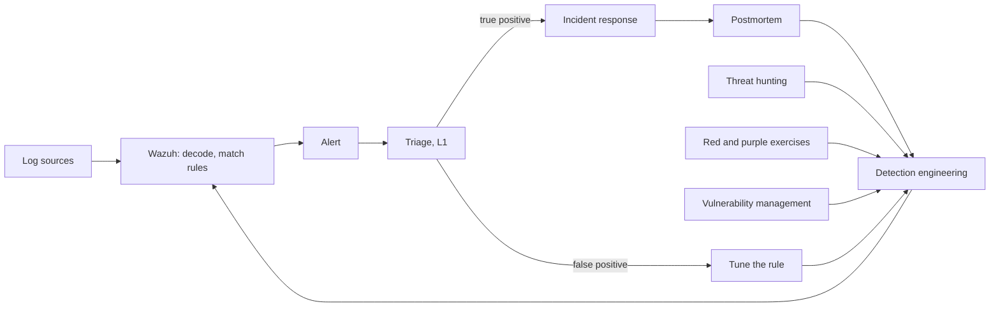
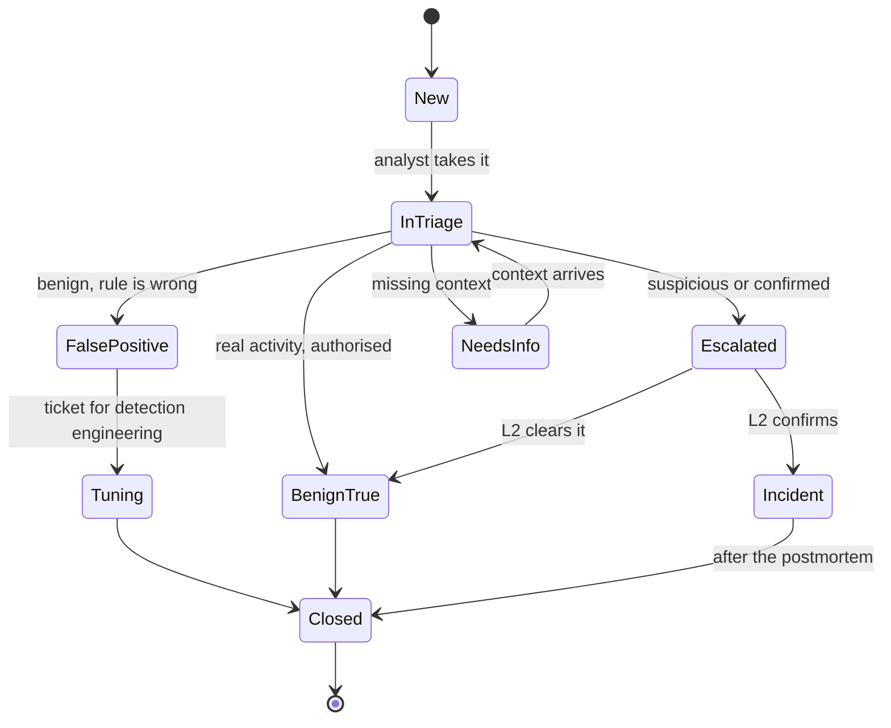
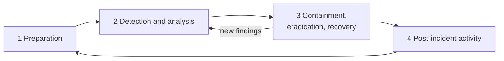
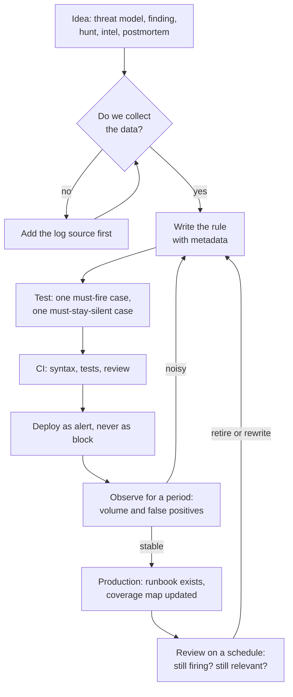
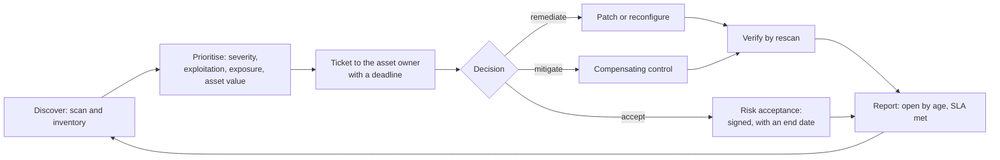
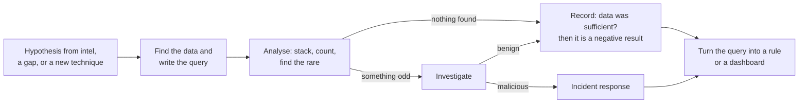

# 04 · Security operations

> **Status: PROPOSED**, except items marked **(built)**, which describe detections that exist in
> the Stage 0 lab (Wazuh rules 100100–100213, Suricata rules 1000001–1000007, five Prometheus
> alerts). Names come from `00-naming-and-addressing.md`.

> **Assumptions**
>
> 1. Wazuh stays the SIEM at every stage. Other SIEMs are discussed only as learning extras
>    (`06-learning-path.md`).
> 2. NIST SP 800-61 is taught here in its Revision 2 form (the four-phase lifecycle that
>    interviews ask about). Revision 3 reorganises the same activities around the NIST
>    Cybersecurity Framework 2.0 functions (verify the current revision before citing it).
> 3. Windows event IDs and ATT&CK technique IDs are from memory (verify against your audit
>    policy and the current ATT&CK version).

---

## 1. The whole loop on one page



| Step | Who | Tool | Evidence | What can go wrong |
|---|---|---|---|---|
| Log sources | every host | Wazuh agents, Sysmon, Suricata, firewall logs | events in the indexer | a source stops sending and nobody notices: silence looks like safety |
| Rules | SOC engineer | Wazuh rules, Suricata rules, Sigma (Stage 3) | rule files in Git | rules written but never tested against a real event |
| Triage | SOC analyst | Wazuh dashboard, runbooks | the alert's closing note | closing by habit |
| Incident response | the incident lead | the IR plan, section 3 | timeline, case record | improvising |
| Postmortem | everyone involved | the template in section 3.5 | the postmortem | blaming a person, so the next person hides mistakes |
| Detection engineering | detection engineer | section 4 | new or changed rules with tests | fixing the one alert, not the class of problem |
| Hunting, exercises, vulnerabilities | hunter, red role, analyst | sections 5, 8; `05-offensive-engagements.md` | hunt reports, findings | results that never become rules |

The point of the picture: **every arrow ends in detection engineering.** A SOC that only closes
alerts stays as blind tomorrow as it is today.

---

## 2. Alert lifecycle



| State | Who | Tool | Evidence | What can go wrong |
|---|---|---|---|---|
| New | Wazuh | rule match → alert; level 10+ also to Discord through Alertmanager or a Wazuh integration | the alert document | too many: an analyst can honestly handle a few dozen a day |
| In triage | L1 (`p.lindqvist`) | the runbook for that rule | the analyst's name and start time | no runbook, so every analyst decides differently |
| False positive | L1 | — | closing note stating why | closing as false positive when it was authorised activity; the two need different fixes |
| Benign true positive | L1 | the change calendar, the RoE of a running test | note linking the ticket or engagement | an attacker hiding behind a scheduled pentest |
| Needs info | L1 | ask the user or system owner | the question and answer | asking the possibly compromised user over the possibly compromised mailbox |
| Escalated | L1 → L2 | hand-over note: what, when, which host and user, what was checked | the note | "please check" with no facts |
| Incident | L2, incident lead | section 3 | a case in `thehive01` (Stage 3) or a ticket | declaring too late |
| Tuning | detection engineer | section 4 | a PR with a test case from the false positive | disabling the rule instead of narrowing it |

### 2.1 Severity and response time

| Wazuh level | Meaning in this lab | Example **(built unless marked)** | First look within |
|---|---|---|---|
| 0–4 | noise or context; not stored or not alerted | firewall egress (100102, level 3) | — |
| 5–7 | worth storing; reviewed in bulk | one blocked request (100201, level 6) | next working day |
| 8–11 | suspicious; one analyst looks | brute force (100211, level 10); port scan (100103, level 10) | 4 hours |
| 12+ | likely compromise; page someone | PROPOSED: Tier 0 account used outside Tier 0; honey account touched; DCSync | 15 minutes |

### 2.2 L1 triage checklist (every alert)

- [ ] **What fired?** Read the rule description and its ATT&CK technique.
- [ ] **Who and where?** Source address → device certificate or host; user; destination.
- [ ] **Is it expected?** Change calendar, running engagement (check the RoE's times and source addresses), known scanner (`gvm01`).
- [ ] **What happened around it?** Same source and same user, 30 minutes before and after.
- [ ] **Did it succeed?** A blocked attempt and a successful one are different alerts in one costume.
- [ ] **Decide:** false positive, benign true positive, or escalate. Write one sentence of reasoning.

### 2.3 Example L1 runbook: rule 100211 (brute force, T1110) **(rule built; runbook PROPOSED)**

| Step | Action | Decision |
|---|---|---|
| 1 | Open the alert. Note the source address, the site (`mail.access.log` or `vuln.access.log`) and the time window | — |
| 2 | Map the address to a VPN certificate from the OpenVPN connect log | attacker certificate during an engagement → benign true positive, link the RoE |
| 3 | Count 401s and look for a 200 or 302 on the sign-in path from the same address afterwards | a success after failures → **escalate at once** |
| 4 | Check 100212 (rate limit) for the same source | present → the limiter is holding the attacker back |
| 5 | Check whether one account or many were tried (application log) | many accounts, few tries each → spraying; note it |
| 6 | Unknown certificate, or a staff certificate behaving like this → escalate; propose revoking the certificate | — |

Write one runbook like this per rule at level 8 or above. A rule without a runbook produces an
alert nobody knows how to act on.

---

## 3. Incident response (NIST SP 800-61)



| Phase | Who | Tool | Evidence | What can go wrong |
|---|---|---|---|---|
| Preparation | security lead | the IR plan, contact list, runbooks, tested backups, log retention, a forensic toolkit | the plan; a tabletop record | a plan nobody rehearsed; logs that rotate before anyone looks |
| Detection and analysis | SOC, incident lead | Wazuh, Suricata `eve.json`, flow logs, CloudTrail, Velociraptor (Stage 3) | timeline; scope: which hosts, accounts, data | "fixing" the first infected host and missing the other four |
| Containment | incident lead decides, admins act | section 3.2 | actions with timestamps | containing so loudly that the attacker knows and destroys evidence; or wiping before collecting |
| Eradication | admins | remove persistence, rotate credentials, patch the entry point | list of removed artefacts, rotated secrets | rotating passwords while the attacker still holds a domain controller |
| Recovery | admins, service owners | rebuild from code, restore data (flow 5), watch closely | verify output; extra monitoring period | restoring the backup that already contains the implant |
| Post-incident | everyone | postmortem, section 3.5 | the postmortem; new rules and fixes | skipping it because everyone is tired |

The loop back from phase 3 to phase 2 is the important line: containment reveals more scope.

### 3.1 Roles

| Role | Does | In the lab |
|---|---|---|
| Incident lead | decides, keeps the timeline, speaks for the response | you, with a timer and a log file |
| Analyst | investigates, collects evidence | you |
| Admin | carries out containment and recovery | you, with the admin account |
| Communications | tells management, users, customers, regulators | you write the three messages (section 3.4) |
| Scribe | records every action with a time | a plain text file; non-negotiable |

### 3.2 Containment options

| Goal | AWS | Proxmox |
|---|---|---|
| Isolate a host and keep it running for forensics | replace its security groups with an empty "quarantine" group; keep SSM for the responder | move the VM's interface to an isolated VLAN, or set the VM firewall to drop |
| Preserve memory | harder: no hypervisor memory capture for you; run a memory tool in the guest before anything else | snapshot **including RAM**; the state is frozen without touching the guest |
| Preserve disk | EBS snapshot, then work on a copy | VM snapshot or a PBS backup, then work on a clone |
| Cut off an identity | disable the AD account; end `kc01` sessions; revoke the VPN certificate and publish the CRL; for an instance role, attach a deny policy for sessions older than now | the same, without the IAM part |
| Stop traffic | an nftables drop on `fw-ips` or `hq-fw` for the address; a Suricata `drop` rule | an OPNsense block rule or alias |
| Kill switch for the whole range | `make down` | disconnect `isp-rtr`'s home-side interface |

**Order of volatility.** Collect what disappears first: memory, network connections and running
processes, then disk, then logs already held centrally. Deciding to "just rebuild from code",
which the lab makes very easy, destroys the evidence. In an incident exercise, **snapshot
before you rebuild**.

### 3.3 Evidence handling

- Export raw logs before teardown **(built: `evidence.yml`, with `SHA256SUMS`, decision 107)**.
- Record for each item: what, from where, when (UTC), by whom, hash.
- Work on copies. Keep originals read-only.
- Evidence stays out of the public repository.

This is a small chain of custody. In a real case it decides whether evidence can be used in
court or in an employment dispute.

### 3.4 Communication

Write these three during every exercise, even though nobody reads them:

| Message | To | Within | Content |
|---|---|---|---|
| Internal alert | management | 1 hour of declaring | what we know, what we don't, what we're doing, next update time |
| User notice | affected staff | when action is needed from them | what to do (change password, don't open X), no speculation |
| Regulator or customer notice | data protection authority, customers | GDPR: 72 hours after becoming aware of a personal-data breach; NIS2 has its own staged deadlines (verify) | facts, impact, measures, contact |

### 3.5 Postmortem template

```markdown
# Postmortem: <short title>

- Date of incident:            Severity:            Author:
- Status: draft | reviewed

## Summary
Three sentences: what happened, the impact, how it ended.

## Timeline (UTC)
| Time | Event | Source of evidence |
|---|---|---|

## Detection
- How was it detected, and by which rule or person?
- Time from first malicious action to detection (MTTD):
- What should have detected it earlier, and why didn't it?

## Response
- Time from detection to containment (MTTR):
- What worked, and what slowed us down?

## Root cause
The technical cause and the process cause. Ask "why" until the answer is a process, not a person.

## Impact
Systems, data, accounts, duration.

## What went well

## Actions
| Action | Type (prevent / detect / respond) | Owner | Due | Ticket |
|---|---|---|---|---|

## ATT&CK techniques observed
| Technique | Evidence | Detected? |
|---|---|---|
```

**Blameless means:** the postmortem names decisions and conditions, not culprits. The lab's own
example is decision 82: a Suricata rule promoted to `drop` took the application down. The
recorded cause was not "a mistake"; it was "synthetic captures were too simple to show the
problem", and the action was "three realistic captures must stay silent before any promotion".
That is the pattern to copy.

### 3.6 Tabletop exercises (Stage 3)

A tabletop is a rehearsal on paper: a scenario is read out step by step and the team says what
it would do. Three scenarios that fit Quillmere:

1. Ransomware note on `fs01` on a Friday evening; backups are on `bkp01`.
2. A customer reports their mailbox tokens were used from an unknown address (Mailbridge breach).
3. CloudTrail shows an access key created for a role that should have none.

Record for each: decisions, the open questions the plan didn't answer, and the changes made to
the plan afterwards.

---

## 4. Detection engineering lifecycle



| Step | Who | Tool | Evidence | What can go wrong |
|---|---|---|---|---|
| Idea | anyone | a ticket with the technique ID | the ticket | writing rules for what is easy to detect, not for what the threat model fears |
| Data check | detection engineer | search the indexer for the event the rule needs | a sample event | writing a rule for a field the decoder never fills (the lab's own case: Suricata 1000002 can't fire) |
| Write | detection engineer | Wazuh XML, Suricata, Sigma at Stage 3 | the rule with ID, description, level, technique, author, date, references | one giant regex nobody can explain |
| Test | detection engineer | `wazuh-logtest` on real lines; `suricata -r` on captures; `promtool test rules` **(all built)**; Atomic Red Team (Stage 2) | the test files in the repo | **a test that can't fail.** Every harness needs a case that must be caught (a lesson already recorded in the Tier 1 write-up) |
| CI | automation | syntax checks; replay of the test set | check results | tests run only on the engineer's laptop |
| Deploy as alert | SOC engineer | Ansible | the rule loaded; a test event fires it live | deploying as `drop` first (decision 82) |
| Observe | SOC | alert counts per day | the numbers | no baseline, so nobody knows what "noisy" means |
| Production | SOC lead | runbook written; coverage map row updated | both | a rule in production without a runbook |
| Review | detection engineer | quarterly: rules that never fired, rules always closed as false positive | the review record | rule sets only grow; nobody deletes |

### 4.1 Rule metadata (keep with every rule)

| Field | Example |
|---|---|
| ID and name | 100211 · many refused sign-ins from one address |
| Technique | T1110 |
| Data source | Nginx access log, per site |
| Logic in one sentence | 10 POSTs answered 401 from one address in 5 minutes |
| Known gaps | a slow guesser under 2 per minute; a guesser who rotates addresses |
| False positives seen | none yet |
| Test | `wazuh-logtest` with the sample lines in the repo |
| Runbook | section 2.3 |

"Known gaps" is the field that makes you credible. Every rule misses something; the engineer
who can say what, without being asked, understands the rule.

### 4.2 Detection as code (Stage 3)

- Rules in **Sigma**, a vendor-neutral format, converted to Wazuh (verify converter support for
  Wazuh; otherwise convert to the indexer's query language and keep Wazuh XML for real-time
  rules).
- CI: lint, convert, replay a library of sample events, fail on any unexpected match or miss.
- Each rule file carries the metadata above; the coverage map (section 7) is generated from it.

**Options.** A: stay with Wazuh XML plus tests (recommended through Stage 2: one tool, fully
understood). B: Sigma in CI converted for Wazuh (Stage 3: portable skills, matches job adverts).
C: a second SIEM such as Elastic or Splunk's free tier for comparison (extra idea; costs RAM and
focus).

---

## 5. Vulnerability management



| Step | Who | Tool | Evidence | What can go wrong |
|---|---|---|---|---|
| Discover | vulnerability analyst | `gvm01` authenticated scans (T3.2); Trivy for images (T2.2); Wazuh inventory; ECR scan on push **(built)** | scan reports | unauthenticated scans; assets missing from the scope because the inventory is wrong |
| Prioritise | analyst with the security lead | CVSS for severity, EPSS for likelihood, KEV for "exploited now", plus your own exposure and asset tier | a ranked list | chasing CVSS 9.8 on an isolated host while a KEV-listed 7.5 faces the VPN |
| Ticket | analyst | `glpi01` | ticket with owner and deadline | findings mailed as a 300-page PDF nobody opens |
| Remediate | asset owner | flow 4 in `03-operations-flows.md` | change record | the owner closes the ticket without fixing |
| Mitigate | owner with security | a firewall rule, a WAF rule, disabling a feature | the control, and its test | a "temporary" mitigation that becomes permanent |
| Accept | the risk owner (management) | risk register entry | signed acceptance with a review date | security accepting risk on the business's behalf |
| Verify | analyst | rescan of that host | finding closed by the scanner | closing on the owner's word |
| Report | analyst | monthly numbers | open findings by age and severity; percentage inside SLA | reporting counts found (looks bad) instead of time to fix (shows control) |

**The lab already has a real accepted risk** to model on: CRS 4.25.0 lacks three fixes that need
a newer engine (decision 63), tracked as task T2.4. It has a reason, a compensating control and a
planned end. Write it into the risk register as entry one.

---

## 6. Log sources per stage

| Source | What it shows | Stage | Collected how | Key events |
|---|---|---|---|---|
| nftables on `fw-ips` | blocked and egress traffic | 0 (built) | journald → Wazuh agent | `FW-DROP`, `FW-INPUT-DROP`, `FW-EGRESS` |
| Suricata `eve.json` | alerts, TLS, DNS, flows | 0 (built) | agent reads JSON | alert, tls, flow, drop |
| Nginx and ModSecurity | web requests, WAF blocks | 0 (built) | per-site access logs, error log, audit log | 401, 403, 429; CRS rule IDs |
| OpenVPN | who connected, from where | 0 (built) | journald | connect, disconnect, tls-crypt rejection |
| Linux auth | sudo, logins | 0 (built) | journald | PAM, sudo |
| Container egress | attempts from Juice Shop | 0 (built) | kernel log on `vuln` | `VULN-EGRESS-DROP` |
| CloudTrail | AWS control plane | 0 (built, to S3) | PROPOSED: Wazuh's AWS module reading the bucket | console logins, IAM changes, `PassRole` |
| VPC flow logs | all traffic metadata | 0 (built, to S3) | stays in S3; queried on demand | `REJECT` records |
| GuardDuty | AWS threat findings | 0 (task 2.14) | PROPOSED: findings into Wazuh | credential use from outside, recon |
| Windows Security log | logons, account changes, Kerberos | 1 | Wazuh agent on every Windows host; advanced audit policy by GPO | 4624, 4625, 4648, 4672, 4720–4740, 4768, 4769, 4771, 4776 |
| Sysmon | process, network, file, registry detail | 1 | Sysmon with a community configuration, read by the Wazuh agent | 1 process, 3 network, 10 process access, 11 file create, 13 registry, 22 DNS |
| PowerShell | script content | 1 | script block logging by GPO | 4104 |
| `hq-fw` | office perimeter and inter-VLAN traffic | 1 | syslog to Wazuh; Suricata `eve.json` | blocks, IPS alerts |
| `mail01` | mail flow, spam verdicts, sign-ins | 1 | Postfix, Dovecot and Rspamd logs | delivery, authentication failures |
| `fs01` file auditing | who read or changed what | 1 | object access auditing on selected folders | 4663, 5145 |
| DNS on the DCs | what clients look up | 2 | DNS analytical log, or Sysmon 22 on clients | long names, rare domains |
| AD CS on `ca01` | certificate requests | 2 | CA auditing | 4886, 4887 |
| `kc01` | sign-ins, MFA, admin changes | 2 | Keycloak event log | login, login error, token exchange |
| `wsus01`, `gvm01` | patch and vulnerability state | 2 | reports; Greenbone's own alerts | — |
| Directory changes | who changed AD objects | 2 | directory service changes auditing | 5136, 4662 |
| `pam01` | privileged sessions | 3 | audit events, recordings | session start, command log |
| `vault01` | secret access | 3 (1 on Proxmox) | audit device | read of a path, by which identity |
| k3s | API server audit | 3 | audit policy → file → agent | create pod, exec, secrets read |
| Zeek (PROPOSED) | rich network metadata | 3 | on a mirror port (Proxmox) or Traffic Mirroring (AWS) | conn, dns, http, ssl, kerberos, smb |
| Proxmox | hypervisor actions | 1 (Proxmox) | task log and `pveproxy` access log → agent on `pve01` | VM start, console open, config change |

**Rule for adding a source** (already the lab's habit, decision 105): one reviewed line per
source, a test event proven in the dashboard, and a note of which rules use it. A source nobody
has a rule or a hunt for is cost without value.

**Windows audit policy is the trap.** Windows logs very little by default. Process creation with
command lines (4688), Kerberos service tickets (4769) and directory changes (5136) each need a
setting. Deploy the audit policy by GPO from code and verify with `auditpol /get /category:*`.

---

## 7. ATT&CK coverage matrix template

One row per technique you care about. "Result" uses the lab's existing vocabulary from
`findings-report.md`: **blocked**, **detected**, **missed**.

| Tactic | Technique | Stage | Test (how it's exercised) | Data source | Detection | Result | Fix / next step | Last tested |
|---|---|---|---|---|---|---|---|---|
| Reconnaissance / Discovery | T1046 Network service discovery | 0 | port scan from the VPN | nftables drops | Wazuh 100103 **(built)** | detected (live, 2026-11-06) | — | 2026-11-06 |
| Initial access | T1190 Exploit public-facing application | 0 | SQLi and XSS against both sites | ModSecurity audit log | CRS 942100, 949110; Wazuh 100201 **(built)** | blocked and detected | bypass tests in task 2.15 | 2026-11-09 |
| Credential access | T1110 Brute force | 0 | wrong passwords against the sign-in | per-site access logs | Wazuh 100210, 100211, 100212 **(built)** | detected; fast bursts limited by Nginx | slow-guess gap noted | 2026-11-09 |
| Command and control | T1071 Application layer protocol | 0 | connection attempt from inside the Juice Shop container | kernel log on `vuln` | Wazuh 100120 **(built)** | blocked and detected | — | 2026-11-09 |
| Impact | T1498 Network denial of service | 0 | request flood | Nginx error log; Suricata | Wazuh 100213; Suricata 1000004 drop **(built)** | blocked and detected | — | 2026-11-09 |
| Exfiltration | T1048 Exfiltration over alternative protocol (DNS) | 0 | DNS queries from a private host to 10.0.0.2 | none today | none | **expected miss** (known gap, decision 30) | scenario 2.2 | — |
| Credential access | T1110.003 Password spraying | 1 | one password against all users | Security log 4625, 4771 | PROPOSED | | | |
| Credential access | T1557.001 LLMNR/NBT-NS poisoning | 1 (Proxmox) | Responder on `hq-users` | Sysmon 22, Suricata | PROPOSED | | | |
| Initial access | T1566 Phishing | 1 | GoPhish campaign to lab users | Rspamd, Sysmon 1 and 11 | PROPOSED | | | |
| Lateral movement | T1550.002 Pass the hash | 1 | local admin hash from `ws01` to `ws02` | Security log 4624 type 3 | PROPOSED | | | |
| Credential access | T1558.003 Kerberoasting | 2 | ticket request for `svc-intra` | Security log 4769 | PROPOSED, plus a honey SPN | | | |
| Credential access | T1558.004 AS-REP roasting | 2 | request for the legacy user | Security log 4768 | PROPOSED | | | |
| Credential access | T1003.006 DCSync | 2 | replication request from a non-DC | Security log 4662 | PROPOSED | | | |
| Privilege escalation | T1649 Steal or forge authentication certificates | 2 | ESC1 request on `ca01` | CA events 4886, 4887 | PROPOSED | | | |
| Command and control | T1071.004 DNS | 2 | DNS tunnel from `hq-users` | DNS logs | PROPOSED | | | |
| Defense evasion | T1562.001 Disable or modify tools | 3 | stop the Wazuh agent or Sysmon | agent disconnect, service events | PROPOSED | | | |
| Persistence | T1053.005 Scheduled task | 3 | task created by the C2 implant | Security log 4698, Sysmon 1 | PROPOSED | | | |

**How to use it**

1. Fill the first six rows from the Stage 0 pentest (most are already proven).
2. At each stage, add the techniques from that stage's engagement plan
   (`05-offensive-engagements.md`) **before** the engagement, with the expected result.
3. After the engagement, fill in the real result. Differences between expected and real are the
   findings.
4. Publish the matrix as a coloured ATT&CK Navigator layer (a JSON file) in the repo: a strong
   portfolio piece.

**Don't chase 100 %.** ATT&CK has hundreds of techniques. A company covers the ones its threat
model names. A matrix with 30 honest rows, each with a test date, is worth more than a full
green heat map nobody tested.

---

## 8. Threat hunting

Hunting is searching for attackers the rules didn't catch, starting from a **hypothesis**.



| Step | Who | Tool | Evidence | What can go wrong |
|---|---|---|---|---|
| Hypothesis | hunter | threat model, ATT&CK, the "known gaps" field of your rules | one sentence that can be proven wrong | "let's look for bad stuff" isn't a hypothesis |
| Query | hunter | the Wazuh indexer's query language; Velociraptor (Stage 3) | the saved query | the data isn't collected, and the hunt ends as a logging ticket (which is still a useful result) |
| Analyse | hunter | stacking: count by value, look at the rare end | the result table | drowning in results; narrow the hypothesis |
| Record | hunter | a short hunt report | hypothesis, data, query, result, next step | no record, so the same hunt is repeated next year |
| Rule | detection engineer | section 4 | a new rule or a dashboard panel | hunts that never improve detection |

**Six hunts that fit the lab**

| # | Hypothesis | Data | Stage |
|---|---|---|---|
| 1 | A compromised private host exfiltrates through DNS, which nothing filters (decision 30) | flow logs to 10.0.0.2 port 53; later DNS query logs | 0 |
| 2 | Someone uses a valid VPN certificate from an unusual network or at an unusual hour | OpenVPN connect logs | 0 |
| 3 | A workstation runs PowerShell with an encoded command | Sysmon 1, PowerShell 4104 | 1 |
| 4 | A service account logs on interactively or from a new host | Security log 4624, by account and source | 2 |
| 5 | A host requests service tickets for many different SPNs in a short time | Security log 4769, count of distinct services per client | 2 |
| 6 | A process that isn't a browser talks to the internet from a Tier 0 host | Sysmon 3 on DCs; `hq-fw` logs | 3 |

---

## 9. What to measure

| Metric | Definition | Where the number comes from | Why it matters |
|---|---|---|---|
| MTTD | first malicious action → first alert a human would see | red role's operation log vs alert timestamps | the purple loop's main number |
| MTTR | alert → containment | the incident timeline | shows whether runbooks work |
| Coverage | techniques tested and detected ÷ techniques in the threat model | section 7 | honest progress |
| False-positive rate per rule | false positives ÷ alerts | closing states | where tuning time should go |
| Patch SLA compliance | findings fixed within the deadline ÷ findings due | section 5 | vulnerability management that manages |
| Log source health | sources that sent in the last hour ÷ sources expected | PROPOSED: a Prometheus alert on silence per agent | silence isn't safety |
| Restore-test age | days since each system's last restore | restore-test records | backups that are real |

**Lab vs real.** Your MTTD will look excellent, because you know when the attack starts and
you're watching. State that in every report. The honest version of the metric in a lab is:
*"an alert fired N seconds after the action, and a level-10 alert would have reached Discord"*,
not *"we detected it in N seconds"*.
