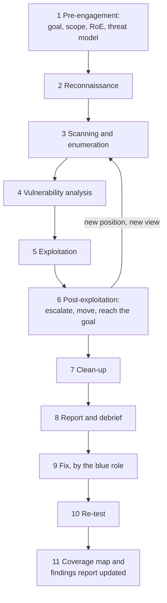
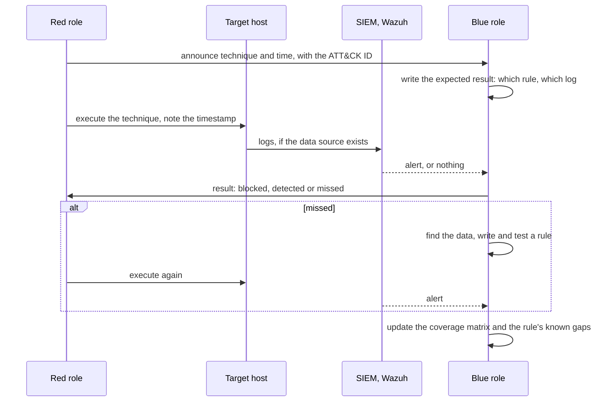

# 05 · Offensive engagements

> **Status: PROPOSED**, except the Stage 0 safety controls marked **(built or decided)**: the
> separate attacker certificate (decision 73), the scope file and wrapper with rate caps
> (decision 75), the separate browser profile (decision 76), and the task order 2.17 → 2.14 →
> 2.15 → 2.2–2.5 (decision 132). Names and weaknesses (`W1-01`…) come from
> `00-naming-and-addressing.md` and `01-company-profiles.md`.

> **Assumptions**
>
> 1. You are both the client and the tester, so "permission" is a document you write to yourself.
>    Write it anyway: the habit is the skill.
> 2. Tool names are current common choices (verify they are maintained when you reach the stage).
> 3. The AWS penetration-testing policy is summarised from memory and from decision 75's reading
>    of it. Read the current policy before every AWS engagement (verify).

---

## 1. Hard limits (they apply to every engagement in this file)

1. **Only the lab is attacked.** Targets are addresses inside 10.0.0.0/16, 10.20.0.0/16,
   10.30.0.0/16 and, on Proxmox, 198.51.100.0/24. Nothing else, ever.
2. **Never third-party services.** No Google or Microsoft API, no cloud provider's own
   infrastructure, no real person's mailbox, no public scanner or callback service that would
   send lab data elsewhere.
3. **A written scope and rules of engagement exist before the first packet.**
4. **Malware and C2 run only in isolated segments** with no internet route: `hq-red` and
   `sandbox` on Proxmox. See section 8 for AWS.
5. **Phishing targets only lab personas** on `mail01`. No message leaves the lab.
6. **No denial of service.** Rate caps on every tool (decision 75).
7. **Every action is logged by the attacker too**: a timestamped operation log, so blue's
   timeline can be compared with red's.

---

## 2. Concepts to keep apart

| Term | Question it answers | Scope | Output |
|---|---|---|---|
| Vulnerability assessment | what known weaknesses exist? | broad, automated, no exploitation | a prioritised list |
| Penetration test | can these weaknesses be used, and how far does it go? | defined targets, limited time, exploitation allowed | findings with proof and fixes |
| Assumed-breach test | what can an attacker do once inside? | starts from a given foothold | attack paths, detection gaps |
| Red team operation | can a realistic adversary reach a specific goal without being stopped? | the whole organisation, goal-driven, stealth matters | a narrative, MTTD and MTTR, strategic recommendations |
| Purple team exercise | does each technique get detected, and if not, why? | technique by technique, red and blue together | coverage map, new detections |

| Knowledge level | The tester gets | When companies choose it |
|---|---|---|
| Black box | nothing but a name | to imitate an outsider; slow and shallow for the money |
| Grey box | accounts, some documentation | the usual choice: best findings per day |
| White box | source code, configurations, architecture | for depth; you always have this, so say so in the report |

**Interview line:** "A pentest finds as many weaknesses as the time allows; a red team operation
tests whether the defenders notice one realistic attack. They are bought for different reasons."

---

## 3. The engagement flow



| Step | Who | Tool | Evidence | What can go wrong |
|---|---|---|---|---|
| 1 Pre-engagement | client and tester | the RoE template (section 5); the stage's threat model | signed RoE; blue's written expectations | testing first and writing the scope afterwards |
| 2 Reconnaissance | red | passive: what the public sees (DNS, certificate transparency for your own name only); the company "website" | recon notes | touching anything that isn't yours; for a lab, recon is small and that is fine |
| 3 Enumeration | red | nmap, service-specific tools, through the scope wrapper | scan output with timestamps; blue sees drops and scans | scanning the wrong range. The wrapper exists for this |
| 4 Vulnerability analysis | red | manual review, Burp Suite, Nuclei, BloodHound from Stage 2 | candidate list with reasoning | trusting scanner output unverified |
| 5 Exploitation | red | the least destructive proof that works | proof: request and response, screenshot, hash | destabilising a host; a proof that changes or reads more data than needed |
| 6 Post-exploitation | red | depends on the stage | the attack path, step by step | going outside the scope because a path "led there" |
| 7 Clean-up | red | remove accounts, files, tasks, implants created | a list of everything created and removed | forgotten implants or test accounts become real weaknesses |
| 8 Report | red | the findings template (section 6) | the report | a list of tool output without impact or fix |
| 9 Fix | blue | flow 1 in `03-operations-flows.md` | PRs | fixing the instance, not the cause |
| 10 Re-test | red | the same steps as the finding | "fixed" with new evidence, or "still open" | marking fixed without repeating the attack |
| 11 Record | both | `findings-report.md`; the ATT&CK matrix in `04-security-operations.md` | updated rows | the report stays a PDF; nothing changes in the SIEM |

The arrow from step 6 back to step 3 is how real attacks work: each new position shows a
network the attacker couldn't see before.

**Method references to name in reports:** OWASP Web Security Testing Guide for web work; PTES
and NIST SP 800-115 for the overall structure; MITRE ATT&CK for naming techniques; TIBER-EU as
the model for threat-led red teaming in Stage 3 (verify current versions).

---

## 4. One engagement plan per stage

### 4.1 Stage 0: web application and cloud pentest

| Item | Plan |
|---|---|
| Type | grey-box penetration test |
| Client's question | "If someone attacks our product behind its defences, what stops them and what sees them?" (the question in the Tier 1 write-up) |
| Start position | the `attacker` VPN certificate, user pool 10.8.0.x **(decided)** |
| In scope | `vuln.<domain>` first, then `mail.<domain>`, both through `proxy` 10.0.2.10; what a stolen user certificate can reach; the AWS account's configuration, read-only |
| Out of scope | Google and Microsoft endpoints, including the OAuth flows' provider side; DoS; anything not in the scope file |
| Existing tasks | 2.17 threat model → 2.14 tooling → 2.15 Juice Shop → 2.2 stolen certificate → 2.3 malicious e-mail → 2.4 access control → 2.5 report |
| Web techniques | OWASP Top 10 classes: injection, XSS, broken access control (IDOR), authentication, SSRF, file upload, path traversal, JWT handling; WAF bypass attempts against CRS at PL1 |
| **PROPOSED cloud part** | (a) a configuration review of your own account with Prowler or ScoutSuite, read-only; (b) from a shell on `vuln` (assume the container is compromised): try IMDS, try the instance role's permissions, try reaching `db` and `app`; (c) review each instance role against "what if this host is compromised" |
| ATT&CK | T1190, T1110, T1078 (valid accounts: the stolen certificate), T1552.005 (cloud instance metadata), T1046, T1048 |
| Blue's expectations | written in the threat model per threat: which layer blocks, which detects |
| Deliverables | `findings-report.md` filled; the first six rows of the coverage matrix; a blog-style summary |
| Lab vs real | you wrote the WAF exclusions and know the app; record "white box" in the report |

### 4.2 Stage 1: external pentest, then assumed-breach phishing

**Part A: external penetration test**

| Item | Plan |
|---|---|
| Type | black-to-grey-box external test |
| Client's question | "What can someone on the internet reach and break at our new office?" |
| Start position | Proxmox: `kali-ext` on `sim-inet`. AWS: your laptop without the VPN, against the two Elastic IPs (your own addresses; port scans of your own instances are allowed, floods aren't; verify) |
| In scope | the public addresses of `fw-ips` and `hq-fw` |
| Techniques | port and service discovery; VPN endpoint fingerprinting; the site-to-site tunnel port; anything published from `hq-dmz` (nothing at Stage 1) |
| Expected result | very little is exposed. **A short report that says "the attack surface is two UDP ports, and here is the proof" is a valid and good result.** The Tier 1 scan already showed how evidence (flow logs) corrects a misleading scan result (the carrier answering on port 21) |
| ATT&CK | T1595 (active scanning), T1133 (external remote services) |

**Part B: assumed-breach phishing**

| Item | Plan |
|---|---|
| Type | phishing simulation followed by an assumed-breach test |
| Client's question | "If one employee clicks, how far does the attacker get before we notice?" |
| Start position | `phish01` (GoPhish) sends to lab personas on `mail01`; the landing page is on `phish01`; then `kali-int` in `hq-red` as the attacker's machine |
| In scope | `hq-users`, `hq-servers`; weaknesses `W1-01` to `W1-07` |
| Out of scope | `prod` beyond what a normal user reaches; real mailboxes; real domains (the "lookalike domain" is a name inside `corp.<domain>`'s own DNS) |
| Chain | phishing e-mail → credential on the landing page (`W1-06`) → sign in to webmail and the VPN as the user → share enumeration, find the script with a password (`W1-05`) → FTP credentials (`W1-01`) → local administrator reuse across workstations (`W1-04`) → password spraying (`W1-03`) → on Proxmox, LLMNR poisoning (`W1-07`) → how close to `dc01`? |
| Tools | GoPhish, NetExec, Impacket, Responder (Proxmox), a credential-harvesting page you write yourself |
| ATT&CK | T1566.002, T1078, T1135 (share discovery), T1552.001 (credentials in files), T1110.003, T1550.002, T1557.001 |
| Blue's expectations | which Windows events and Wazuh rules should fire at each step |
| Deliverables | an external test report; an assumed-breach report with the attack path as a diagram; the campaign statistics (who clicked: personas only); first Windows detections |
| Lab vs real | no real human clicks. You click as the persona. What you can still measure honestly: whether the mail was delivered or filtered, and what the click and the logon left in the logs |

### 4.3 Stage 2: internal network pentest

| Item | Plan |
|---|---|
| Type | grey-box internal test with one low-privileged domain account |
| Client's question | "Can an ordinary employee's account become Domain Admin, and would we see it?" |
| Start position | `kali-int` in `hq-red`, with the credentials of `o.haddad` (Sales). A second run starts from `hq-guest` with no account |
| In scope | all HQ VLANs; weaknesses `W2-01` to `W2-10` |
| Out of scope | destructive actions on DCs; `bkp01`'s data; `prod` except through allowed flows |
| Chain (one of several) | enumerate the domain with BloodHound → Kerberoast `svc-intra` (`W2-01`) → crack offline → the nested group gives rights on `intra01` → unconstrained delegation (`W2-04`) or the ESC1 template on `ca01` (`W2-03`) → Domain Admin → DCSync as proof → stop |
| Other paths to test | AS-REP roasting (`W2-02`); the helpdesk ACL path (`W2-05`); the SYSVOL password (`W2-06`); DNS tunnelling out of `hq-users` (`W2-07`); pivot from `prn01` (`W2-08`); on Proxmox, NTLM relay (`W2-09`) and layer-2 attacks |
| Segmentation test | from each VLAN, try every other VLAN; compare the result with the allowed-flows table. Any reachable port not in the table is a finding |
| Tools | BloodHound with its collector, Impacket, NetExec, Rubeus, Certipy, hashcat, a DNS tunnelling tool such as dnscat2 or iodine against your own resolver only, Responder and ntlmrelayx (Proxmox) |
| ATT&CK | T1087, T1069, T1558.003, T1558.004, T1649, T1003.006, T1021.002, T1071.004, T1557 |
| Purple | Atomic Red Team: run the atomic test for each technique on a schedule and record the result in the coverage matrix |
| Deliverables | an internal pentest report with BloodHound path screenshots before and after the fixes; the coverage matrix as an ATT&CK Navigator layer; a list of new Wazuh rules with tests |
| Lab vs real | a real domain has thousands of objects and the path is hard to find. Yours is small. Add generated users and random delegations to an isolated copy to practise finding a path you didn't plant |

### 4.4 Stage 3: goal-driven red team operation

| Item | Plan |
|---|---|
| Type | assumed-breach red team operation with a C2 |
| Client's question | "Can an attacker who lands on a workstation reach our crown jewels, and how long until the SOC responds?" |
| Goal (pick one per operation) | (1) read a specific file on the Finance share as a user who shouldn't; (2) obtain the Mailbridge token-encryption key's *location and the access path to it* without reading the value; (3) deploy a harmless marker file on `dc01` |
| Start position | an implant on `ws02`, placed by the blue role on request (the "click" already happened) |
| In scope | HQ and branch; `prod` through the tunnel within the allowed flows; weaknesses `W3-01` to `W3-06` |
| Out of scope | reading real secret values; anything destructive; any C2 traffic leaving the lab |
| Infrastructure | `c2-01` (Sliver) in `hq-red`; on Proxmox, `redir01` on `sim-inet` as a redirector so the traffic pattern is realistic. No internet route for either |
| Chain (example) | implant → situational awareness → blind spot `W3-06` → credential of a `t1-` admin from `intra01` → the Tier 0 session left behind (`W3-01`) → Tier 0 → goal; or the branch path: `ws-br01` → `dc03` and its cached passwords (`W3-04`) |
| OPSEC practice | choose techniques by what the blue role logs; record which actions you expected to be seen |
| Measurement | for each step: red's timestamp, the first alert's timestamp, when a human would have been paged, when containment happened. MTTD and MTTR per step and overall |
| ATT&CK | T1059, T1055, T1562.001, T1053.005, T1021, T1550, T1078.002, T1041 |
| Deliverables | an executive summary of one page; an attack narrative with a timeline; a detection gap list; a postmortem by the blue role (the template in `04-security-operations.md`) |
| **Differs from decision 75** | decision 75 excludes C2 and reverse shells, because of AWS's policy. This plan needs both. Run it **on Proxmox**, where that policy doesn't apply and isolation is under your control; on AWS, only after reading the current policy and, if required, obtaining approval (section 8) |
| Lab vs real | a real operation lasts weeks and faces defenders who don't know it's happening. Yours lasts a few sessions. The timeline discipline is what transfers |

---

## 5. Rules of engagement template

```markdown
# Rules of engagement: <engagement name>

## 1. Parties
- Client (system owner):                         Tester:
- Emergency contact and how to reach them:

## 2. Goal
One sentence: the question the client wants answered.

## 3. Type and knowledge level
Penetration test | assumed breach | red team | purple team · black | grey | white box

## 4. Scope
| In scope (address, name, application) | Notes |
|---|---|

| Explicitly out of scope | Reason |
|---|---|

## 5. Time
- Window (dates, hours, time zone):
- Blackout periods:

## 6. Source of testing
- Source addresses, certificate or accounts used by the tester:
  (so the defenders can tell the test from a real attack)

## 7. Allowed and forbidden techniques
| Allowed | Forbidden |
|---|---|
| | denial of service; destructive actions; social engineering of real people; any target outside section 4; data leaving the lab |

- Rate limits per tool:
- C2: allowed? where does it run, and proof that it has no internet route:
- Malware samples: allowed? where:

## 8. Data handling
- What may be read as proof (minimum necessary):
- Where evidence is stored, and when it is deleted:
- Secrets found are reported, never copied into the report in full.

## 9. Stop conditions
The test stops and the emergency contact is called if: a service degrades; traffic to an
out-of-scope address is noticed; evidence of a real, unrelated compromise is found.

## 10. Platform rules
- Cloud provider's testing policy read on (date):            Approval needed: yes | no
- Hosting constraints:

## 11. Deliverables and dates
- Report:                 Debrief:                 Re-test:

## 12. Authorisation
Signed by the system owner, with date.
```

**Why section 6 matters.** The attacker certificate (decision 73) exists so that every log line
can be attributed. In a real engagement the SOC is often told the tester's source addresses, so
a real attacker during the test window isn't mistaken for the tester. In a red team operation
the SOC is *not* told; a small "white cell" knows instead.

**Why section 9 matters.** The most valuable finding a pentester can make is somebody else's
intrusion already in progress. A tester who keeps going past that point damages evidence.

---

## 6. Findings template

One per finding. It extends the row format already in `docs/findings-report.md` with the fields
a client report needs.

```markdown
## F-<stage>-<number>: <title that states the weakness, not the tool>

| Field | Value |
|---|---|
| Severity | Critical / High / Medium / Low / Informational |
| Score | CVSS vector and score (state the version used) |
| Affected | host, URL, account or configuration item |
| Weakness ID | W<stage>-<nn>, if it was a deliberate weakness; otherwise "unplanned" |
| ATT&CK | technique ID and name |
| Status | open / fixed / accepted · date |

### Description
What is wrong, in two or three sentences a manager can follow.

### Impact
What an attacker gains, in terms of the business: which data, which control.

### Steps to reproduce
1. Numbered, exact, repeatable. Commands and requests in code blocks.
2. Evidence: output, screenshot, hash. Secrets redacted.

### Detection: what each layer did
| Layer | Result (blocked / detected / missed) | Evidence (rule ID, log line) |
|---|---|---|
| Firewall (nftables, OPNsense) | | |
| IPS (Suricata) | | |
| WAF (ModSecurity) | | |
| Endpoint (Sysmon, Windows events) | | |
| SIEM (Wazuh) | | |
| Cloud (CloudTrail, GuardDuty, flow logs) | | |

### Root cause
Why the weakness exists: the technical cause and the process that allowed it.

### Recommendation
- Fix (removes the cause):
- Mitigation (if the fix must wait):
- Detection (so the next attempt is seen):

### Re-test
Date, the same steps, the result, new evidence.
```

**Severity without self-deception**

| Severity | Rule of thumb |
|---|---|
| Critical | direct path to domain or cloud-account takeover, or to customers' mail tokens, from the tester's start position |
| High | compromise of a server or of many accounts; one more step to critical |
| Medium | useful to an attacker only in combination; or needs unusual conditions |
| Low | hardening gap with little direct use |
| Informational | an observation; no risk on its own |

Score with CVSS for consistency, then adjust the *priority* by context and say so. A reader
should never see "Critical" on something reachable only by an administrator who could already
do worse.

### 6.1 Report structure

| Section | Reader | Length |
|---|---|---|
| Executive summary | management | one page: goal, overall result in plain words, the three things to do first |
| Scope and method | the client's technical lead | half a page; what was *not* tested |
| Attack narrative | technical staff | the path as a story with a diagram and a timeline |
| Findings | administrators | one template each, sorted by severity |
| Detection summary | the SOC | the coverage matrix rows for this engagement |
| Positive observations | everyone | what worked; a report with none isn't believable |
| Appendix | — | tool versions, the operation log, the RoE |

**The executive summary is the hardest page and the one employers ask to see.** Write it last,
with no tool names and no acronyms.

---

## 7. The purple-team loop



| Step | Who | Tool | Evidence | What can go wrong |
|---|---|---|---|---|
| Announce | red | the plan row from section 4 | technique ID and time | vague techniques ("lateral movement") that can't be marked detected or missed |
| Expect | blue | the threat model; the rule's metadata | the written expectation, before the test | writing the expectation after seeing the result |
| Execute | red | the manual technique, or an Atomic Red Team test for repeatability | red's timestamp and command | an atomic test that differs from how the technique is really used, so the rule matches the test and nothing else |
| Observe | blue | Wazuh dashboard; raw logs if no alert | the alert, or the raw event, or proof that no event exists | stopping at "no alert" without checking whether the raw event arrived |
| Classify | both | — | blocked / detected / missed | counting "the log exists" as "detected". Detected means an alert a human would have seen |
| Improve | blue | the detection engineering lifecycle | a rule with a test case made from this run | a rule that matches the tool's default strings only |
| Repeat | red | the same technique, then a variation | the second result | never testing a variation; the rule is brittle and nobody knows |
| Record | blue | the coverage matrix | the row with a date | results kept in memory |

**Three outcomes when nothing fires, and they need different fixes**

| What you find | Meaning | Fix |
|---|---|---|
| no event anywhere | the data source is missing | logging: audit policy, Sysmon configuration, a new agent source |
| the event is on the host, not in the SIEM | collection is broken | agent configuration, decoder |
| the event is in the SIEM, no alert | detection logic is missing | a rule |

This three-way split is the most useful thing a purple exercise teaches.

---

## 8. Safety controls for the red role

| Control | What it does | State |
|---|---|---|
| Attacker identity | a separate VPN certificate; attacks never come from the admin certificate | built into the plan (decision 73), created in task 2.14 |
| Scope file and wrapper | every tool runs through a wrapper that refuses targets outside the scope and applies rate caps | decided (decision 75), built in 2.14; **PROPOSED:** extend the scope file per engagement with the HQ and branch ranges |
| Separate browser profile | the attacker's browser is never signed in to Mailbridge | decided (decision 76) |
| Red network | `hq-red` has no route to the internet and only the flows the RoE allows | PROPOSED |
| C2 containment | `c2-01` listens only inside the lab; its segment has no default route; implants call back to lab addresses only | PROPOSED |
| Malware handling | samples only in `sandbox` (no gateway); moved in by an ISO or a one-way share, never by network from the internet-connected side | PROPOSED, Proxmox |
| Kill switch | Proxmox: disconnect `isp-rtr`'s home-side interface. AWS: `make down` | PROPOSED / built |
| Snapshot before, revert after | every engagement starts from a snapshot and ends with a revert or a rebuild from code | PROPOSED |
| Operation log | the attacker's own timestamped log | PROPOSED |
| Credential hygiene | hashes and passwords obtained stay in an encrypted folder outside the repo and are deleted after the report | PROPOSED |

### 8.1 AWS specifics

- AWS permits security testing of a listed set of its services on your own account without prior
  approval, and forbids denial of service, flooding, and attacks on AWS's own infrastructure
  (verify the current list and wording).
- Decision 75 records the lab's reading that **C2 needs approval** on AWS. Until you've re-read
  the policy and, if needed, obtained approval, the Stage 3 operation runs on Proxmox only.
- Phishing simulation inside your own VPC, between your own instances, sends nothing to the
  internet. Outbound port 25 from EC2 is blocked by default in any case.
- The cloud-native attack path (`W3-05`) runs in a **separate sandbox account** with nothing of
  value in it, described in `aws/03-attack-ranges.md`.

### 8.2 Practice platforms are a different thing

Hosted training platforms and certification labs (Hack The Box, TryHackMe, exam environments)
give you explicit permission to attack *their* targets under *their* rules. Using them is part
of the learning path. They are never mixed with this lab: no lab tool is pointed at them through
the lab's network, and nothing from them is pointed at the lab.

---

## 9. What each stage's engagement produces for your portfolio

| Stage | Artefact | Why an employer cares |
|---|---|---|
| 0 | web and cloud pentest findings with per-layer detection results | shows you can attack and measure defence in the same piece of work |
| 1 | external test report; assumed-breach report with an attack-path diagram | the two reports consultancies sell most |
| 2 | internal AD pentest report with before-and-after BloodHound paths; ATT&CK Navigator layer | the core skill of internal testers and of AD defenders |
| 3 | red team report with an executive summary, timeline and MTTD/MTTR; the blue postmortem of the same operation | shows judgment and communication, which is what senior roles are hired for |

Publish them with addresses and names from `00-naming-and-addressing.md` only. They are all
fictional or private ranges, so the reports can be public.
